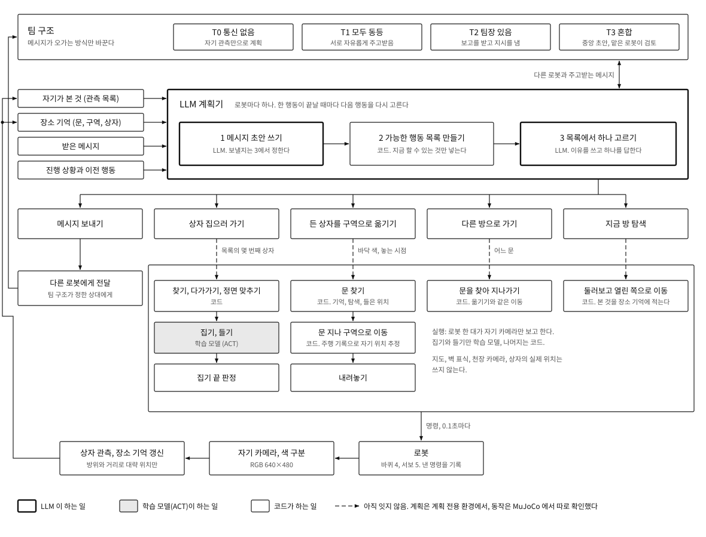
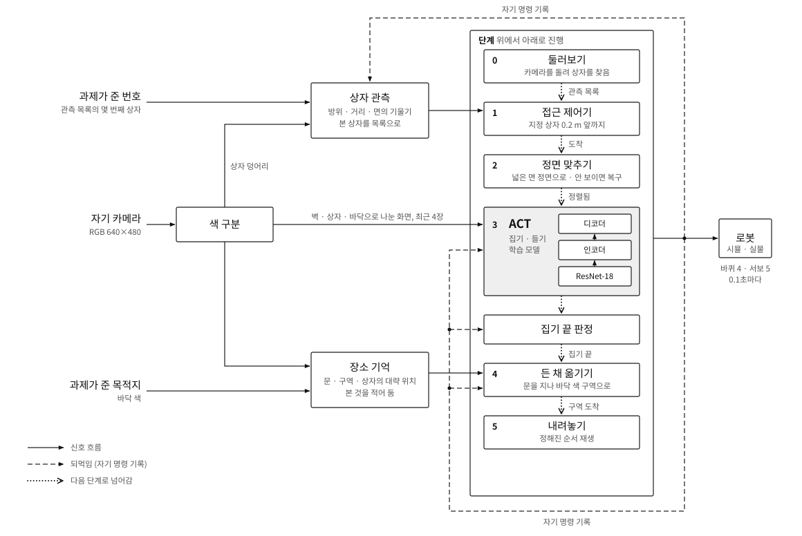

# UGRP: 로봇 협력 이송과 Sim2Real

  

MasterPi 로봇들이 자기 카메라만 보고 상자를 집어 옮기는 연구다. 무엇을 할지는 LLM 이 계획하고, 고른 행동은 학습 모델(ACT)이나 코드가 실행한다. MuJoCo 시뮬레이션에서 만들고, 같은 입출력 규격으로 실물 로봇에 옮긴다.
지도, 벽 표식, 천장 카메라는 쓰지 않는다. 벽은 짙은 초록, 상자는 빨강과 파랑이다.

아래 [구조](#구조) 절에 전체 구조와 로봇 한 대의 구조를 모두 적었다.

## 연구 질문

각 로봇이 자기가 본 것만 아는 상황에서, LLM 이 짠 작업 계획은 팀 구조에 따라 얼마나 달라지는가.
통신 없음, 모두 동등, 팀장 있음, 혼합의 네 구조를, 협업이 필요한 이유가 서로 다른 과제(정보 의존, 좁은 통로, 어려운 길, 순서 제약, 능력 차이, 로봇별 지정 구역)에서 비교한다.
팀 구조와 보고 체계를 미리 정해 주는 방식(계층, 역할 분담, 공유 게시판, 입찰, 구역 담당, 스스로 짜기)도 함께 비교한다.
로봇은 실물 3대이고, 시뮬레이션에서는 64대까지 늘린다.
두 로봇이 한 물체를 맞잡아 옮기는 과제는 연구에서 뺐다. 모든 과제는 혼자 집어 옮기는 동작만으로 된다.

**[연구 설계 전문](docs/research_design.md)**: 방향, 질문과 가설, 팀 구조, 협업 과제 14종, 로봇 수, 지표, 실험의 세 층.

## 구조

### 전체: LLM 이 계획하고, 선택에 따라 ACT 나 코드가 실행한다

맨 위 그림이다.

| 층 | 누가 | 하는 일 |
|---|---|---|
| 팀 구조 | 실험 조건 | 로봇끼리 메시지가 오가는 방식을 정한다. 통신 없음(T0), 모두 동등(T1), 팀장 있음(T2), 혼합(T3: 중앙 초안을 맡은 로봇이 검토) |
| 계획 | LLM, 로봇마다 하나 | ① 메시지 초안을 쓴다 ② 코드가 지금 가능한 행동 목록을 만든다 ③ LLM 이 목록에서 하나를 고른다. 한 행동이 끝날 때마다 다시 고른다 |
| 실행 | ACT 와 코드 | 고른 행동을 바퀴와 팔 명령으로 바꾼다 |
| 인식 | 코드 | 자기 카메라 화면에서 상자, 문, 구역을 찾아 관측 목록과 장소 기억을 고친다 |

계획기가 받는 것은 자기가 본 것, 장소 기억, 받은 메시지, 진행 상황과 이전 행동뿐이다. 다른 로봇이 본 것이나 전체 지도는 받지 않는다.

LLM 이 고를 수 있는 행동과, 고르면 누가 실행하는지:

| 행동 | 목록에 들어가는 조건 | 실행 | 누가 |
|---|---|---|---|
| 메시지 보내기 | 초안이 있을 때 | 팀 구조가 정한 상대에게 전달 | 통신 |
| 상자 집으러 가기 | 빈손이고, 옮길 상자를 알 때 | 찾기, 다가가기, 정면 맞추기 → 집기, 들기 → 집기 끝 판정 | 코드 → **ACT** → 코드 |
| 든 상자를 구역으로 옮기기 | 상자를 들고 있고 놓을 구역을 알 때 | 문 찾기 → 문 지나 구역으로 이동 → 내려놓기 | 코드 |
| 다른 방으로 가기 | 항상 | 문을 찾아 지나가기 | 코드 |
| 지금 방 탐색 | 아직 둘러보지 않은 방일 때 | 둘러보고 열린 쪽으로 이동, 본 것을 장소 기억에 적기 | 코드 |

- 계획은 LLM: 누가 무엇을 맡을지, 알릴지 말지는 상황마다 달라 규칙으로 적기 어렵다.
- 집기는 ACT: 집게와 상자가 닿는 구간은 화면을 보고 고쳐 가는 쪽이 낫다.
- 이동은 코드: 학습 모델로 이동까지 시켰을 때 처음 보는 장면에서 실패했다. 코드는 실물에서 숫자 몇 개를 맞춰 고칠 수 있다.

**아직 잇지 않은 곳(그림의 점선).** 계획기의 선택을 실제 동작으로 넘기는 연결은 아직 없다. 계획은 계획 전용 환경(이동, 집기, 놓기를 정해진 시간이 걸리는 것으로 단순화)에서, 동작은 MuJoCo 에서 따로 확인했다. 지금 MuJoCo 실행에서는 몇 번째 상자인지와 목적지 바닥 색을 과제가 직접 준다.

### 로봇 한 대: 찾고, 집고, 든 채 옮겨, 내려놓는다

  

| 단계 | 누가 | 하는 일 |
|---|---|---|
| 0 둘러보기 | 코드 | 제자리에서 카메라를 돌려 빨강·파랑 상자를 찾고, 방위와 거리를 추정해 관측 목록을 만든다. 이때 본 문과 바닥 색 구역도 장소 기억에 적는다 |
| 1 접근 | 코드 | 목록에서 지정된 상자 0.2 m 앞까지 간다 |
| 2 정면 맞추기 | 코드 | 상자의 넓은 면 정면에 서도록 둘레를 돈다. 상자가 화면에서 잘렸으면 먼저 다시 보이게 한다 |
| 3 집기·들기 | 학습 모델 (ACT) | 화면을 보고 팔과 집게를 움직여 상자를 집어 든다 |
| 집기 끝 판정 | 코드 | 자기가 내보낸 명령 기록으로 집기가 끝났는지 판정한다 |
| 4 든 채 옮기기 | 코드 | 기억한 문으로 가서 곧게 지나가고, 지정한 바닥 색 구역을 찾아 그 위에 선다 |
| 5 내려놓기 | 코드 | 정해진 순서(전진, 팔 내림, 집게 열기, 후진)를 재생한다 |

든 채 옮길 때:
- **장소 기억**: 벽 전체를 그린 지도가 아니라 "문, 구역, 상자가 어디쯤 있었다"의 목록이다.
- **자기 위치**: 자기가 내보낸 바퀴 명령을 더해 추정하고, 문이 다시 보이면 기억한 문에 맞춰 고친다.
- **모를 때**: 문이나 구역이 기억에 없으면 제자리에서 돌며 찾고, 그래도 없으면 트인 쪽으로 옮겨 다시 찾는다. 다른 로봇이 알려 준 위치가 있으면 그쪽으로 바로 간다.
- **안전**: 기억한 상자와 벽에서 떨어진 길만 고른다. 그런 길이 없거나 문이 안 보이면 움직이지 않고 이유를 남기고 멈춘다.

ACT 모델: LeRobot 0.6.2 구현, ResNet-18, 인코더 4층·디코더 1층, 매개변수 약 5,180만 개. 입력은 색 구분한 최근 화면 4장과 최근 명령 16개, 출력은 0.1초 간격 동작 8개 묶음. 시뮬레이션 교사 시연 140개로 학습했다.

로봇이 쓰는 것은 자기 카메라 화면(RGB 640×480), 자기가 내보낸 명령의 기록, 과제가 준 값(몇 번째 상자, 목적지 바닥 색)뿐이다. 장면에는 상자만 둔다.

### 어디까지 확인했나

| 부분 | 환경 | 상태 |
|---|---|---|
| 계획기와 팀 구조 (T0–T3) | 계획 전용 환경 | 돌아간다. 과제 두 종류(정보 의존, 좁은 통로)에서 시험 실행 중 |
| 찾기, 다가가기, 집기, 내려놓기 | MuJoCo, 로봇 한 대 | 돌아간다 |
| 든 채 문을 지나 바닥 색 구역에 놓기 | MuJoCo, 로봇 한 대, 장면에 상자만 | 돌아간다. 문을 못 찾으면 멈춘다 |
| 다른 로봇이 알려 준 위치로 가기 | MuJoCo, 로봇 한 대. 알려 주는 말은 실행 옵션으로 넣음 | 돌아간다 |
| 계획기의 선택을 MuJoCo 동작으로 넘기기 | | 아직 없다 |
| 여러 로봇이 MuJoCo 에서 동시에 움직이기 | | 아직 없다 |
| 실물 로봇 | | 아직 없다 |

모두 개발용 실행 환경에서 본 것이다. 단계별 세부(끝 조건, 모델 표, 실물에서 맞출 값)는 [Solo 구조와 모델](docs/solo_architecture.md), 계획기와 선행 연구 대응은 [전체 구조](docs/architecture.md)에 있다. 집기까지의 코드는 `solo_pipeline/` 에 있고, 든 채 이동과 계획 전용 환경의 코드는 정리한 뒤 올린다.

## 지금 하는 일

| 갈래 | 상태 |
|---|---|
| 팀 구조 비교 실험 (계획 전용 환경) | 계획기와 네 팀 구조가 돌아간다. 과제 두 종류(정보 의존, 좁은 통로)에서 시험 실행 중 |
| 로봇 한 대의 동작 (시뮬레이션) | 자기 카메라만으로 상자를 찾아 집고, 든 채 문을 지나, 지정한 바닥 색 구역에 놓는 데까지 된다. 장면에 상자만 있을 때다. 집기까지의 코드는 `solo_pipeline/` |
| 계획과 동작 잇기 | 아직 없다. 여러 로봇이 시뮬레이션에서 동시에 움직이는 것도 아직 없다 |
| 실물로 옮기기 | 과제 카드 준비 완료, 실물 시험은 아직 없다 |

자세한 것은 [지금 하는 일](docs/current_status.md)과 [로드맵](ROADMAP.md)에 있다. 실험 수치와 날마다의 진행은 팀 Linear(UGRP 팀)에 적는다.

## 시작하기

| 하고 싶은 일 | 문서 |
|---|---|
| 시뮬레이션 돌려 보기 | [설치와 첫 실행](docs/ubuntu_quickstart.md), [로컬 실행](docs/local_simulation.md) |
| 실물로 옮기기 | [Sim2Real 안내](docs/sim2real/README.md), [과제 목록](docs/sim2real/04_tasks.md) |
| 구조와 규격 알기 | [전체 구조](docs/architecture.md), [Solo 구조와 모델](docs/solo_architecture.md), [단계별 구성](docs/sim2real/03_pipeline.md), [로봇 입출력 규격](docs/sim2real/02_robot_interface.md), [경기장과 색](docs/sim2real/01_environment.md) |
| 옛 기록 찾기 | [문서 찾아보기](docs/README.md), [실험 목록](experiments/README.md) |

Sim2Real 은 순서가 정해진 단계가 아니라 여러 사람이 동시에 맡는 과제 묶음이다. 과제마다 준비물, 절차, 통과 기준, 결과를 올릴 위치가 적혀 있다.

## 폴더

| 경로 | 내용 |
|---|---|
| `harness/` | 인식, 제어, 모델 입력과 실행 |
| `sim/` | MuJoCo 환경과 평가 |
| `scripts/` | 실행, 검증, 기록 도구 |
| `tests/` | 자동 검사 |
| `configs/` | 실행 설정 |
| `calibration/` | 실물 측정과 보정 |
| `solo_pipeline/` | 로봇 한 대의 구조(둘러보기, 접근, 정면 맞추기, ACT 집기, 내려놓기) 코드 묶음 |
| `docs/sim2real/` | 실물로 옮기는 안내와 과제 |
| `experiments/` | 실험별 요약. 영상과 큰 자료는 [드라이브](experiments/RAW_DATA_INDEX.md)에 있다 |

## 함께 일하는 규칙

실물로 옮기는 과제를 맡은 사람이 지켜야 할 것만 적는다.

**과제를 맡을 때**
1. [과제 목록](docs/sim2real/04_tasks.md)에서 하나를 고르고 그 과제 카드를 끝까지 읽는다. 과제 사이에 정해진 순서는 없다.
2. `main` 에서 브랜치를 만들어 작업하고, 결과는 카드에 적힌 폴더에 넣어 PR 로 올린다.
3. 막히면 카드의 "막힐 때"를 먼저 보고, 그래도 안 되면 팀 Linear 에 적는다.

**로봇을 움직일 때**
- 로봇 한 대는 한 번에 한 사람만 움직인다.
- 처음에는 바퀴를 띄우고 짐 없이 시작한다. 손이 닿는 곳에 정지 수단을 두고, 옆에서 지켜보는 사람이 있어야 한다.
- 시뮬레이션의 명령 범위는 실물에서 안전하다는 뜻이 아니다. 관절과 바퀴의 안전한 범위는 로봇마다 직접 확인해 적는다.
- 자세한 확인 목록은 [Sim2Real 안내의 구동 전 체크리스트](docs/sim2real/README.md#구동-전-체크리스트)에 있다.

**로봇이 쓰는 정보**
- 로봇은 자기 카메라 화면과 자기가 내보낸 명령 기록만 쓴다.
- 지도, 벽 표식, 천장 카메라, 줄자로 잰 상자 위치는 로봇에게 주지 않는다. 사람이 잰 값은 보정과 채점에만 쓴다.
- 시뮬레이션과 실물의 입력·명령 형식을 같게 유지한다. 한쪽만 바꾸지 않는다. 형식은 [로봇 입출력 규격](docs/sim2real/02_robot_interface.md)에 있다.

**결과를 적을 때**
- 몇 번 중 몇 번 성공했는지 적는다. 실패한 것과 뺀 것도 함께 적는다.
- 시뮬레이션, 모의 시험, 실물 결과를 섞지 않는다. 직접 해 보지 않은 것은 "확인 안 됨"이라고 적는다.
- 통과 기준 숫자를 결과를 본 뒤에 바꾸지 않는다. 바꿔야 하면 이유를 PR 에 적는다.
- 영상과 큰 원본은 저장소에 올리지 않고 [드라이브](experiments/RAW_DATA_INDEX.md)에 둔다.

**공개 저장소라서**
- 주소(IP), 계정, 비밀번호, 키, 개인 폴더 경로를 올리지 않는다.

시뮬레이션 코드와 학습을 고칠 때의 세부 규칙은 [AGENTS.md](AGENTS.md)와 [CONTRIBUTING.md](CONTRIBUTING.md)에 있다.
