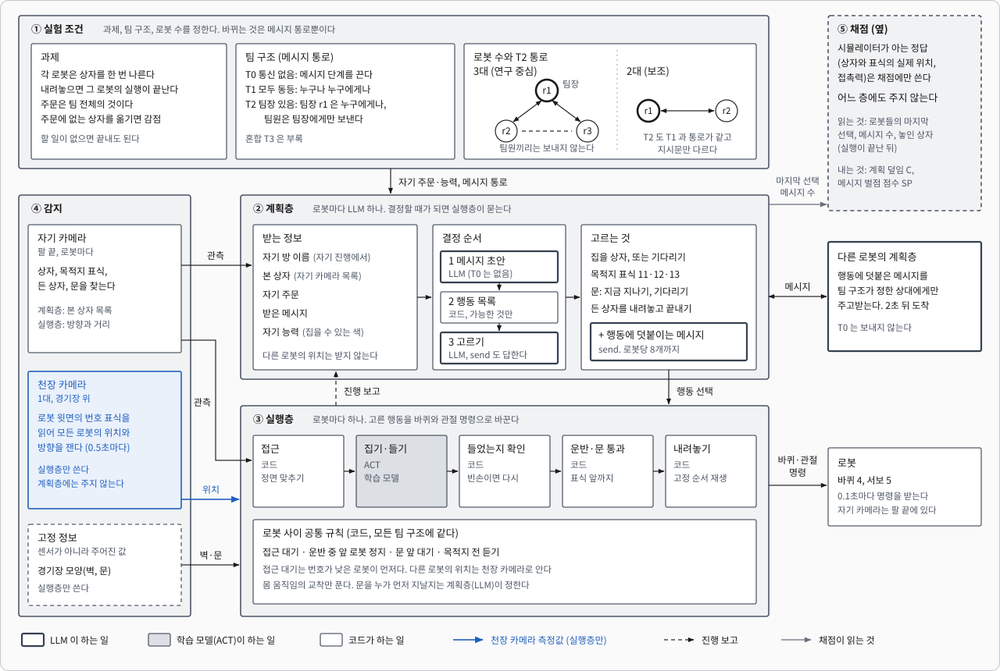
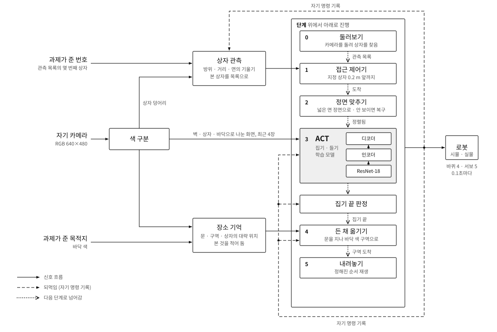

# UGRP: 로봇 협력 이송과 Sim2Real

  

MasterPi 로봇들이 상자를 나눠 집어 옮기는 연구다. 무엇을 할지는 LLM 이 계획하고, 고른 행동은 학습 모델(ACT)이나 코드가 실행한다. MuJoCo 시뮬레이션에서 만들고, 같은 입출력 규격으로 실물 로봇에 옮긴다.
로봇의 위치는 천장 카메라가 로봇 윗면의 번호 표식을 읽어 재고, 상자는 각 로봇이 자기 카메라로 찾는다. 위치는 동작 코드만 쓰고 LLM 은 자기 위치만 안다. 목적지는 벽에 붙인 번호 표식 앞이다. 벽은 짙은 초록, 상자는 빨강과 파랑이다.

아래 [구조](#구조) 절에 전체 구조와 로봇 한 대의 구조를 모두 적었다.

## 연구 질문

각 로봇이 자기가 본 것만 아는 상황에서, LLM 이 짠 작업 계획은 팀 구조에 따라 얼마나 달라지는가.
1차는 MuJoCo 로봇 3대로 통신 없음(T0), 모두 동등(T1), 팀장 있음(T2) 세 구조를 비교했다(장면 30개 × 3구조 × 2회 = 180회, 끝남). 2차는 로봇 3대(상자 5개)와 6대(상자 10개)에서 선출 팀장 구조(LE: 모든 말이 팀장을 거치고 팀장 배정을 따름)와 동등 구조(P)를 비교한다. 로봇은 결정마다 일하기와 말하기 중 하나를 고르고, 말하면 시간을 쓴다. 과제는 모든 로봇이 모든 주문과 순서 규칙을 아는 한 종류이고, 지도는 생성기 하나로 3대·6대를 같은 규칙으로 만든다. 장면은 협업이 필요한 이유가 서로 다른 유형(주문이 한 로봇에 몰림, 같은 색 상자 경쟁, 로봇마다 집을 수 있는 색이 다름)과 대조 장면으로 짠다.
주 지표는 실제 실행 결과로 잰 주문 달성률 R 과, 말을 너무 많이 하면 점수를 깎은 R_SP 다(2026-11-16 사전 등록 결정 D13). 로봇들의 계획이 주문을 덮었는지(계획 덮임 C)는 계획 실패와 실행 실패를 가르는 원인 분석에 쓴다. 본문은 통신 구조가 정답 계획에 못 미친 몫의 원인 분해, 전체 정보를 준 LLM과의 대비, 계획 실패와 물리 실패의 분리, 개입으로 원인 확인(사전 교환, 재결정 끔)으로 쓴다.
계층, 역할 분담, 공유 게시판 같은 구조 미리 정해 주기와 로봇 수 늘리기는 전체 설계에는 있으나 이번 제출에서는 하지 않는다. 두 로봇이 한 물체를 맞잡아 옮기는 과제는 연구에서 뺐다. 로봇이 상자를 하나 나른 뒤 돌아와 다시 나르는 과제와 중간 이동 행동은 2단계로 미룬다([작업 계획](docs/plan.md)).

**[작업 계획](docs/plan.md)**: 이번 제출의 범위, 실험 묶음과 횟수, 일정. **[연구 설계](docs/research_design.md)**: 전체 설계와 이번 제출의 동결 설계(11절).

## 구조

### 전체: LLM 이 계획하고, 선택에 따라 ACT 나 코드가 실행한다

맨 위 그림이다. 2026-11-15 결정(천장 카메라 위치 측정)을 반영했다.

| 블록 | 누가 | 하는 일 |
|---|---|---|
| ① 실험 조건 | 과제, 팀 구조, 로봇 수 | 상자가 로봇보다 많아 여러 번 나른다. 팀 구조는 로봇끼리 메시지가 오가는 방식을 정한다. 2차: 동등(P, 누구나 누구에게나 말함), 선출 팀장(LE, 모든 말이 팀장을 거치고 배정은 구속). 통신 없음(T0)은 1차에서만. 로봇 3대·6대 |
| ② 계획층 | LLM, 로봇마다 하나 | 1 메시지 초안을 쓴다. 2 코드가 지금 가능한 행동 목록을 만든다. 3 LLM 이 목록에서 하나를 고르고, 그 행동에 초안을 덧붙여 보낼지 답한다. 결정할 때가 되면 실행층이 묻는다 |
| ③ 실행층 | ACT 와 코드, 로봇마다 | 고른 행동을 바퀴와 관절 명령으로 바꾼다. 결과(집기 실패, 문 통과, 운반 끝)를 계획기에 보고한다 |
| ④ 감지: 경기장 모양 | 고정 정보 | 벽과 문의 위치. **실행층만 쓴다**. 목적지 표식의 위치는 주지 않는다(로봇이 자기 카메라로 찾는다) |
| ④ 감지: 위치 측정 | 천장 카메라 | 경기장 가운데 위의 1대가 로봇 윗면의 번호 표식을 읽어 모든 로봇의 위치·방향을 잰다. **이 값은 실행층만 쓴다** |
| ⑤ 채점 (옆) | 시뮬레이터 | 정답 좌표(상자와 표식의 실제 위치, 접촉력)는 채점에만 쓰고 어느 층에도 주지 않는다 |

**누가 무엇을 아나.** 연구 질문(각 로봇이 아는 것이 다를 때 계획이 어떻게 달라지나)을 지키기 위해 나눈다.

| | 실행층(코드, ACT) | LLM 계획기 |
|---|---|---|
| 자기 위치·방향 | 천장 카메라 측정값 | 방 이름만 ("상자 방" / 문을 지난 뒤 "목적지 방"). 천장 카메라가 아니라 자기 진행에서 나온다 |
| 다른 로봇의 위치 | 천장 카메라 측정값 (경로, 양보, 앞 로봇 정지) | 받지 않는다. 메시지로만 안다 |
| 벽, 문 위치 | 고정 정보로 받는다 (문 찾기, 경로) | 받지 않는다 |
| 목적지 표식 위치 | 받지 않는다. 자기 카메라로 번호를 읽어 찾는다 | 받지 않는다 |
| 상자 | 자기 카메라 | 자기 카메라로 본 목록 |
| 주문 | | 과제가 준 자기 몫만 |
| 다른 로봇의 계획·진행 | | 메시지로만 안다 |

LLM 이 고르는 것과, 고르면 누가 실행하는지. 이번 실험에서 각 로봇은 상자를 한 번만 나른다(돌아가기는 2단계). 메시지 규칙은 [계획기와 메시지 규칙](docs/planning_messages.md)에 있다.

| 고르는 것 | 실행 | 누가 |
|---|---|---|
| 집을 상자 (자기 목록의 몇 번째) | 찾기·다가가기·정면 맞추기 → 집기·들기 → 들었는지 확인. 빈손이면 계획기에 알리고 다시 고른다 | 코드 → **ACT** → 코드 |
| 목적지 표식 (벽의 번호 표식) | 문 앞으로 가서 지나가기 → 표식을 찾아 그 앞으로 → 내려놓기 | 코드 |
| 문: 지금 지날지, 기다릴지 | 기다리면 상자를 든 채 집은 자리에서 선다 | 코드 |
| 든 상자를 내려놓고 끝내기 (목적지, 문 앞, 문 결정에서) | 그 자리에서 내려놓고 그 로봇의 실행이 끝난다. 틀린 배치로 세지 않는다 | 코드 |
| 메시지 덧붙이기 (위 어느 행동에든) | 팀 구조가 정한 상대에게 전달. 차례를 쓰지 않고, 로봇당 8개까지다 | 통신 |

- 계획은 LLM: 누가 무엇을 맡을지, 알릴지 말지는 상황마다 달라 규칙으로 적기 어렵다.
- 집기는 ACT: 집게와 상자가 닿는 구간은 화면을 보고 고쳐 가는 쪽이 낫다.
- 이동은 코드: 학습 모델로 이동까지 시켰을 때 처음 보는 장면에서 실패했다. 코드는 실물에서 숫자 몇 개를 맞춰 고칠 수 있다.
- 위치는 천장 카메라: 바퀴 명령만으로 추정한 방향은 상자 둘레를 돈 뒤 50~150° 틀렸다. 소형 로봇 여러 대를 쓰는 연구실이 흔히 쓰는 방식이고, 시뮬레이션도 정답 좌표 대신 그린 화면에서 같은 방법으로 읽어 실물과 조건을 맞춘다.
- 공통 규칙(양보, 앞 로봇 정지, 문 앞 다시 보기, 목적지 전 듣기)은 몸 움직임의 교착만 풀고, 문을 누가 먼저 지날지는 LLM 이 정한다. 그래야 순서를 정하는 협업이 계획 결과에 남는다.

### 팀 구조와 LLM 대화

팀 구조(P 동등, LE 선출 팀장의 말 통로·배정 구속·팀장 멈춤 대비)와 LLM 결정 한 번(언제 묻나, 프롬프트, 말하기 시간, 기억)은 그림 두 장으로 따로 그렸다: [팀 구조](docs/architecture.md#3-팀-구조), [한 번의 결정과 말하기](docs/architecture.md#4-한-번의-결정과-말하기).

### 로봇 한 대: 찾고, 집고, 든 채 옮겨, 내려놓는다

  

| 단계 | 누가 | 하는 일 |
|---|---|---|
| 0 둘러보기 | 코드 | 제자리에서 카메라를 돌려 빨강·파랑 상자를 찾고, 방위와 거리를 추정해 관측 목록을 만든다. 이때 본 문도 장소 기억에 적는다 |
| 1 접근 | 코드 | 목록에서 계획기가 고른 상자 0.2 m 앞까지 간다 |
| 2 정면 맞추기 | 코드 | 상자의 넓은 면 정면에 서도록 둘레를 돈다. 상자가 화면에서 잘렸으면 먼저 다시 보이게 한다 |
| 3 집기·들기 | 학습 모델 (ACT) | 화면을 보고 팔과 집게를 움직여 상자를 집어 든다 |
| 집기 끝 판정 | 코드 | 자기가 내보낸 명령 기록으로 집기가 끝났는지 판정한다 |
| 들었는지 확인 | 코드 | 0.4 m 물러나 앞 바닥과 집었던 자리를 본다. 같은 색 상자가 남아 있으면 빈손으로 보고, 계획기에 알린 뒤 다시 둘러본다 |
| 4 든 채 옮기기 | 코드 | 문으로 가서 곧게 지나가고, 계획기가 고른 벽의 번호 표식을 찾아 그 앞에 선다. 표식의 거리는 시선이 닿는 벽에서 얻는다 |
| 5 내려놓기 | 코드 | 정해진 순서(전진, 팔 내림, 집게 열기, 후진)를 재생한다 |

든 채 옮길 때:
- **자기 위치**: 천장 카메라 측정값을 쓴다(0.5초마다). 측정이 없을 때만 바퀴 명령 기록과 문 다시 보기로 추정한다.
- **장소 기억**: 벽 전체를 그린 지도가 아니라 "문, 표식, 상자가 어디쯤 있었다"의 목록이다. 자기 카메라로 본 것만 적는다.
- **모를 때**: 문이나 표식이 기억에 없으면 제자리에서 돌며 찾고, 그래도 없으면 트인 쪽으로 옮겨 다시 찾는다. 다른 로봇이 알려 준 위치가 있으면 그쪽으로 바로 간다.
- **안전**: 기억한 상자·벽과 측정한 다른 로봇에서 떨어진 길만 고른다. 옮기는 중 바로 앞에 다른 로봇이 있으면 멈춘다. 길이 없으면 움직이지 않고 이유를 남기고 멈춘다.

ACT 모델: LeRobot 0.6.2 구현, ResNet-18, 인코더 4층·디코더 1층, 매개변수 약 5,180만 개. 입력은 색 구분한 최근 화면 4장과 최근 명령 16개, 출력은 0.1초 간격 동작 8개 묶음. 시뮬레이션 교사 시연 140개로 학습했다.

이 단계들이 쓰는 것은 자기 카메라 화면(RGB 640×480), 자기가 내보낸 명령의 기록, 천장 카메라의 위치 측정값, 계획기가 고른 값(몇 번째 상자, 목적지 표식 번호)이다. 장면에는 상자만 둔다.

### 어디까지 확인했나

| 부분 | 환경 | 상태 |
|---|---|---|
| 계획기와 팀 구조 (T0–T3) | 계획 전용 환경(동작을 시간으로만 단순화) | 돌아간다. 이 환경의 실험은 접었다. 계획기는 MuJoCo 실행에 연결해 쓴다 |
| 찾기, 다가가기, 집기, 내려놓기 | MuJoCo, 로봇 한 대 | 돌아간다 |
| 든 채 문을 지나 벽 번호 표식 앞에 놓기 | MuJoCo, 로봇 3대, 장면에 상자만 | 돌아간다 |
| 다른 로봇이 알려 준 위치로 가기 | MuJoCo, 로봇 한 대. 알려 주는 말은 실행 옵션으로 넣음 | 돌아간다 |
| 여러 로봇이 MuJoCo 에서 동시에 움직이기 | MuJoCo, 로봇 3대 | 돌아간다. 정답 계획 기준선 30회 R 91.1% |
| 계획기의 선택을 MuJoCo 동작으로 넘기기, 내려놓기 행동 | MuJoCo, 로봇 3대 | 돌아간다. 1차 본 실험 180회가 모두 끝까지 돌았다(계획기가 멈춘 2회는 다시 돌림) |
| 천장 카메라 위치 측정 | MuJoCo | 실행에 붙어 돌아간다 |
| 들었는지 확인과 다시 집기 | MuJoCo | 돌아간다 |
| 로봇 3대 | MuJoCo | 연구 중심이다. 정답 계획으로 장면이 풀리는지 보는 관문의 기준은 [작업 계획 3절](docs/plan.md#3-순서와-일정)에 있고, 결과는 Linear 에 적는다 |
| 실물 로봇 | | 아직 없다 |

모두 개발용 실행 환경에서 본 것이다. 단계별 세부(끝 조건, 모델 표, 실물에서 맞출 값)는 [Solo 구조와 모델](docs/solo_architecture.md), 구조의 세부는 [전체 구조](docs/architecture.md), [계획기와 메시지 규칙](docs/planning_messages.md), [실행층](docs/execution_layer.md)에 있다. 집기까지의 코드는 `solo_pipeline/` 에 있고, 든 채 이동, 여러 로봇 실행, 계획기 연결, 천장 카메라 코드는 `harness/`, `scripts/`, `team/` 에 있다([팀 실행 안내](team/README.md)).

## 지금 하는 일

| 갈래 | 상태 |
|---|---|
| 팀 구조 비교 실험 | 1차(로봇 3대, T0·T1·T2, 180회)는 끝났다: 주문 달성률 R 은 T0 38.3%, T1 84.4%, T2 75.0%. 2차는 로봇 3대·6대에서 선출 팀장(LE)과 동등(P)을 자유 말하기로 비교한다(지도 20개 × 2구조 × 2대수 = 80회 + 시험). 지금은 지도 확인과 시험 준비 단계다. [전체 구조](docs/architecture.md) |
| 로봇 한 대의 동작 (시뮬레이션) | 자기 카메라로 상자를 찾아 집고, 들었는지 확인하고, 든 채 문을 지나 벽 번호 표식 앞에 놓는 데까지 된다(장면에 상자만). 집기까지의 코드는 `solo_pipeline/` |
| 계획과 동작 잇기 | LLM 이 고른 상자·목적지·문 순서·내려놓기대로 로봇 3대가 MuJoCo 에서 움직인다. 몸 움직임의 교착(길 막힘, 문 앞 마주침)은 모든 구조에 같은 고정 규칙으로 푼다([전체 구조](docs/architecture.md)) |
| 2단계 (별도 개발) | 돌아와 다시 나르기, 중간 이동 행동(물러나기, 비켜 주기, 둘러보기, 상자 방으로 돌아가기), 3대 실행 고치기. 본 실험의 동결 코드와 따로 개발하고 결과를 합치지 않는다 |
| 실물로 옮기기 | 과제 카드 준비 완료, 실물 시험은 아직 없다 |

자세한 것은 [작업 계획](docs/plan.md), [지금 하는 일](docs/current_status.md), [로드맵](ROADMAP.md)에 있다. 실험 수치와 날마다의 진행은 팀 Linear(UGRP 팀)에 적는다.

## 시작하기

### 새 체크아웃에서 확인할 수 있는 범위

| 경로 | 확인할 수 있는 것 | 재현 상태 |
|---|---|---|
| CPU 설치 데모 | 고정 바퀴 명령, 물리 진행, 장면·자기 카메라 렌더링 | 아래 설치 안내의 무료 GIF 데모. LLM·ACT·자율 운반 성공을 검사하지 않는다 |
| Solo v1 코드·모델 | 공개 코드 묶음과 ACT 가중치 | [릴리스](https://github.com/cmkang131/UGRP-Multi-Robot-Collaboration-Project/releases/tag/solo-v1-20261114)에 있다. 실행 보조 파일과 평가 입력 연결이 부족해 새 체크아웃의 전체 평가 재현은 막혀 있다([#679](https://github.com/cmkang131/UGRP-Multi-Robot-Collaboration-Project/issues/679)) |
| 최신 2대 LLM–MuJoCo 실행 | 위의 개발 환경에서 확인한 동작 | 든 채 이동·여러 로봇 실행·계획기 연결·천장 카메라 코드는 배포 전이다. 기존 데모로 이 결과를 재현했다고 판단하지 않는다 |

실제로 실행한 명령·출력·수동 작업은 [2026-11-16 새 CPU 환경 점검](experiments/2026-11-16-cpu-repro-audit/README.md)에 있다. 이 점검은 Debian 13의 새 Python 가상환경에서 수행했으며 Ubuntu 24.04 전체 검증을 뜻하지 않는다.

| 하고 싶은 일 | 문서 |
|---|---|
| 시뮬레이션 돌려 보기 | [설치와 첫 실행](docs/ubuntu_quickstart.md), [로컬 실행](docs/local_simulation.md) |
| 실물로 옮기기 | [Sim2Real 안내](docs/sim2real/README.md), [과제 목록](docs/sim2real/04_tasks.md) |
| 구조와 규격 알기 | [전체 구조](docs/architecture.md), [Solo 구조와 모델](docs/solo_architecture.md), [단계별 구성](docs/sim2real/03_pipeline.md), [로봇 입출력 규격](docs/sim2real/02_robot_interface.md), [경기장과 색](docs/sim2real/01_environment.md) |
| 옛 기록 찾기 | [문서 찾아보기](docs/README.md), [실험 목록](experiments/README.md) |

Sim2Real 은 순서가 정해진 단계가 아니라 여러 사람이 동시에 맡는 과제 묶음이다. 과제마다 준비물, 절차, 통과 기준, 결과를 올릴 위치가 적혀 있다.

## 폴더

| 경로 | 내용 |
|---|---|
| `harness/` | 인식, 제어, 모델 입력과 실행 |
| `sim/` | MuJoCo 환경과 평가 |
| `scripts/` | 실행, 검증, 기록 도구 |
| `tests/` | 자동 검사 |
| `configs/` | 실행 설정 |
| `calibration/` | 실물 측정과 보정 |
| `solo_pipeline/` | 로봇 한 대의 구조(둘러보기, 접근, 정면 맞추기, ACT 집기, 내려놓기) 코드 묶음 |
| `team/` | 팀 실행: LLM 계획기와 그 서버, 시험. 실행기 연결은 `scripts/run_team_carry.py`. [안내](team/README.md) |
| `analysis/` | 팀 실행 기록의 판정, 원인 분해, 검정, 그림 ([RUNBOOK](analysis/RUNBOOK.md)) |
| `batch/` | 묶음 실행 스케줄러(작업 VM 여러 대) ([안내](batch/README.md)) |
| `scenes/` | 팀 실험 장면 파일과 생성기·검사기 |
| `prereg/` | 사전 등록과 동결 도구 |
| `docs/sim2real/` | 실물로 옮기는 안내와 과제 |
| `experiments/` | 실험별 요약. 영상과 큰 자료는 [드라이브](experiments/RAW_DATA_INDEX.md)에 있다 |

## 함께 일하는 규칙

실물로 옮기는 과제를 맡은 사람이 지켜야 할 것만 적는다.

**과제를 맡을 때**
1. [과제 목록](docs/sim2real/04_tasks.md)에서 하나를 고르고 그 과제 카드를 끝까지 읽는다. 과제 사이에 정해진 순서는 없다.
2. `main` 에서 브랜치를 만들어 작업하고, 결과는 카드에 적힌 폴더에 넣어 PR 로 올린다.
3. 막히면 카드의 "막힐 때"를 먼저 보고, 그래도 안 되면 팀 Linear 에 적는다.

**로봇을 움직일 때**
- 로봇 한 대는 한 번에 한 사람만 움직인다.
- 처음에는 바퀴를 띄우고 짐 없이 시작한다. 손이 닿는 곳에 정지 수단을 두고, 옆에서 지켜보는 사람이 있어야 한다.
- 시뮬레이션의 명령 범위는 실물에서 안전하다는 뜻이 아니다. 관절과 바퀴의 안전한 범위는 로봇마다 직접 확인해 적는다.
- 자세한 확인 목록은 [Sim2Real 안내의 구동 전 체크리스트](docs/sim2real/README.md#구동-전-체크리스트)에 있다.

**로봇이 쓰는 정보**
- 상자는 자기 카메라로만 찾는다. 위치는 천장 카메라가 로봇 윗면의 번호 표식을 읽어 잰 값을 동작 코드가 쓴다(2026-11-15 결정). LLM 계획기에는 자기 위치만 준다.
- 지도, 줄자로 잰 상자 위치는 로봇에게 주지 않는다. 사람이 잰 값은 보정과 채점에만 쓴다. 벽의 번호 표식은 목적지 표시이고 위치를 맞추는 데 쓰지 않는다.
- 시뮬레이션과 실물의 입력·명령 형식을 같게 유지한다. 한쪽만 바꾸지 않는다. 형식은 [로봇 입출력 규격](docs/sim2real/02_robot_interface.md)에 있다.

**결과를 적을 때**
- 몇 번 중 몇 번 성공했는지 적는다. 실패한 것과 뺀 것도 함께 적는다.
- 시뮬레이션, 모의 시험, 실물 결과를 섞지 않는다. 직접 해 보지 않은 것은 "확인 안 됨"이라고 적는다.
- 통과 기준 숫자를 결과를 본 뒤에 바꾸지 않는다. 바꿔야 하면 이유를 PR 에 적는다.
- 영상과 큰 원본은 저장소에 올리지 않고 [드라이브](experiments/RAW_DATA_INDEX.md)에 둔다.

**공개 저장소라서**
- 주소(IP), 계정, 비밀번호, 키, 개인 폴더 경로를 올리지 않는다.

시뮬레이션 코드와 학습을 고칠 때의 세부 규칙은 [AGENTS.md](AGENTS.md)와 [CONTRIBUTING.md](CONTRIBUTING.md)에 있다.
