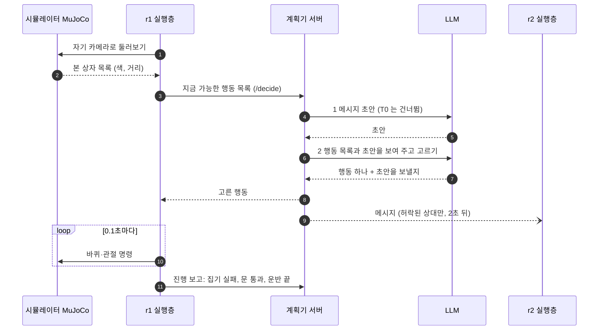
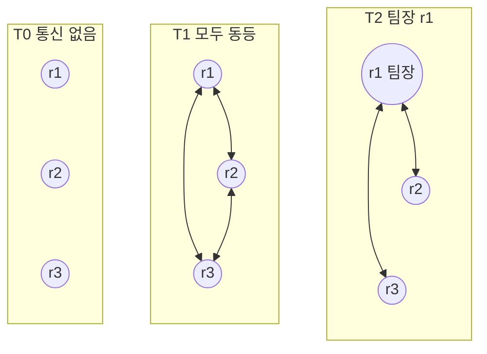
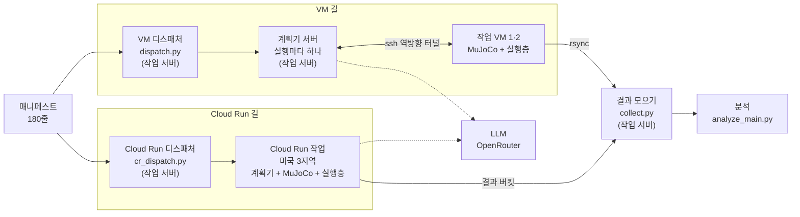
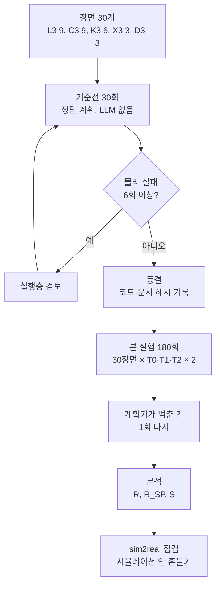

# 전체 구조

로봇 3대가 상자를 하나씩 맡아 다른 방의 목적지까지 나른다. 로봇마다 LLM 하나가 무엇을 할지 고르고, 고른 행동은 학습 모델(ACT)과 코드가 바퀴·관절 명령으로 바꾼다. 실험에서 바꿔 보는 것은 로봇끼리 메시지가 오가는 방식(팀 구조)뿐이다.

이 문서는 **2026-11-17 02:47 KST 에 동결한 본 실험 판**을 설명한다. 처음 보는 사람은 1절 그림과 7절 용어표부터 읽으면 된다.

## 이 문서가 설명하는 판

| 항목 | 동결 값 | 비고 |
|---|---|---|
| 실행층 코드 | v38 (작업 저장소 커밋 `ceed05f`) | 실행층은 따로 둔 작업 저장소에서 고치고, GitHub 에는 파일을 복사해 올린다. 이 문서의 커밋 번호는 그 작업 저장소의 것이다. **GitHub `main` 은 아직 v37 이다**(8절) |
| 계획기 | `brain-v3-msg4-20261116` | `team/brain_server.py`, `team/brain/` 와 논리가 같고 기록 폴더 경로만 다르다 |
| LLM | `z-ai/glm-5.3-flash` (OpenRouter 경유) | 모든 로봇, 모든 팀 구조가 같은 모델 |
| 본 실험 | 로봇 3대, 장면 30개 × 팀 구조 3개 × 반복 2 = 180회 | 장면은 [`scenes/scenes3_main.json`](../scenes/SCENES3.md) |
| 주 지표 | 주문 달성률 R, 메시지 벌점을 뺀 R_SP | 2026-11-16 밤에 계획 덮임 C 에서 바꿨다(사전 등록 결정 D13, 5절) |
| 사전 등록 | `prereg/PREREG.md` + 3대 개정 | 저장소 `prereg/` 에는 D12~D14 가 아직 없고 작업 서버의 동결 기록에만 있다(8절) |

## 1. 한 장으로 보기

  

그림은 다섯 블록이다. 위에서 아래로 정보가 흐르고, 실행층이 계획층에 진행을 보고하는 선만 거꾸로 간다.

| 블록 | 한 줄 설명 | 세부 문서 |
|---|---|---|
| ① 실험 조건 | 장면(상자, 주문)과 팀 구조를 정한다. 팀 구조는 메시지 통로만 바꾼다 | [연구 설계](research_design.md), [장면](../scenes/SCENES3.md) |
| ② 계획층 | 로봇마다 LLM 하나. 지금 가능한 행동 목록에서 하나를 고르고, 메시지를 덧붙일지 정한다 | [계획기와 메시지 규칙](planning_messages.md) |
| ③ 실행층 | 고른 행동을 0.1초마다 바퀴·관절 명령으로 바꾼다. 집기·들기는 ACT, 나머지는 코드 | [실행층](execution_layer.md), [Solo 구조](solo_architecture.md) |
| ④ 감지 | 자기 카메라(팔 끝)는 상자·문·표식을 본다. 천장 카메라는 0.5초마다 모든 로봇의 위치를 재고, 실행층만 쓴다 | [실행층 4절](execution_layer.md#4-위치와-정보의-경계) |
| ⑤ 채점 | 실행이 끝난 뒤 시뮬레이터의 정답 좌표로 몇 상자가 맞는 곳에 갔는지 센다. 어느 층에도 정답을 주지 않는다 | 5절 |

### 블록 사이에 오가는 것

| 보내는 쪽 | 받는 쪽 | 주고받는 것 |
|---|---|---|
| ① 실험 조건 | ② 계획층 | 자기 주문과 능력, 팀 구조 지시문 |
| ④ 자기 카메라 | ② 계획층 | 본 상자 목록(색, 거리) |
| ④ 자기 카메라 | ③ 실행층 | 상자, 문, 표식, 든 상자의 방향과 거리 |
| ④ 천장 카메라 | ③ 실행층 | 모든 로봇의 위치와 방향 |
| ④ 고정 정보 | ③ 실행층 | 경기장 모양(벽, 문) |
| ② 계획층 | ③ 실행층 | 고른 행동 |
| ③ 실행층 | ② 계획층 | 진행 보고: 집기 실패, 문 통과, 운반 끝, 지금 있는 방 |
| ② 계획층 | 다른 로봇의 ② | 메시지: 행동에 덧붙임, 팀 구조가 허락한 상대, 2초 뒤 도착 |
| ③ 실행층 | 로봇 | 바퀴 4, 서보 5 명령, 0.1초마다 |
| 실행 기록 | ⑤ 채점 | 놓인 상자, 메시지 수, 마지막 선택 |
| 시뮬레이터 | ⑤ 채점만 | 정답 좌표. 다른 층으로 가지 않는다 |

### 누가 무엇을 아나

연구 질문은 "로봇마다 아는 것이 다를 때 팀 구조가 결과를 바꾸는가"다. 그래서 LLM 에게 주는 정보를 좁게 잡았다. 원칙은 "LLM 판단에 들어가지 않고 동작 코드에만 쓰이는 정보는 준다"(2026-11-15 결정)이다.

| 정보 | 실행층(코드, ACT) | LLM 계획기 |
|---|---|---|
| 자기 위치·방향 | 천장 카메라 측정값 | 방 이름만("상자 방" 또는 문을 지난 뒤 "목적지 방"). 자기 진행에서 나온다 |
| 다른 로봇의 위치 | 천장 카메라 측정값(양보, 앞 로봇 정지에 씀) | 받지 않는다. 메시지로만 안다 |
| 벽, 문 위치 | 고정 정보로 받는다 | 받지 않는다 |
| 목적지 표식 위치 | 받지 않는다. 자기 카메라로 번호를 읽어 찾는다 | 받지 않는다 |
| 상자 | 자기 카메라 | 자기 카메라로 본 목록(색, 거리) |
| 주문 | | 과제가 준 자기 몫만 |
| 다른 로봇의 주문·계획 | | 메시지로만 안다 |

## 2. 한 번의 결정이 도는 순서

로봇은 결정할 때가 되면(상자를 고를 때, 문 앞, 목적지 앞) 계획기에 묻는다. 계획기는 작은 HTTP 서버이고 실행 하나에 하나씩 뜨며 로봇 3대가 함께 쓴다. 아래는 r1 이 상자를 고르는 한 번이다.

- LLM 에게 주는 것: 자기 방 이름, 본 상자, 자기 주문, 받은 메시지, 자기 능력(집을 수 있는 색). 순서(초안, 행동 목록, 고르기)는 CoELA 에서 빌렸다.
- 행동 목록은 코드가 만든다. LLM 은 목록 밖의 행동을 만들 수 없다. 고를 수 있는 것: 집을 상자, 목적지 표식(11·12·13), 문을 지금 지날지 기다릴지, 든 상자를 내려놓고 끝내기, 기다리기.
- 메시지는 행동에 덧붙여 보낸다. 따로 말할 차례는 없다. 로봇당 8개까지이고, LLM 에게 상한과 감점을 알려 준다. 새 메시지를 받으면 이동 중이라도 답장할 기회가 한 번 온다.
- 각 로봇은 상자를 한 번만 나른다. 내려놓으면 그 로봇의 실행이 끝난다.
- 기준선 실행(정답 계획, `--fixed oracle`)은 계획기를 띄우지 않는다. 실행층 안의 고정 계획(FixedPlan)이 정답 배정을 그대로 준다.

계획기 서버의 주소는 `/decide`(행동 고르기), `/poll`(새 메시지가 왔나), `/chance`(답장 기회), `/tell`(진행 보고), `/record`(기록 저장)다. 실행층 쪽 연결 코드는 `scripts/run_team_carry.py` 의 `RemoteBrain` 이다.

## 3. 팀 구조: 메시지가 갈 수 있는 길

팀 구조가 바꾸는 것은 이 통로뿐이다. 행동 목록, 실행층, 모델, 과제 문장은 세 구조가 같다.

- **T0**: 메시지 단계를 끈다. 각 로봇은 자기가 아는 것과 본 것으로 최선의 추측을 한다. 과제 문장에 "자기 주문을 못 해도 멈추지 말고, 팀에 도움이 될 상자와 표식을 추측하라"를 넣었다(사전 등록 결정 D12, 모든 구조 같은 문장).
- **T1**: 누구나 누구에게나 보낸다.
- **T2**: 팀원(r2, r3)은 팀장(r1)에게만, 팀장은 누구에게나 보낸다. 팀원끼리는 직접 못 보낸다. 로봇 2대일 때는 T2 와 T1 의 통로가 같아 구별이 안 되므로 연구의 중심을 3대로 옮겼다.

## 4. 실제로 어디서 도나 (실행 인프라)

실행 하나 = 장면 하나 × 팀 구조 하나 × 반복 하나다. 돌릴 실행 목록(매니페스트) 한 줄이 실행 하나다. 같은 매니페스트를 두 길로 나눠 돌린다. 두 길은 같은 코드(실행층 v38, 같은 계획기)를 쓰고, 결과를 같은 모양으로 모아 같은 분석기에 넣는다.

| 길 | 계획기는 어디서 | 시뮬레이션은 어디서 | 동시 실행 | 결과가 오는 길 |
|---|---|---|---|---|
| VM | 작업 서버. 실행마다 `brain_server.py` 하나를 띄우고 ssh 역방향 터널로 VM 에 이어 준다 | 작업 VM 1·2 (`run_team_v38.sh` → `run_team_carry.py`) | VM1 최대 5, VM2 최대 2 (실행 하나가 코어 약 5개) | `collect.py` 가 rsync 로 가져온다 |
| Cloud Run | 같은 컨테이너 안에서 `brain_server.py` 를 띄운다 | 같은 컨테이너 | 지역당 8 × 3지역 (작업 하나에 CPU 2, 메모리 5 GiB) | 결과 버킷에 올리고 `cr_dispatch.py fetch` 가 가져온다 |

- 모델 키는 VM 에 두지 않는다. VM 길에서는 작업 서버의 계획기만 LLM 을 부르고, Cloud Run 길에서는 비밀 저장소(Secret Manager)에서 그 컨테이너에만 넣는다.
- 지출 가드: 계획기가 시작할 때 키 사용량을 확인하고 정한 상한(2 USD)을 넘으면 멈춘다. 두 길이 같은 키를 쓰므로 사용량은 합쳐서 본다.
- 시간 상한: 시뮬레이션 시간 900초(`--cap-s 900`), 벽시계 VM 4.5시간, Cloud Run 작업 5시간. 상한에 걸린 실행은 `cap_end` 로 따로 표시한다.
- 고장 처리: 실행이 실패하면 디스패처가 `-retry1` 이름으로 한 번 더 돈다. 계획기가 멈춘 칸은 묶음이 끝난 뒤 `rerun_halted.py` 로 한 번 다시 돈다(이름 끝 `-rr1`). 연속 8번 실패하면 새 실행을 멈춘다.
- 코드: [`batch/`](../batch/README.md)(VM 디스패처, 실행기, 결과 모으기), [`analysis/`](../analysis/RUNBOOK.md)(분석). Cloud Run 쪽(`cr_dispatch.py`, 컨테이너 진입점 `cr_task.py`, 이미지 빌드)은 아직 저장소에 없다(8절).

## 5. 실험 순서와 채점

**동결.** `prereg/freeze_hashes.py` 가 실행층 코드, 계획기, 프롬프트, 장면 파일, 분석 스크립트, 사전 등록 문서의 sha256 과 git 커밋을 한 파일에 적는다. 묶음을 시작하기 전마다 `--check` 로 같은지 보고, 다르면 시작하지 않는다. 2026-11-16~17 에 동결을 세 번 다시 했다(주 표본 2대 → 3대, 과제 문장 D12, 실행층 v38). 다시 할 때마다 그 전에 돈 본 실험 실행은 분석에서 빼고 처음부터 다시 돌렸다.

**채점.** 실행이 끝난 뒤 시뮬레이터의 정답 좌표로 센다.

| 지표 | 뜻 | 쓰임 |
|---|---|---|
| R 주문 달성률 | (맞는 표식에 놓인 상자 − 엉뚱한 곳에 놓인 상자) ÷ 주문 상자 수. 0 아래는 0. 0~1 | **주 지표** |
| R_SP | R − λ × (메시지 수가 허용을 넘은 만큼). 허용은 로봇 수의 두 배라 3대면 6개. λ = 0.02, 민감도로 0.05·0.10 | **주 지표.** 말을 많이 해서 얻은 이득을 깎는다 |
| S 실제 성공 | R = 1 이고 엉뚱한 곳에 놓은 상자 0 | 함께 보고(이항 95% 신뢰구간) |
| C 계획 덮임 | 로봇들이 마지막에 고른 (색, 표식)이 주문과 정확히 같은가. 실행 전 계획만 본다 | 원인 분석용. 계획은 맞았는데 실행이 실패했는지 가른다 |

팀 구조 비교는 장면별 평균 차이와 장면 부트스트랩 95% 신뢰구간으로 하고, 부호 검정을 보조로 쓴다. 시뮬레이션 시간, 메시지 수, LLM 호출 수와 비용도 함께 보고한다.

**sim2real 점검.** 본 실험 뒤에 한다. 계획기를 빼고(정답 계획) 바퀴 마찰, 상자 질량, 카메라 영상, 천장 측정 잡음을 시뮬레이션 안에서 흔들어 실행층이 어느 단계에서 먼저 무너지는지 본다. 실물 시험이 아니다.

## 6. 실행층 판의 흐름

본 실험이 쓰는 실행층은 v38 이다. 같은 장면을 같은 판으로 돌려야 비교가 되므로 실행 기록마다 판 이름과 코드 해시를 남긴다.

| 판 | 작업 저장소 커밋 | 바뀐 것 | 쓰인 곳 |
|---|---|---|---|
| v36 | `6cbd3db` | 첫 집기 전 방향을 다시 잡기, 본 적 없는 상자는 집지 않기, 끝난 로봇을 문 대기열에서 빼기, 들기 확인 후진이 아는 벽 앞에서 멈추기 | 2대 기준선, 3대 관문 |
| v37 | `676768a` | ACT 가 "끝"이라 해도 집기 규칙이 무시하면 잠금을 푼다(136회 중 1회 난 고장) | 3대 기준선 |
| v38 | `ceed05f` | 목적지 표식이 앞 로봇에 가려 안 보이면 옆으로 0.8~1.2 m 비켜 다시 둘러본다. 포기 직전에만 켜지고 그 전 동작은 같다 | **3대 본 실험 180회** |

3대 기준선 30회에서 v38 의 새 분기는 한 번도 켜지지 않았고, 같은 장면을 v38 로 다시 돌린 명령 기록이 v37 과 같았다. 그래서 v37 로 돈 기준선을 v38 기준선으로 그대로 쓴다.

알려진 한계(고치지 않고 사전 등록에 적음): 든 상자가 카메라 모서리에 걸리면 "바닥에 남음"으로 잘못 보고, 다시 집다 떨어뜨릴 수 있다. 모든 구조에 같은 코드다. 분석에서 이런 실행 수를 구조별로 세고, 뺀 결과도 함께 낸다.

## 7. 용어

| 용어 | 뜻 |
|---|---|
| r1, r2, r3 | 로봇 3대. T2 에서는 r1 이 팀장 |
| 상자 방, 목적지 방 | 문 하나로 이어진 두 방. 상자는 상자 방에서 시작한다 |
| 표식 11·12·13 | 목적지 방 벽에 붙은 번호 표식. 상자를 그 앞에 놓는다 |
| 주문 | "빨간 상자 하나를 표식 12 로" 같은 할 일. 로봇마다 일부만 안다 |
| T0, T1, T2 | 팀 구조. 통신 없음, 모두 동등, 팀장 있음 |
| L3, C3, K3, X3, D3 | 장면 유형. 주문 집중, 같은 색 경쟁, 집기 능력 제한, 교차 지식(대조), 미끼(대조) |
| ACT | 사람 시연을 흉내 내는 학습 모델(Action Chunking Transformer). 여기서는 집기와 들기만 한다 |
| 계획기 | LLM 을 부르는 서버(`brain_server.py`). 로봇 3대가 함께 쓰고 로봇마다 따로 묻는다 |
| 실행층 | 고른 행동을 몸 움직임으로 바꾸는 코드와 ACT |
| 천장 카메라 | 경기장 위 카메라 1대. 로봇 윗면 번호 표식을 읽어 위치를 잰다. 실행층만 쓴다 |
| 정답 계획, FixedPlan, 기준선 | LLM 대신 정답 배정을 주는 고정 계획. 실행층만의 실패율을 재는 데 쓴다 |
| 관문 | 다음 단계로 넘어가기 전에 통과해야 하는 시험. 예: 기준선 물리 실패 6회 미만 |
| 동결 | 코드와 문서의 해시를 기록하고 더 고치지 않는 것 |
| 사전 등록(PREREG) | 결과를 보기 전에 지표, 검정, 제외 규칙을 적어 둔 문서 |
| D1~D14 | 사전 등록에 적은 결정 번호. D12 과제 문장, D13 주 지표 R, D14 실행층 v38 |
| v36, v37, v38 | 실행층 판 이름(6절) |
| 매니페스트 | 돌릴 실행 목록 CSV. 한 줄이 실행 하나 |
| 디스패처 | 매니페스트를 읽어 빈 자리에 실행을 띄우고 끝난 것을 확인하는 프로그램 |
| R, R_SP, S, C, λ | 지표(5절). λ 는 허용을 넘은 메시지 한 개마다 깎는 점수 |
| `cap_end` | 시간 상한에 걸려 끝난 실행 |
| `-retry1`, `-rr1` | 실패한 실행의 재시도, 계획기가 멈춘 칸의 재실행 |
| sim2real | 시뮬레이션 결과가 실물에서도 통할지 보는 일 |

## 8. 알려진 어긋남

이 문서를 쓰며 찾은 것이다. 본 실험이 도는 동안은 코드와 동결 파일을 고치지 않으므로 실험 뒤에 처리한다. 처리 방법은 [구조 개선 제안](architecture_proposals.md)에 있다.

- GitHub `main` 의 실행층은 v37 이다(주석 속 내부 경로만 지운 사본). v38 의 옆걸음 다시 보기(`harness/carry_nav_v1.py`)가 아직 없다.
- 저장소 `prereg/` 에는 D12(과제 문장), D13(주 지표 R), D14(v38)가 없다. D12 의 과제 문장 자체는 `team/brain_server.py` 에 들어 있다.
- Cloud Run 길의 코드가 저장소에 없다.
- [연구 설계 11절](research_design.md#11-이번-제출의-동결-설계-2026-11-16)의 지표 표는 D13 전 기준이다. 그 절 머리에 이 사실을 적었다.

## 코드 위치

| 부분 | 위치 |
|---|---|
| 찾기, 다가가기, 정면 맞추기, ACT 집기, 내려놓기 | [`solo_pipeline/`](../solo_pipeline/README.md) |
| 든 채 이동, 장소 기억, 번호 표식, 천장 카메라 | [`harness/`](../harness) 의 `carry_nav_v1.py`, `place_memory_v1.py`, `robot_tags_v1.py`, `overhead_v1.py`, `drive_record_v1.py` |
| 여러 로봇 실행, 계획기 연결 | 실행기 [`scripts/run_team_carry.py`](../scripts/run_team_carry.py), 계획기 [`team/`](../team/README.md) |
| 묶음 실행, 분석, 장면, 사전 등록 | [`batch/`](../batch/README.md), [`analysis/`](../analysis/RUNBOOK.md), [`scenes/`](../scenes/SCENES3.md), [`prereg/`](../prereg/PREREG.md) |

`solo_pipeline/` 은 Solo 평가에 쓴 코드를 그대로 모은 기록이다. 팀 실행에 쓰는 판은 `harness/`, `scripts/` 에 있다. 수치와 날마다의 진행은 팀 Linear(UGRP 팀)에 적는다.
