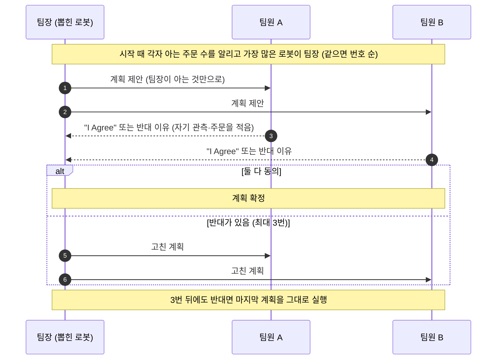
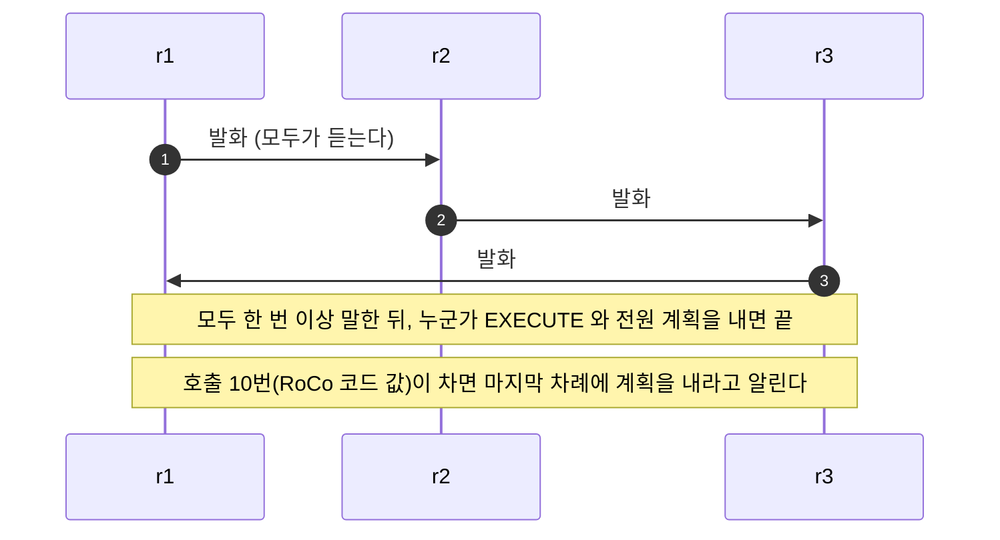
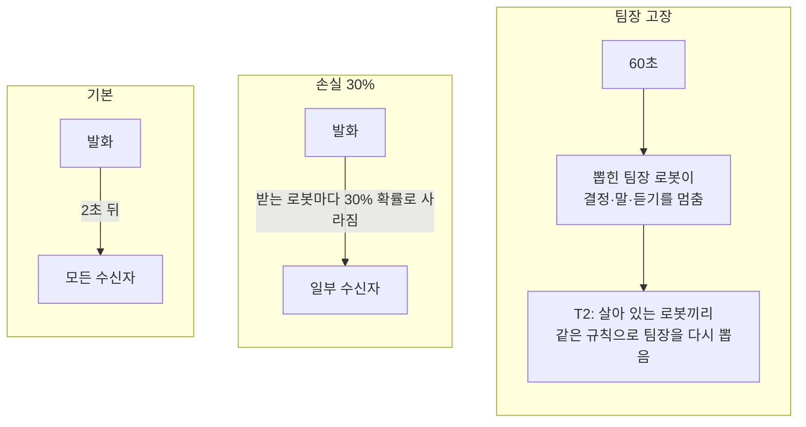
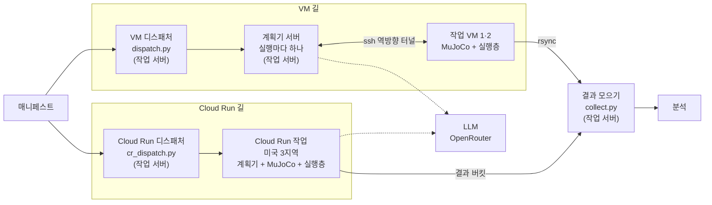
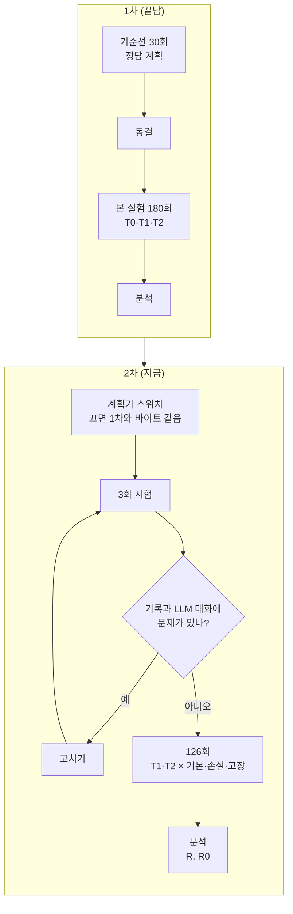

# 전체 구조

로봇 3대가 상자를 하나씩 맡아 다른 방의 목적지까지 나른다. 로봇마다 LLM 하나가 무엇을 할지 고르고, 고른 행동은 학습 모델(ACT)과 코드가 바퀴·관절 명령으로 바꾼다. 실험에서 바꾸는 것은 로봇끼리 이야기하는 방식(팀 구조)과 통신 조건뿐이고, 몸을 움직이는 실행층은 모든 조건에서 같다.

처음 보는 사람은 1절 그림과 8절 용어표부터 읽으면 된다.

## 실험은 두 번이다

| | 1차 실험 (끝남) | 2차 실험 (지금, 시험 중) |
|---|---|---|
| 질문 | 통신하면 나아지는가 | 팀장형과 동등형 중 어느 쪽이 나은가, 통신이 나빠지면 순위가 뒤집히는가 |
| 팀 구조 | T0 통신 없음, T1 동등, T2 팀장 r1 고정 | T1 동등(RoCo·DMAS 식 차례 대화), T2 팀장(HMAS-2 식 제안·검토). 팀장은 로봇들이 뽑는다 |
| 대화 방식 | 행동에 메시지를 덧붙임, 로봇당 8개까지 | 선행 연구 프로토콜 그대로, 메시지 수 제한 없음 |
| 통신 조건 | 기본만 | 기본, 메시지 30% 손실, 60초에 팀장 로봇 고장 |
| 실행 수 | 장면 30 × 3구조 × 2 = 180 (+ 정답 계획 기준선 30) | 장면 9 × 2구조 × (기본 3 + 손실 2 + 고장 2) = 126 |
| 주 지표 | 주문 달성률 R | R 과 감점 없는 달성률 R0 |
| 결과 | R: T0 38.3%, T1 84.4%, T2 75.0% (정답 계획 91.1%) | 아직 없음. 3회씩 시험해 문제를 고치고, 깨끗한 3회 뒤에 126회를 시작한다 |

이 문서의 그림과 설명은 **2차 실험 기준**이다. 1차 실험에만 있던 것(T0, 메시지 덧붙이기 규칙, 메시지 벌점 R_SP)은 그 자리에 "1차"라고 적었다.

## 1. 한 장으로 보기

  

| 블록 | 한 줄 설명 | 세부 문서 |
|---|---|---|
| ① 실험 조건 | 장면(상자, 주문), 팀 구조, 통신 조건을 정한다 | [장면](../scenes/SCENES3.md) |
| ② 계획층 | 로봇마다 LLM 하나. 첫 집기와 다시 집기 때는 팀이 대화해 계획을 정하고, 그 밖의 결정은 혼자 행동 목록에서 고른다 | [계획기와 메시지 규칙](planning_messages.md)(1차 기준) |
| ③ 실행층 | 고른 행동을 0.1초마다 바퀴·관절 명령으로 바꾼다. 집기·들기는 ACT, 나머지는 코드 | [실행층](execution_layer.md), [Solo 구조](solo_architecture.md) |
| ④ 감지 | 자기 카메라(팔 끝)는 상자·문·표식을 본다. 천장 카메라는 0.5초마다 모든 로봇의 위치를 재고, 실행층만 쓴다 | [실행층 4절](execution_layer.md#4-위치와-정보의-경계) |
| ⑤ 채점 | 실행이 끝난 뒤 시뮬레이터의 정답 좌표로 몇 상자가 맞는 곳에 갔는지 센다. 어느 층에도 정답을 주지 않는다 | 6절 |

### 누가 무엇을 아나

연구 질문은 "로봇마다 아는 것이 다를 때 팀을 어떻게 짜야 하는가"다. 그래서 LLM 에게 주는 정보를 좁게 잡았다. 원칙은 "LLM 판단에 들어가지 않고 동작 코드에만 쓰이는 정보는 준다"(2026-11-15 결정)이다.

| 정보 | 실행층(코드, ACT) | LLM 계획기 |
|---|---|---|
| 자기 위치·방향 | 천장 카메라 측정값 | 방 이름만("상자 방" 또는 문을 지난 뒤 "목적지 방"). 자기 진행에서 나온다 |
| 다른 로봇의 위치 | 천장 카메라 측정값(양보, 앞 로봇 정지에 씀) | 받지 않는다. 대화로만 안다 |
| 벽, 문 위치 | 고정 정보로 받는다 | 받지 않는다 |
| 목적지 표식 위치 | 받지 않는다. 자기 카메라로 번호를 읽어 찾는다 | 받지 않는다 |
| 상자 | 자기 카메라 | 자기 카메라로 본 목록(색, 거리) |
| 주문 | | 과제가 준 자기 몫만 |
| 다른 로봇의 주문·계획 | | 대화로만 안다 |

## 2. 팀 대화: 언제, 어떻게

팀 대화는 두 번 열린다. 모든 로봇이 첫 상자를 고를 때, 그리고 집기에 실패해 다시 고를 때다. 대화가 끝나면 계획 `{"r1": {"box": 색, "zone": 표식}, "r2": "stay", ...}` 이 나오고, 각 로봇은 자기 몫을 따른다. 목적지는 계획에서 읽고, 문을 지금 지날지는 혼자 고른다. 대화는 시뮬레이션 시간으로 0초에 끝난다(선행 연구처럼 실행 전에 말한다). 발화는 메시지로 기록되고 기본 2초 뒤 받는 로봇에 닿는다.

### T2 팀장형 (Chen 등 HMAS-2 를 따름)

- 팀원끼리는 직접 말하지 않는다. 팀장이 모르는 정보는 팀원의 반대 이유로만 들어온다.
- 원 논문은 일을 맡은 로봇만 검토하지만, 우리는 팀원 전원이 검토한다. 부분 관측이라 배정이 없는 팀원도 자기 관측을 알려야 하기 때문이다.

### T1 동등형 (RoCo, Chen 등 DMAS 를 따름)

- 번호순으로 돌아가며 한 번에 한 로봇이 말한다. 모든 발화를 모두가 듣는다.
- 계획 없이 끝나면 각 로봇이 혼자 고른다.

### 그 밖의 결정 (혼자 고르기)

문 앞, 목적지 앞처럼 대화가 없는 결정에서는 로봇이 계획기에 묻고, LLM 이 코드가 만든 행동 목록에서 하나를 고른다(추론과 선택을 한 번의 호출로). 고를 수 있는 것: 집을 상자, 목적지 표식(11·12·13), 문을 지금 지날지 기다릴지, 머물기(새 메시지가 오거나 약 20초 뒤 다시 물을 때까지), 든 상자를 내려놓고 끝내기. **다시 찾기(둘러보고 상자를 새로 찾기)는 실행층 v39 로 만드는 중이고, 아직 선택지에 없다.**

계획기 서버의 주소는 `/decide`(행동 고르기), `/poll`(새 메시지가 왔나), `/chance`(답장 기회, 1차), `/tell`(진행 보고), `/record`(기록 저장)다. 실행층 쪽 연결 코드는 `scripts/run_team_carry.py` 의 `RemoteBrain` 이다. 정답 계획 기준선(`--fixed oracle`)은 계획기를 띄우지 않고, 실행층 안의 고정 계획(FixedPlan)이 정답 배정을 준다.

## 3. 통신 조건 (2차)

- 손실은 받는 로봇마다 따로 정해지고, 실행마다 고정 시드를 쓴다.
- 고장은 T1 에서도 같은 로봇을 멈춰 두 구조를 같은 조건으로 비교한다.
- 고장은 계획기 쪽 정지다. 멈춘 로봇의 몸은 그 순간의 동작을 끝낼 때까지 움직인다. 몸까지 멈추는 것은 실행층 v39 로 만드는 중이다.
- 메시지 수 제한은 없다. 프로토콜의 호출 상한(T1 10번, T2 검토 3번)과 로봇당·실행당 안전 상한만 있다.

## 4. 실제로 어디서 도나 (실행 인프라)

실행 하나 = 장면 하나 × 조건 하나 × 반복 하나다. 돌릴 실행 목록(매니페스트) 한 줄이 실행 하나다. 2차 실험은 주로 Cloud Run 에서 돈다.

| 길 | 계획기는 어디서 | 시뮬레이션은 어디서 | 동시 실행 | 결과가 오는 길 |
|---|---|---|---|---|
| VM | 작업 서버. 실행마다 `brain_server.py` 하나를 띄우고 ssh 역방향 터널로 VM 에 이어 준다 | 작업 VM 1·2 | VM1 최대 5, VM2 최대 2 (실행 하나가 코어 약 5개) | `collect.py` 가 rsync 로 가져온다 |
| Cloud Run | 같은 컨테이너 안에서 `brain_server.py` 를 띄운다 | 같은 컨테이너 | 지역당 8 × 3지역 (작업 하나에 CPU 2, 메모리 5 GiB) | 결과 버킷에 올리고 `cr_dispatch.py fetch` 가 가져온다 |

- 모델: `z-ai/glm-5.3-flash`, temperature 0.7. 1차와 같게 두어 비교한다.
- 모델 키는 VM 에 두지 않는다. VM 길에서는 작업 서버의 계획기만 LLM 을 부르고, Cloud Run 길에서는 비밀 저장소(Secret Manager)에서 그 컨테이너에만 넣는다.
- 지출 가드: 계획기가 시작할 때 키 사용량을 확인하고 정한 상한(10 USD)을 넘으면 멈춘다. 두 길이 같은 키를 쓰므로 사용량은 합쳐서 본다.
- 시간 상한: 시뮬레이션 시간 900초(`--cap-s 900`), 벽시계 VM 4.5시간, Cloud Run 작업 5시간. 상한에 걸린 실행은 `cap_end` 로 따로 표시한다.
- 고장 처리: 실행이 실패하면 디스패처가 `-retry1` 이름으로 한 번 더 돈다. 계획기가 멈춘 칸은 묶음이 끝난 뒤 한 번 다시 돈다(이름 끝 `-rr1`). 설계된 로봇 고장(`robot_failed`)은 결과이므로 다시 돌지 않는다.
- 코드: [`batch/`](../batch/README.md), [`analysis/`](../analysis/RUNBOOK.md). 2차 계획기와 Cloud Run 코드는 아직 저장소에 없다(9절).

## 5. 실험 순서

- 1차 실험은 코드와 문서의 해시를 기록(동결)한 뒤 돌렸다. 동결은 세 번 다시 했고(주 표본 2대 → 3대, 과제 문장, 실행층 v38), 다시 할 때마다 그 전에 돈 실행은 분석에서 뺐다.
- 2차 실험의 새 기능은 모두 계획기 스위치다. 스위치를 모두 끄면 1차 계획기와 프롬프트·결과가 바이트까지 같은지 대본 11개로 확인했다.
- 3회 시험에서 보는 것: 파서가 답을 못 읽어 무작위로 고른 곳, 잘못된 판단, 멈춘 로봇, 엉뚱한 상대에게 간 메시지, 고장 주입이 실제로 작동했는지.

## 6. 채점

실행이 끝난 뒤 시뮬레이터의 정답 좌표로 센다.

| 지표 | 뜻 | 쓰임 |
|---|---|---|
| R 주문 달성률 | (맞는 표식에 놓인 상자 − 엉뚱한 곳에 놓인 상자) ÷ 주문 상자 수. 0 아래는 0 | 1차·2차 주 지표 |
| R0 감점 없는 달성률 | 맞는 표식에 놓인 상자 ÷ 주문 상자 수 | 2차 주 지표. 추측 배달 감점이 결과를 흔드는지 본다 |
| S 실제 성공 | R = 1 이고 엉뚱한 곳에 놓은 상자 0 | 함께 보고 |
| 그 밖 | 끝난 시간, 발화 수, LLM 호출 수와 비용, 같은 상자를 두 로봇이 고른 횟수, 계획 없이 끝난 대화 수 | 함께 보고 |
| R_SP, C | 메시지 벌점을 뺀 R, 계획 덮임 | 1차에서만. 2차는 메시지 제한이 없어 R_SP 를 쓰지 않는다 |

팀 구조 비교는 장면 단위 평균 차이와 장면 부트스트랩 95% 신뢰구간, 부호 검정으로 한다. 2차에서 보려는 것은 (T2 − T1) 이 통신 조건에 따라 부호가 바뀌는지다.

## 7. 실행층 판

실행층은 모든 조건에서 같은 판을 쓴다. 판 이름과 코드 해시를 실행 기록마다 남긴다.

| 판 | 작업 저장소 커밋 | 바뀐 것 | 쓰인 곳 |
|---|---|---|---|
| v36 | `6cbd3db` | 첫 집기 전 방향을 다시 잡기, 본 적 없는 상자는 집지 않기, 끝난 로봇을 문 대기열에서 빼기, 들기 확인 후진이 아는 벽 앞에서 멈추기 | 2대 기준선, 3대 관문 |
| v37 | `676768a` | ACT 가 "끝"이라 해도 집기 규칙이 무시하면 잠금을 푼다 | 3대 기준선 |
| v38 | `ceed05f` | 목적지 표식이 앞 로봇에 가려 안 보이면 옆으로 0.8~1.2 m 비켜 다시 둘러본다 | 1차 본 실험 180회, 2차 시험 |
| v39 | 만드는 중 | 다시 찾기 선택지, 고장 난 로봇의 몸 정지, 들기 확인 오판 고치기. 모두 스위치로, 끄면 v38 과 같게 | 2차 126회(완성되면) |

알려진 한계: 든 상자가 카메라 모서리에 걸리면 "바닥에 남음"으로 잘못 보고 다시 집다 떨어뜨릴 수 있다(1차 본 실험 180회 중 7회로 판별). v39 에서 고친다.

## 8. 용어

| 용어 | 뜻 |
|---|---|
| r1, r2, r3 | 로봇 3대 |
| 상자 방, 목적지 방 | 문 하나로 이어진 두 방. 상자는 상자 방에서 시작한다 |
| 표식 11·12·13 | 목적지 방 벽에 붙은 번호 표식. 상자를 그 앞에 놓는다 |
| 주문 | "빨간 상자 하나를 표식 12 로" 같은 할 일. 로봇마다 일부만 안다 |
| T0, T1, T2 | 팀 구조. 통신 없음(1차만), 동등, 팀장 있음 |
| RoCo, DMAS | 동등형 대화를 따른 선행 연구. 로봇이 번호순으로 돌아가며 말하고 합의하면 실행한다 |
| HMAS-2 | 팀장형 대화를 따른 선행 연구(Chen 등). 팀장이 계획을 내고 팀원이 동의하거나 고칠 점을 말한다 |
| 선출 팀장 | 시작 때 로봇들이 아는 주문 수를 알리고 가장 많은 로봇이 팀장이 된다. 실험자가 정하지 않는다 |
| L3, C3, K3, X3, D3 | 장면 유형. 주문 집중, 같은 색 경쟁, 집기 능력 제한, 교차 지식(대조), 미끼(대조) |
| ACT | 사람 시연을 흉내 내는 학습 모델(Action Chunking Transformer). 여기서는 집기와 들기만 한다 |
| 계획기 | LLM 을 부르는 서버(`brain_server.py`). 로봇 3대가 함께 쓰고 로봇마다 따로 묻는다 |
| 실행층 | 고른 행동을 몸 움직임으로 바꾸는 코드와 ACT |
| 천장 카메라 | 경기장 위 카메라 1대. 로봇 윗면 번호 표식을 읽어 위치를 잰다. 실행층만 쓴다 |
| 정답 계획, FixedPlan, 기준선 | LLM 대신 정답 배정을 주는 고정 계획. 실행층만의 실패율을 재는 데 쓴다 |
| 동결 | 코드와 문서의 해시를 기록하고 더 고치지 않는 것 |
| 사전 등록(PREREG) | 결과를 보기 전에 지표, 검정, 제외 규칙을 적어 둔 문서 |
| v36~v39 | 실행층 판 이름(7절) |
| 매니페스트 | 돌릴 실행 목록 CSV. 한 줄이 실행 하나 |
| 디스패처 | 매니페스트를 읽어 빈 자리에 실행을 띄우고 끝난 것을 확인하는 프로그램 |
| R, R0, S | 지표(6절) |
| `cap_end` | 시간 상한에 걸려 끝난 실행 |
| `-retry1`, `-rr1` | 실패한 실행의 재시도, 계획기가 멈춘 칸의 재실행 |

## 9. 알려진 어긋남

이 문서를 쓰며 찾은 것이다. 처리 방법은 [구조 개선 제안](architecture_proposals.md)에 있다.

- GitHub `main` 의 실행층은 v37 이다(주석 속 내부 경로만 지운 사본). v38 의 옆걸음 다시 보기(`harness/carry_nav_v1.py`)가 아직 없다.
- 2차 계획기(선행 연구 프로토콜, 선출 팀장, 손실·고장 스위치)는 작업 서버에만 있고 저장소 `team/` 은 1차 판이다.
- 저장소 `prereg/` 에는 1차의 D12~D14 와 2차 사전 등록이 없다.
- Cloud Run 길의 코드가 저장소에 없다.
- [계획기와 메시지 규칙](planning_messages.md), [연구 설계 11절](research_design.md#11-이번-제출의-동결-설계-2026-11-16)은 1차 기준이다.

## 코드 위치

| 부분 | 위치 |
|---|---|
| 찾기, 다가가기, 정면 맞추기, ACT 집기, 내려놓기 | [`solo_pipeline/`](../solo_pipeline/README.md) |
| 든 채 이동, 장소 기억, 번호 표식, 천장 카메라 | [`harness/`](../harness) 의 `carry_nav_v1.py`, `place_memory_v1.py`, `robot_tags_v1.py`, `overhead_v1.py`, `drive_record_v1.py` |
| 여러 로봇 실행, 계획기 연결 | 실행기 [`scripts/run_team_carry.py`](../scripts/run_team_carry.py), 계획기 [`team/`](../team/README.md)(1차 판) |
| 묶음 실행, 분석, 장면, 사전 등록 | [`batch/`](../batch/README.md), [`analysis/`](../analysis/RUNBOOK.md), [`scenes/`](../scenes/SCENES3.md), [`prereg/`](../prereg/PREREG.md) |

수치와 날마다의 진행은 팀 Linear(UGRP 팀)에 적는다.
