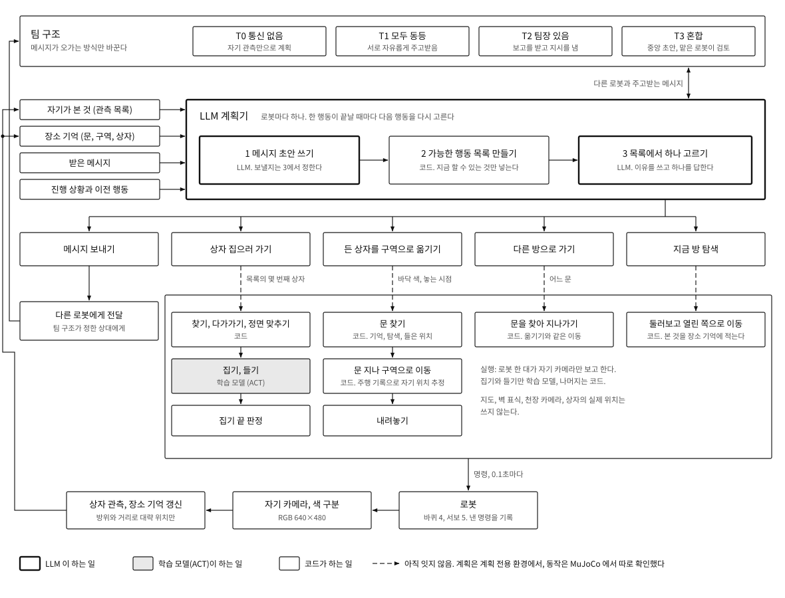

# 전체 구조

LLM 이 계획을 세우고, 그 선택에 따라 학습 모델(ACT)이나 코드가 로봇을 움직이는 구조다. 2026-11-14 기준.

  

## 1. 한눈에

| 층 | 누가 | 하는 일 |
|---|---|---|
| 팀 구조 | 실험 조건 | 로봇끼리 메시지가 오가는 방식을 정한다. 통신 없음(T0), 모두 동등(T1), 팀장 있음(T2), 혼합(T3) |
| 계획 | LLM (로봇마다 하나) | 메시지 초안을 쓰고, 지금 할 수 있는 행동 목록에서 하나를 고른다 |
| 행동 목록 | 코드 | 로봇이 아는 것으로 지금 가능한 행동만 골라 목록을 만든다 |
| 실행 | ACT 와 코드 | 고른 행동을 바퀴와 팔 명령으로 바꾼다. 집기와 들기만 ACT, 나머지는 코드 |
| 인식 | 코드 | 자기 카메라 화면에서 상자, 문, 구역을 찾아 관측 목록과 장소 기억을 고친다 |

**아직 잇지 않은 곳.** 계획기의 선택을 실제 동작으로 넘기는 연결(그림의 점선)은 아직 없다. 계획은 계획 전용 환경에서, 동작은 MuJoCo 에서 따로 돌려 확인했다. 지금 MuJoCo 실행에서는 점선에 적힌 값(몇 번째 상자, 바닥 색, 놓는 시점)을 과제가 직접 준다.

## 2. LLM 계획기

로봇마다 계획기가 하나씩 있고, 한 행동이 끝날 때마다 다음 행동을 다시 고른다. 순서는 CoELA 의 구조를 따랐다.

| 순서 | 누가 | 내용 |
|---|---|---|
| 1 메시지 초안 | LLM | 지금 알릴 것이 있으면 메시지를 쓴다. 이 단계에서는 보내지 않는다 |
| 2 행동 목록 | 코드 | 아래 3절의 행동 가운데 지금 가능한 것만 넣는다. 초안이 있으면 "메시지 보내기"도 넣는다 |
| 3 고르기 | LLM | 이유를 쓰고 목록에서 하나를 답한다. "메시지 보내기"를 골랐을 때만 초안이 실제로 나간다 |

계획기가 받는 것은 네 가지다.

| 입력 | 내용 |
|---|---|
| 자기가 본 것 | 상자의 종류와 대략 위치. 자기 카메라로 본 것만 |
| 장소 기억 | 문, 바닥 색 구역, 상자가 어디쯤 있었는지 |
| 받은 메시지 | 다른 로봇이 보낸 것 |
| 진행 상황과 이전 행동 | 자기가 무엇을 들고 있는지, 최근에 무엇을 했는지 |

다른 로봇이 본 것, 다른 로봇의 위치, 전체 지도, 상자의 실제 위치는 받지 않는다. 자기 위치는 천장 카메라로 잰 값을 받는다(2026-11-15 결정, [작업 계획](plan.md) 2절).

## 3. 고를 수 있는 행동과 실행

| 행동 | 목록에 들어가는 조건 | 실행 | 누가 |
|---|---|---|---|
| 메시지 보내기 | 초안이 있을 때 | 팀 구조가 정한 상대에게 전달 | 통신 |
| 상자 집으러 가기 | 빈손이고, 아직 제자리에 없는 상자를 알 때 | 찾기, 다가가기, 정면 맞추기 → 집기, 들기 → 집기 끝 판정 | 코드 → ACT → 코드 |
| 든 상자를 구역으로 옮기기 | 상자를 들고 있고 놓을 구역을 알 때 | 문 찾기 → 문 지나 구역으로 이동 → 내려놓기 | 코드 |
| 다른 방으로 가기 | 항상 | 문을 찾아 지나가기 | 코드 |
| 지금 방 탐색 | 아직 둘러보지 않은 방일 때 | 둘러보고 열린 쪽으로 이동, 본 것을 장소 기억에 적기 | 코드 |

행동을 실행으로 넘길 때 필요한 값은 적다. 집기에는 관측 목록의 몇 번째 상자인지, 옮기기에는 목적지 바닥 색과 놓는 시점이면 된다.

**왜 이렇게 나눴나.**
- 계획은 LLM: 누가 무엇을 맡을지, 알릴지 말지는 상황마다 달라서 규칙으로 적기 어렵다.
- 집기는 ACT: 집게와 상자가 닿는 구간은 화면을 보고 고쳐 가는 쪽이 낫다.
- 이동은 코드: 학습 모델로 이동까지 시켰을 때 처음 보는 장면에서 실패했다. 코드는 실물에서 숫자 몇 개를 맞춰 고칠 수 있다.

로봇 한 대의 실행 쪽 자세한 설명은 [Solo 구조와 모델](solo_architecture.md)에 있다.

## 4. 팀 구조

팀 구조는 계획기 자체가 아니라 메시지가 오가는 방식을 바꾼다. 로봇의 행동과 실행은 네 구조에서 같다.

| 기호 | 이름 | 방식 | 따른 선행 연구 |
|---|---|---|---|
| T0 | 통신 없음 | 메시지 단계를 끈다. 다른 로봇이 있다는 것은 안다 | CoELA 의 통신 끔 조건 |
| T1 | 모두 동등 | 누구나 누구에게나 보낸다. 조직에 대한 지시는 없다 | CoELA |
| T2 | 팀장 있음 | 한 로봇을 팀장으로 지정하는 지시문을 더한다. 팀장도 자기 카메라만 본다 | Organized Teams |
| T3 | 혼합 | 중앙에서 계획 초안을 내고, 일을 맡은 로봇이 검토한다. 합의가 되면 실행한다 | HMAS-2 |

질문과 가설, 과제 유형은 [연구 설계](research_design.md)에 있다.

## 5. 어디까지 확인했나

| 부분 | 환경 | 상태 |
|---|---|---|
| 계획기와 팀 구조 (T0–T3) | 계획 전용 환경. 이동, 집기, 놓기는 정해진 시간이 걸리는 것으로 단순화 | 돌아감. 과제 두 종류에서 시험 실행 중 |
| 찾기, 다가가기, 집기, 내려놓기 | MuJoCo, 로봇 한 대 | 돌아감 |
| 든 채 문을 지나 바닥 색 구역에 놓기 | MuJoCo, 로봇 한 대, 장면에 상자만 있을 때 | 돌아감. 문이 안 보이거나 길이 막히면 부딪히지 않고 멈춘다 |
| 다른 로봇이 알려 준 위치로 가기 | MuJoCo, 로봇 한 대. 알려 주는 말은 실행 옵션으로 넣음 | 돌아감 |
| 계획기의 선택을 MuJoCo 동작으로 넘기기 | | 아직 없음 |
| 여러 로봇이 MuJoCo 에서 동시에 움직이기 | | 아직 없음 |
| 실물 로봇 | | 아직 없음 |

모두 개발용 실행 환경에서 본 것이다. 수치와 날마다의 진행은 팀 Linear(UGRP 팀)에 적는다.

## 6. 코드

| 부분 | 위치 |
|---|---|
| 찾기, 다가가기, 정면 맞추기, ACT 집기, 내려놓기 | [`solo_pipeline/`](../solo_pipeline/README.md) |
| 든 채 이동(장소 기억, 문 통과, 구역 찾기) | 아직 저장소에 없음. 정리한 뒤 올린다 |
| 계획 전용 환경과 계획기 | 아직 저장소에 없음. 정리한 뒤 올린다 |

## 7. 참고한 연구

- CoELA: Zhang et al., *Building Cooperative Embodied Agents Modularly with Large Language Models*, arXiv:2307.02485. 계획기의 순서(메시지 초안, 행동 목록, 고르기)와 기억 구성.
- Organized Teams: Guo et al., *Embodied LLM Agents Learn to Cooperate in Organized Teams*, arXiv:2403.12482. 팀장 지정 지시문.
- HMAS-2: Chen et al., *Scalable Multi-Robot Collaboration with Large Language Models: Centralized or Decentralized Systems?*, arXiv:2309.15943. 중앙 초안과 검토 절차.
