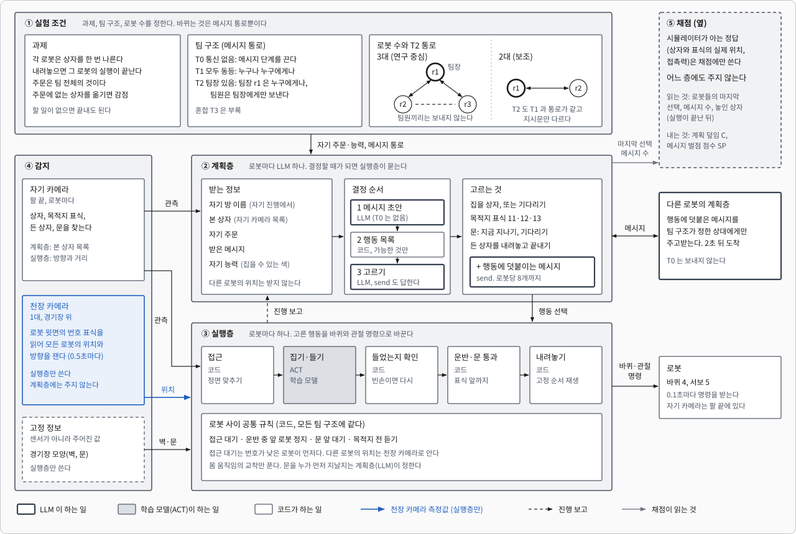

# 전체 구조

LLM 이 계획하고, 고른 행동을 학습 모델(ACT)이나 코드가 실행한다. 아래 상위 블록 넷과 옆의 채점으로 나눠 읽는다. 블록마다 하는 일, 들어오는 것과 나가는 것, 세부 문서를 적었다. 2026-11-16 동결 직전 설계 기준이다.

  

## 1. 실험 조건 (①)

과제, 팀 구조, 로봇 수를 정한다. 팀 구조는 메시지가 오가는 통로만 바꾸고, 로봇의 행동과 실행은 모든 구조에서 같다.

| 항목 | 내용 |
|---|---|
| 과제 | 각 로봇은 상자를 한 번 나른다. 내려놓으면 그 로봇의 실행이 끝난다. 주문은 팀 전체의 것이고, 주문에 없는 상자를 옮기면 감점이다 |
| 팀 구조 | T0 통신 없음, T1 모두 동등, T2 팀장 있음(지시문으로 한 로봇을 팀장으로 지정, 기본 r1). 혼합 T3 은 부록 |
| 로봇 수 | 연구 중심은 3대(r1 팀장, r2, r3). 2대는 보조다. 3대의 T2 는 팀원이 팀장에게만, 팀장은 누구에게나 보낸다. 2대의 T2 는 T1 과 통로가 같고 지시문만 다르다 |

| 들어오는 것 | 나가는 것 |
|---|---|
| 장면(상자, 주문), 팀 구조 지시문 | 로봇마다 자기 주문과 능력, 메시지 통로 |

세부: [작업 계획](plan.md), [연구 설계](research_design.md), 팀 구조별 전달은 [계획기와 메시지 규칙 4절](planning_messages.md#4-메시지-규칙)

## 2. 계획층 (②)

로봇마다 LLM 하나가 있다. 결정할 때가 되면 실행층이 묻고, LLM 은 지금 가능한 행동 목록에서 하나를 고르며 그 행동에 메시지를 덧붙일지도 답한다. 다른 로봇의 위치와 주문은 받지 않고 메시지로만 안다.

| 들어오는 것 | 나가는 것 |
|---|---|
| 자기 방 이름(자기 진행에서, 천장 카메라가 아니다), 본 상자(자기 카메라 목록), 자기 주문, 받은 메시지, 자기 능력 | 고른 행동(집을 상자, 목적지 표식, 문 지금·기다림, 내려놓고 끝내기, 기다리기), 행동에 덧붙이는 메시지 |

세부: [계획기와 메시지 규칙](planning_messages.md)

## 3. 실행층 (③)

고른 행동을 바퀴와 관절 명령으로 바꾸고 결과를 계획층에 보고한다. ACT 는 집기와 들기를 하고, 접근, 들었는지 확인, 운반, 문 통과, 내려놓기는 코드가 한다. 로봇 사이 공통 규칙은 몸 움직임의 교착만 풀고, 문을 누가 먼저 지날지는 계획층이 정한다.

| 들어오는 것 | 나가는 것 |
|---|---|
| 고른 행동, 자기 카메라 관측, 천장 카메라 위치, 경기장 모양(벽, 문) | 바퀴·관절 명령(0.1초마다), 진행 보고(집기 실패, 문 통과, 운반 끝) |

세부: [실행층](execution_layer.md), 로봇 한 대의 단계는 [Solo 구조와 모델](solo_architecture.md)

## 4. 감지 (④)

자기 카메라(로봇마다 팔 끝)가 상자, 문, 목적지 표식, 든 상자를 찾는다. 천장 카메라 1대가 로봇 윗면의 번호 표식을 읽어 모든 로봇의 위치와 방향을 잰다(0.5초마다). 이 위치는 실행층만 쓴다. 시뮬레이션도 정답 좌표를 쓰지 않고 천장 카메라 화면을 그려서 같은 방법으로 읽는다. 벽의 번호 표식은 목적지 표시이고 위치를 맞추는 데 쓰지 않는다. 경기장 모양(벽, 문)은 센서가 아니라 주어진 고정 정보이고, 이 블록에 두며 실행층만 쓴다.

| 들어오는 것 | 나가는 것 |
|---|---|
| 자기 카메라 화면, 천장 카메라 화면(로봇 윗면 번호 표식), 고정 정보(경기장 모양) | 본 상자 목록(계획층과 실행층), 표식 번호와 방향(실행층), 모든 로봇의 위치와 방향(실행층만), 경기장 모양(실행층만) |

세부: [실행층 4절](execution_layer.md#4-위치와-정보의-경계)

## 5. 채점 (⑤, 옆)

상자의 실제 위치, 목적지 표식의 위치, 접촉력은 시뮬레이터가 채점에만 쓴다. 어느 층에도 주지 않는다.

| 들어오는 것 | 나가는 것 |
|---|---|
| 로봇들의 마지막 선택, 보낸 메시지 수, 놓인 상자(실행 뒤에 읽는다), 시뮬레이터의 정답 좌표 | 계획 덮임 C, 메시지 벌점 점수 SP, 보조로 물리 성공 |

세부: [연구 설계 11절](research_design.md#11-이번-제출의-동결-설계-2026-11-16)

## 블록 사이의 데이터 흐름

| 보내는 쪽 | 받는 쪽 | 주고받는 것 |
|---|---|---|
| ① 실험 조건 | ② 계획층 | 자기 주문과 능력, 팀 구조 지시문 |
| ④ 자기 카메라 | ② 계획층 | 관측: 본 상자 목록(색, 거리) |
| ④ 자기 카메라 | ③ 실행층 | 관측: 상자, 문, 표식, 든 상자의 방향과 거리 |
| ④ 천장 카메라 | ③ 실행층 | 위치: 모든 로봇의 위치와 방향 |
| ④ 고정 정보 | ③ 실행층 | 경기장 모양(벽, 문) |
| ② 계획층 | ③ 실행층 | 행동 선택 |
| ③ 실행층 | ② 계획층 | 진행 보고: 집기 실패, 문 통과, 운반 끝, 지금 있는 방 |
| ② 계획층 | 다른 로봇의 ② | 메시지: 행동에 덧붙임, 팀 구조가 정한 상대, 2초 뒤 도착 |
| ③ 실행층 | 로봇 | 바퀴·관절 명령: 바퀴 4, 서보 5, 0.1초마다 |
| ②, ③ | ⑤ 채점 | 마지막 선택, 메시지 수, 놓인 상자 |
| 시뮬레이터 | ⑤ 채점만 | 정답 좌표. 다른 층으로 가지 않는다 |

원칙: LLM 판단에 들어가지 않고 동작 코드에만 쓰이는 정보는 준다(2026-11-15). 그래서 경기장 모양과 로봇 위치는 실행층에 주고 계획층은 받지 않는다. 목적지 표식의 위치는 실행층에도 주지 않고, 로봇이 자기 카메라로 번호를 읽어 찾는다.

## 코드

| 부분 | 위치 |
|---|---|
| 찾기, 다가가기, 정면 맞추기, ACT 집기, 내려놓기 | [`solo_pipeline/`](../solo_pipeline/README.md) |
| 든 채 이동, 장소 기억, 번호 표식, 천장 카메라 | [`harness/`](../harness) 의 `carry_nav_v1.py`, `place_memory_v1.py`, `robot_tags_v1.py`, `overhead_v1.py`, `drive_record_v1.py` |
| 여러 로봇 실행, 계획기 연결 | 실행기 [`scripts/run_team_carry.py`](../scripts/run_team_carry.py), 계획기 [`team/`](../team/README.md) |
| 분석, 묶음 실행, 장면, 사전 등록 | [`analysis/`](../analysis/RUNBOOK.md), [`batch/`](../batch/README.md), [`scenes/`](../scenes/SCENES3.md), [`prereg/`](../prereg/PREREG.md) |

`solo_pipeline/` 은 Solo 평가에 쓴 코드를 그대로 모은 기록이다. 팀 실행에 쓰는 판은 `harness/`, `scripts/` 에 있고 같은 이름 파일은 그 뒤에 고친 것이다.

무엇이 돌아가는지는 [지금 하는 일](current_status.md)에 있다. 수치와 날마다의 진행은 팀 Linear(UGRP 팀)에 적는다. 계획기가 따른 선행 연구는 [계획기와 메시지 규칙 6절](planning_messages.md#6-참고한-연구)에 있다.
