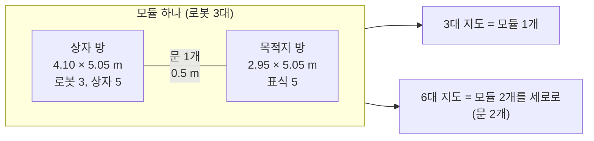
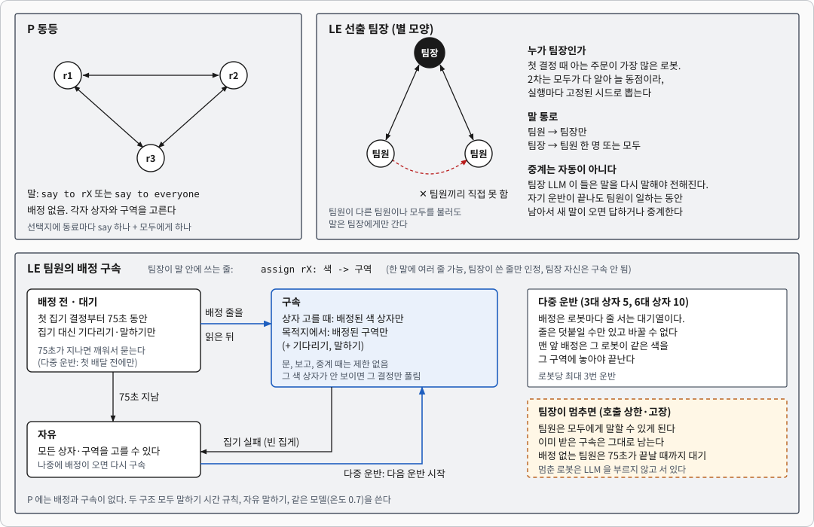
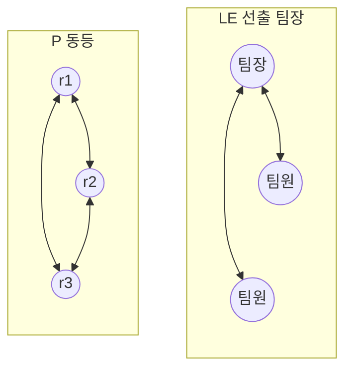
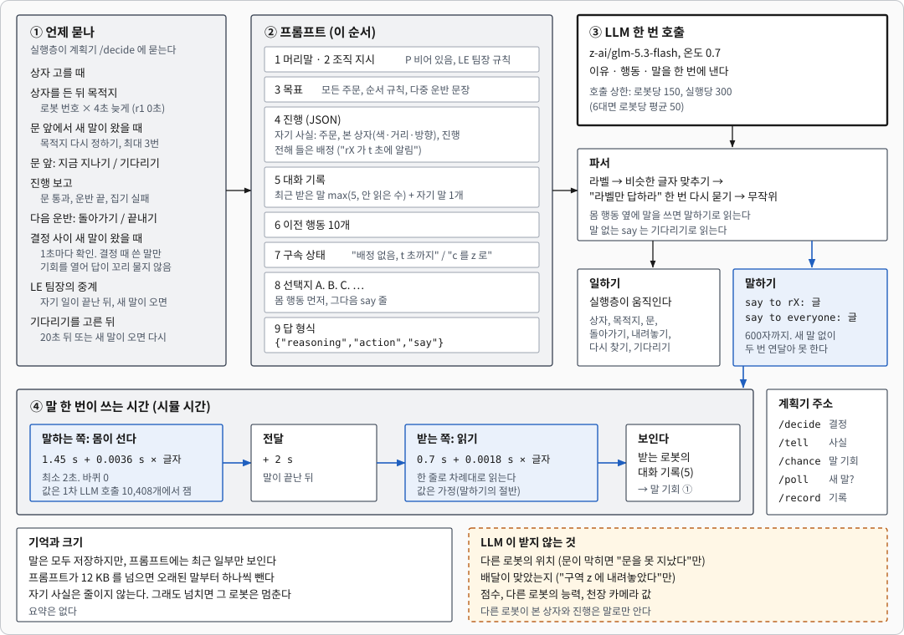
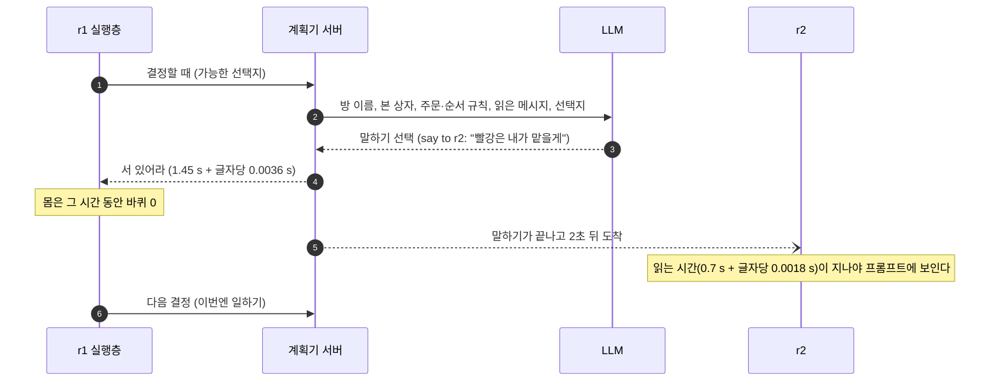
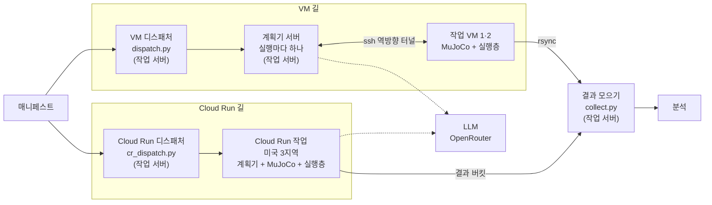
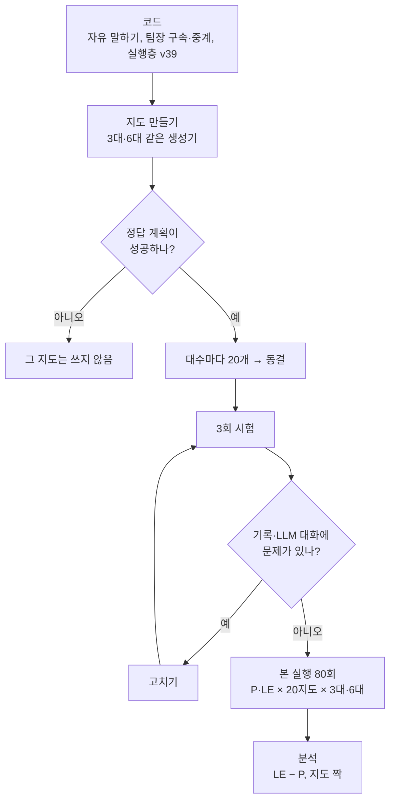

# 전체 구조

로봇 여러 대가 상자를 하나씩 맡아 다른 방의 목적지 표식 앞까지 나른다. 로봇마다 LLM 하나가 무엇을 할지 고르고, 고른 행동은 학습 모델(ACT)과 코드가 바퀴·관절 명령으로 바꾼다. 실험에서 바꾸는 것은 팀 구조(누가 누구에게 말하고 누구의 배정을 따르는가)와 로봇 수뿐이고, 몸을 움직이는 실행층은 모든 조건에서 같다.

이 문서는 **2차 실험(계획서 7판, 2026-11-17)** 기준이다. 처음 보는 사람은 1절 그림과 9절 용어표부터 읽으면 된다.

## 실험 한눈에

| 항목 | 2차 실험 (지금) | 1차 실험 (끝남, 참고) |
|---|---|---|
| 질문 | 선출 팀장 구조(LE)와 동등 구조(P) 중 어느 쪽이 협동 과제를 잘하는가, 로봇이 3대에서 6대로 늘면 순위가 바뀌는가 | 통신하면 나아지는가 |
| 로봇 | 3대(상자 5개), 6대(상자 10개). 상자가 로봇보다 많아 여러 번 나른다 | 3대, 로봇마다 상자 하나 |
| 팀 구조 | P 동등, LE 선출 팀장 | T0 통신 없음, T1 동등, T2 팀장 r1 고정 |
| 말하기 | 결정마다 "일하기"와 "말하기" 중 하나를 고른다. 말하면 시뮬 시간을 쓴다. 메시지 수 제한 없음 | 행동에 메시지를 덧붙임, 로봇당 8개까지 |
| 과제 | 한 종류: 모든 로봇이 모든 주문과 순서 규칙을 안다 | 로봇마다 아는 주문이 다름 |
| 지도 | 생성기 하나로 3대·6대 지도를 만들고, 정답 계획이 성공한 지도만 쓴다 | 손으로 고른 장면 30개 |
| 실행 수 | 2구조 × 지도 20개 × 2대수 = 80, 시험 최대 12, 약 92회 | 180 (+ 정답 계획 30) |
| 주 지표 | 배달 비율 R0, 완료 시간, 순서 위반 | 주문 달성률 R |
| 결과 | 아직 없음 | R: T0 38.3%, T1 84.4%, T2 75.0% (정답 계획 91.1%) |

통신 대 무통신은 1차에서 답했으므로(통신 쪽이 크게 높음) 2차에는 통신 없는 조건이 없다.

## 1. 한 장으로 보기

  

| 블록 | 한 줄 설명 |
|---|---|
| ① 실험 조건 | 과제(모든 로봇이 모든 주문·순서 규칙을 앎), 팀 구조(P 또는 LE), 지도(3대 또는 6대)를 정한다 |
| ② 계획층 | 로봇마다 LLM 하나. 결정할 때마다 코드가 만든 선택지에서 일하기 또는 말하기를 고른다 |
| ③ 실행층 | 고른 행동을 0.1초마다 바퀴·관절 명령으로 바꾼다. 집기·들기는 ACT, 나머지는 코드. v38 + v39 |
| ④ 감지 | 자기 카메라(팔 끝)는 상자·문·표식을 본다. 천장 카메라는 0.5초마다 모든 로봇의 위치를 재고, 실행층만 쓴다 |
| ⑤ 채점 | 실행이 끝난 뒤 시뮬레이터의 정답 좌표로 놓인 상자와 놓인 순서를 센다. 어느 층에도 정답을 주지 않는다 |

### 실물에서 연결한 감지 경로

ras1의 자기 카메라로 초록 벽의 바닥 접점과 점박이 바닥 특징점을 읽고, 짧은 차체 왕복 중 상대 이동을 추정했다. 이 관측은 실행층의 `PlaceMemory`에 들어간다. `CarryNav`는 경기장 벽 정보가 주어지지 않은 경우 이 기억에서 주변 벽 점을 읽는다. 적용 범위는 고정 카메라 자세에서의 단일 로봇 지역 관측이다. [실행층의 Sim2Real 연결](execution_layer.md#실물-관측-연결)

### 누가 무엇을 아나

| 정보 | 실행층(코드, ACT) | LLM 계획기 |
|---|---|---|
| 주문과 순서 규칙 | | 모든 로봇이 전부 안다(실험자가 정보를 나눠 주지 않는다) |
| 상자 | 자기 카메라 | 자기 카메라로 본 목록(색, 거리). 다른 로봇이 본 것은 말로만 안다 |
| 자기 위치·방향 | 천장 카메라 측정값 | 방 이름만("상자 방" 또는 문을 지난 뒤 "목적지 방") |
| 다른 로봇의 위치·진행 | 천장 카메라 측정값(양보, 앞 로봇 정지에 씀) | 받지 않는다. 말로만 안다(누가 앞 주문을 놓았는지도) |
| 벽, 문 위치 | 고정 정보로 받는다 | 받지 않는다 |
| 목적지 표식 위치 | 받지 않는다. 자기 카메라로 번호를 읽어 찾는다 | 받지 않는다 |

## 2. 과제와 지도

**과제(한 종류).** 지도에는 상자(빨강·파랑)와 목적지 표식이 3대는 5개, 6대는 10개 있고, 주문도 상자 수만큼 있다("빨간 상자 하나를 표식 12 로"). 모든 로봇이 모든 주문을 알고, 순서 규칙("주문 A 가 먼저 놓여야 주문 B 를 인정")도 안다. 규칙은 로봇 3대마다 하나이고, 두 주문은 색이 다르다. 상자가 로봇보다 많으므로 로봇은 하나를 놓은 뒤 돌아와 다시 나른다(2026-11-18 결정). 협동이 필요한 이유는 과제 구조에서만 온다.

| 협동이 필요한 이유 | 내용 |
|---|---|
| 순서 | 앞 주문과 뒤 주문은 다른 로봇이 나르므로, 뒤 로봇은 앞 로봇이 끝났는지 말로 들어야 한다 |
| 나누기 | 같은 색 상자와 주문이 여럿이라 누가 무엇을 맡을지 정해야 한다. 안 정하면 같은 상자에 몰리거나 같은 주문을 겹쳐 나른다 |
| 부분 관측 | 각 로봇은 자기 카메라로 본 상자만 안다 |

**지도.** 생성기 하나(`gen_p2.py`)가 3대·6대 지도를 같은 규칙으로 만든다.

- 방 크기는 1개 상자 판 값이고, 다중 운반 생성기 수정이 끝나면 확정한다. 로봇당 면적과 문 하나당 로봇 수(3)가 3대와 6대에서 똑같다. 시드는 상자·로봇·표식의 좌표와 어느 주문이 어디 있는지만 바꾸고 배치 규칙은 바꾸지 않는다.
- 정답 계획은 같은 색 상자를 로봇끼리 나누도록 짜여, 로봇 대부분은 가장 가까운 상자가 아닌 상자를 맡는다. 그래서 "다들 가장 가까운 상자를 집자"로 하면 같은 상자에 몰리는 지도가 3대 약 29%였다(1개 상자 판 생성기 확인 값). 다중 운반·6대 판 값은 생성기를 고친 뒤 다시 잰다.
- **지도 확인(본 실험과 별개의 준비 작업):** 지도마다 LLM 없이 정답 계획을 한 번 돌려, 모든 주문이 순서 위반 없이 900초 안에 놓인 지도만 쓴다. 시드 번호 순서로 통과한 첫 20개를 대수마다 쓴다(후보 1~24, 예비 25~40).

## 3. 팀 구조

   구역 을 팀원이 읽으면 그 색 상자와 그 구역만 고를 수 있다. 배정 전에는 첫 집기 결정부터 75초 동안 기다리기와 말하기만 할 수 있다. 집기에 실패하면 풀리고, 다중 운반에서는 다음 운반에서 다시 묶인다. 배정은 로봇마다 줄 서는 대기열이다. 팀장이 멈추면 팀원은 모두에게 말할 수 있다" width="960">

그림은 2차 계획기 코드(2026-11-18 기준)를 읽고 그렸다.

| | P 동등 | LE 선출 팀장 |
|---|---|---|
| 누구에게 말하나 | 누구나 특정 로봇 하나에게, 또는 모두에게 | 팀원은 팀장에게만. 팀장은 팀원 한 명에게, 또는 모두에게. 팀원끼리 직접 말할 수 없다(Chen 등 HMAS-2 의 중앙형과 같은 모양) |
| 배정 | 없다. 각자 정한다 | 팀장이 말 안에 `assign rX: 색 -> 구역` 을 쓴다. 배정을 읽은 팀원은 그 색 상자와 그 구역만 고를 수 있다(구속) |
| 배정이 안 오면 | | 팀원은 첫 집기 결정부터 75초 동안 기다리거나 말하기만 할 수 있고, 그 뒤 풀린다. 집기에 실패하면(빈 집게) 구속도 풀린다. 다중 운반에서는 다음 운반을 시작할 때 다시 묶인다 |
| 팀장은 누구 | | 시작 때 아는 주문 수가 가장 많은 로봇. 이 과제에서는 모두 같으므로 실행마다 고정된 시드로 무작위로 뽑는다. 실험자가 정하지 않는다 |
| 팀장이 먼저 끝나면 | | 자기 운반이 끝난 뒤에도 팀원이 하나라도 일하는 동안 대화에 남아 질문에 답하고 중계한다 |
| 팀장이 멈추면 | | 호출 상한 등으로 팀장이 멈추면, 팀원은 남은 모두에게 말할 수 있게 된다 |

## 4. 한 번의 결정과 말하기

  

로봇은 결정할 때가 되면(상자를 고를 때, 문 앞, 목적지 앞, 진행을 보고할 때, 새 메시지를 받았을 때) 계획기에 묻는다. LLM 은 코드가 만든 선택지에서 하나를 고른다. 선택지는 몸 행동과 말하기로 이루어진다.

| 선택지 | 내용 |
|---|---|
| 몸 행동 | 집을 상자, 목적지 표식, 문을 지금 지날지 기다릴지, 머물기(새 메시지가 오거나 약 20초 뒤 다시 물을 때까지), 다시 찾기(둘러보고 상자를 새로 찾기, v39), 든 상자를 내려놓고 끝내기 |
| 말하기 | `say to rX: 글` 또는 `say to everyone: 글`, 600자까지. LE 팀원에게는 `say to 팀장` 하나만 있다 |

말하기는 공짜가 아니다. 이번 결정을 말하는 데 쓰고, 그동안 몸은 서 있다.

- 말하는 시간 값은 1차 실험의 LLM 호출 10,408개에서 잰 지연이다. 읽는 시간 값은 측정이 아니라 가정(말하기의 절반)이다.
- 직전 결정에서 자기가 말했고 그 뒤 새 메시지가 없으면 말하기 선택지를 빼서 혼자 계속 말하지 않게 한다(CoELA 와 같은 규칙).
- 프롬프트가 12 KB(`max_input_bytes`, 기본값)를 넘으면 오래된 메시지부터 하나씩 빼고 "(N older messages not shown)" 한 줄을 넣는다. 자기 사실(own_facts)은 줄이지 않아, 그래도 넘치면 그 로봇은 멈춘다.

계획기 서버의 주소는 `/decide`(결정), `/poll`(새 메시지가 왔나), `/tell`(진행 보고), `/record`(기록 저장)다. 실행층 쪽 연결 코드는 `scripts/run_team_carry.py` 의 `RemoteBrain` 이다. 정답 계획(`--fixed oracle`)은 계획기를 띄우지 않고 실행층 안의 고정 계획(FixedPlan)이 상자 좌표와 순서를 지켜 배정한다.

## 5. 실제로 어디서 도나 (실행 인프라)

실행 하나 = 지도 하나 × 팀 구조 하나다. 돌릴 실행 목록(매니페스트) 한 줄이 실행 하나다. 2차 실험은 주로 Cloud Run 에서 돈다.

| 길 | 계획기는 어디서 | 시뮬레이션은 어디서 | 동시 실행 | 결과가 오는 길 |
|---|---|---|---|---|
| VM | 작업 서버. 실행마다 `brain_server.py` 하나를 띄우고 ssh 역방향 터널로 VM 에 이어 준다 | 작업 VM 1·2 | VM1 최대 5, VM2 최대 2 | `collect.py` 가 rsync 로 가져온다 |
| Cloud Run | 같은 컨테이너 안에서 `brain_server.py` 를 띄운다 | 같은 컨테이너 | 지역당 8 × 3지역 | 결과 버킷에 올리고 `cr_dispatch.py fetch` 가 가져온다 |

- 모델: `z-ai/glm-5.3-flash`, temperature 0.7(1차와 같음).
- 모델 키는 VM 에 두지 않는다. VM 길에서는 작업 서버의 계획기만 LLM 을 부르고, Cloud Run 길에서는 비밀 저장소에서 그 컨테이너에만 넣는다.
- 지출 가드: 계획기가 시작할 때 키 사용량을 확인하고 정한 상한을 넘으면 멈춘다. 호출 상한은 로봇당 150, 실행당 300.
- 시간 상한: 시뮬레이션 시간 900초. 상한에 걸린 실행은 `cap_end` 로 따로 표시한다.
- 고장 처리: 실행 고장은 한 번 다시 돈다(`-retry1`, `-rr1`). 점수가 나쁘다는 이유로는 다시 돌지 않는다.

## 6. 진행 순서

- 새 기능은 모두 계획기와 실행층의 스위치다. 스위치를 모두 끄면 1차 판(v38)과 프롬프트·명령이 바이트까지 같은지 확인한다.
- 3회 시험에서 보는 것: 파서가 답을 못 읽은 곳, 멈춘 로봇, 잘못 간 메시지, 말하기 시간이 몸에 실제로 걸렸는지, 팀장 배정이 전달되고 지켜졌는지, 순서 소식("앞 주문을 놓았다")이 뒤 로봇에 닿았는지.
- 본 실행은 계획서에 대한 결정 뒤에만 시작한다.

## 7. 채점

실행이 끝난 뒤 시뮬레이터의 정답 좌표로 센다. 같은 지도에서 LE 와 P 를 짝지어 `d = LE − P` 를 지도 단위로 보고, 장면 부트스트랩 95% 구간과 부호 검정으로 보고한다.

| 지표 | 뜻 |
|---|---|
| R0 배달 비율 | 맞는 표식에 놓인 주문 ÷ 주문 수. 엉뚱한 곳 감점 없음. 순서 규칙을 어긴 뒤 주문은 채워지지 않은 것으로 센다 |
| 완료 시간 | 마지막 로봇이 끝난 시뮬 시각. 못 끝내면 상한 900초 |
| 순서 위반 | 뒤 주문이 앞 주문보다 먼저 놓였는가 |
| 함께 보고 | 같은 정답 계획 대비 값, 같은 상자를 두 로봇이 노린 횟수, 말 수와 글자 수, 팀장 수신·송신 부하, 배정 도착 시각, LLM 호출 수와 비용 |

## 8. 실행층 판

실행층은 모든 조건에서 같은 판을 쓴다. 판 이름과 코드 해시를 실행 기록마다 남긴다.

| 판 | 바뀐 것 | 쓰인 곳 |
|---|---|---|
| v38 | 목적지 표식이 앞 로봇에 가려 안 보이면 옆으로 비켜 다시 둘러본다 | 1차 본 실험 180회 |
| v39 | 들기 확인 오판 고침(든 상자가 카메라 모서리에 걸린 경우), 다시 찾기 선택지, 고장 난 로봇의 몸 정지, 말하는 동안 몸 세우기. 모두 스위치이고 끄면 v38 과 같다 | 2차 |
| 2차 합본 | v39 + 생성 지도(최대 6대, 다중 운반, 표식 사전 250개, 정답 계획의 순서 대기) + 팀장 중계 경로 | 2차 지도 확인과 본 실행 |

## 9. 용어

| 용어 | 뜻 |
|---|---|
| P, LE | 2차의 팀 구조. 동등(peer), 선출 팀장(leader elected) |
| T0, T1, T2 | 1차의 팀 구조. 통신 없음, 동등, 팀장 r1 고정 |
| 구속 배정 | 팀장이 준 (색, 구역)을 받은 팀원은 그것만 고를 수 있다 |
| 중계 | LE 에서 팀원끼리의 말은 팀장을 거쳐야 하므로, 팀장이 받은 내용을 다른 팀원에게 전한다 |
| HMAS-2 | 팀장형 대화를 따른 선행 연구(Chen 등). 팀장이 계획을 내고 팀원이 의견을 낸다 |
| CoELA | 말하기를 행동 선택지 하나로 두는 방식을 따른 선행 연구 |
| 순서 규칙 | "주문 A 가 먼저 놓여야 주문 B 를 인정" |
| 모듈 | 로봇 3대, 문 1개, 상자 방과 목적지 방으로 된 지도 단위. 3대는 1개, 6대는 2개 |
| 정답 계획, FixedPlan | LLM 대신 정답 배정을 주는 고정 계획. 지도 확인과 정답 대비 비교에 쓴다 |
| ACT | 사람 시연을 흉내 내는 학습 모델(Action Chunking Transformer). 집기와 들기만 한다 |
| 계획기 | LLM 을 부르는 서버(`brain_server.py`). 한 실행의 로봇 모두가 함께 쓰고 로봇마다 따로 묻는다 |
| 실행층 | 고른 행동을 몸 움직임으로 바꾸는 코드와 ACT |
| 천장 카메라 | 경기장 위 카메라. 로봇 윗면 번호 표식을 읽어 위치를 잰다. 실행층만 쓴다 |
| 동결 | 코드와 문서·지도의 해시를 기록하고 더 고치지 않는 것 |
| 매니페스트 | 돌릴 실행 목록 CSV. 한 줄이 실행 하나 |
| 디스패처 | 매니페스트를 읽어 빈 자리에 실행을 띄우고 끝난 것을 확인하는 프로그램 |
| R0, R | 배달 비율(감점 없음), 1차의 주문 달성률(엉뚱한 곳 감점) |
| `cap_end` | 시간 상한에 걸려 끝난 실행 |

## 10. 알려진 어긋남

이 문서를 쓰며 찾은 것이다. 처리 방법은 [구조 개선 제안](architecture_proposals.md)에 있다.

- 2차 계획기(자유 말하기, 선출, 구속 배정, 팀장 중계), 실행층 v39·2차 합본, 지도 생성기, Cloud Run 코드는 작업 서버에만 있다. 저장소 `team/`, `harness/`, `scripts/` 는 1차 판(실행층은 v37)이다.
- 저장소 `prereg/` 에는 1차의 D12~D14 와 2차 사전 등록이 없다.
- [계획기와 메시지 규칙](planning_messages.md), [연구 설계 11절](research_design.md#11-이번-제출의-동결-설계-2026-11-16)은 1차 기준이다.

## 코드 위치

| 부분 | 위치 |
|---|---|
| 찾기, 다가가기, 정면 맞추기, ACT 집기, 내려놓기 | [`solo_pipeline/`](../solo_pipeline/README.md) |
| 든 채 이동, 장소 기억, 번호 표식, 천장 카메라 | [`harness/`](../harness) 의 `carry_nav_v1.py`, `place_memory_v1.py`, `robot_tags_v1.py`, `overhead_v1.py`, `drive_record_v1.py` |
| 여러 로봇 실행, 계획기 연결 | 실행기 [`scripts/run_team_carry.py`](../scripts/run_team_carry.py), 계획기 [`team/`](../team/README.md)(둘 다 1차 판) |
| 묶음 실행, 분석, 장면, 사전 등록 | [`batch/`](../batch/README.md), [`analysis/`](../analysis/RUNBOOK.md), [`scenes/`](../scenes/SCENES3.md)(1차 장면), [`prereg/`](../prereg/PREREG.md) |

수치와 날마다의 진행은 팀 Linear(UGRP 팀)에 적는다.
