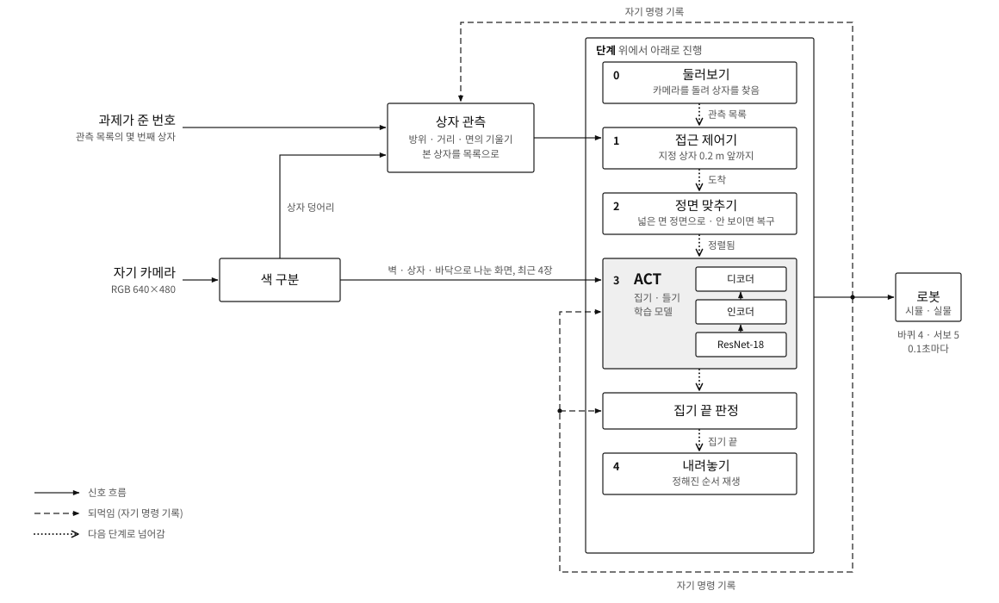

# Solo 구조와 모델

로봇 한 대가 자기 카메라만 보고 상자를 찾아 집고 내려놓는 구조다. 2026-11-14 기준.

  

## 1. 한눈에

| 단계 | 누가 | 하는 일 |
|---|---|---|
| 0 둘러보기 | 코드 | 제자리에서 카메라를 좌우로 돌려 빨강·파랑 상자를 찾고, 상자마다 방위와 거리를 추정해 관측 목록을 만든다 |
| 1 접근 | 코드 | 관측 목록에서 지정된 상자로 다가가 0.2 m 앞에 선다 |
| 2 정면 맞추기 | 코드 | 상자의 넓은 면 정면에 서도록 상자 둘레를 돌고, 가운데와 거리를 맞춘다. 상자가 화면에서 잘렸으면 먼저 다시 보이게 한다 |
| 3 집기·들기 | 학습 모델 (ACT) | 화면을 보고 팔과 집게를 움직여 상자를 집어 든다 |
| 집기 끝 판정 | 코드 | 자기가 내보낸 명령 기록으로 집기가 끝났는지 판정한다 |
| 4 내려놓기 | 코드 | 정해진 순서(전진, 팔 내림, 집게 열기, 후진)를 재생한다 |

로봇이 쓰는 것은 자기 카메라 화면, 자기가 내보낸 명령의 기록, 그리고 과제가 준 번호 하나(관측 목록의 몇 번째 상자인지)뿐이다. 지도, 벽 표식, 천장 카메라, 상자와 로봇의 실제 위치는 쓰지 않는다.

## 2. 입력과 출력

| 항목 | 내용 |
|---|---|
| 카메라 | 팔 끝 카메라 1대, RGB 640×480 |
| 과제 입력 | 관측 목록의 번호 하나. 시뮬레이션에서는 채점 쪽이 지정 상자와 목록을 맞춰 번호만 넘긴다. 나중에는 계획(LLM)이 이 목록에서 고른다 |
| 출력 | 0.1초마다 바퀴 4개(속도, 펄스 길이)와 서보 5개(팔, 집게, 카메라 방향) |
| 바퀴 명령 | 속도는 0 또는 크기 0.31–0.40, 펄스 길이는 0–0.15초 |
| 겉모습 | 벽은 짙은 초록, 상자는 빨강과 파랑 |

자세한 형식은 [로봇 입출력 규격](sim2real/02_robot_interface.md)에 있다.

## 3. 단계별 설명

### 0 둘러보기
바퀴는 멈춘 채 카메라 방향 서보만 13번 바꾼다. 방향마다 0.5초 기다린 뒤 화면 3장을 본다(합쳐서 약 10초). 화면에서 빨강·파랑 덩어리를 찾고, 덩어리 아래쪽 윤곽을 카메라 명령 자세로 바닥에 투영해 방위와 거리를 구한다. 여러 장에서 본 같은 상자는 하나로 합친다. 결과는 `종류, 방위, 거리`의 목록이다.

### 1 접근
지정된 항목의 방위와 거리에서 시작한다. 이후에는 화면의 상자 덩어리를 따라가며 짧은 바퀴 펄스로 다가간다. 가까워지면 카메라를 아래로 내린다.

### 2 정면 맞추기
교사 시연은 항상 상자의 넓은 면(폭 40 mm)을 정면으로 보고 집었고, ACT 는 그 화면으로 배웠다. 그래서 집기 전에 그 자세를 만든다.

- **면의 기울기 읽기**: 상자 덩어리의 아래쪽 윤곽을 바닥에 투영하면 상자 밑변이 한두 개의 직선으로 나온다. 긴 변의 방향이 로봇 정면 기준 면의 기울기다. 90° 주기라 가장 가까운 면까지의 기울기를 준다.
- **돌아 맞추기**: 옆걸음(메카넘 바퀴)과 제자리 회전을 짧은 펄스로 번갈아 내어 기울기를 줄인다. 조금 움직이고 멈춰서 다시 재는 식이다. 움직이지 않는 펄스는 길이를 늘리고 지나치면 줄인다.
- **면 종류 가리기**: 정면에 섰을 때 보이는 긴 변의 길이로 넓은 면과 좁은 면(34 mm)을 가린다. 좁은 면이면 상자 둘레를 4분의 1 바퀴 더 돈다.
- **복구**: 접근이 상자가 잘린 채 끝났으면, 색이 치우친 쪽으로 돌고, 카메라를 끝까지 내리고, 그래도 안 보이면 뒤로 물러난다.
- **끝 조건**: 기울기 4° 이내, 상자가 화면 가운데(±30화소), 거리 추정 0.196–0.210 m.

### 3 집기·들기 (ACT)
5절의 모델이 0.1초마다 동작 8개 묶음을 낸다. 넘겨줄 때 모델에 들어가는 로봇 자신의 시계 두 개(기술을 시작한 뒤 흐른 시간, 팔 자세 명령이 바뀐 뒤 흐른 시간)를 다시 맞춘다. 교사 시연에는 둘러보기와 정면 맞추기가 없어서, 그대로 두면 시계 값이 모델이 배운 범위를 벗어난다.

### 집기 끝 판정
바퀴 명령이 0 이고 팔 명령이 "든 자세"에 가까운 상태가 45행(4.5초) 이어지면 집기가 끝난 것으로 본다. 자기가 내보낸 명령만 본다. 접촉력이나 상자의 실제 위치는 보지 않는다.

### 4 내려놓기
교사 시연 140개에서 뽑은 87행짜리 고정 순서를 재생한다.

## 4. 왜 이렇게 나눴나

| 선택 | 이유 |
|---|---|
| 접근과 정면 맞추기는 코드 | 학습 모델 하나로 접근부터 시켰을 때 처음 보는 장면에서 실패했다. 코드는 실물에서 숫자 몇 개를 맞춰 고칠 수 있다 |
| 집기는 학습 모델 | 집게와 상자가 닿는 구간은 화면을 보고 고쳐 가는 쪽이 낫다 |
| 시작 정보를 화면에서 추정 | 로봇이 쓸 수 없는 정보(상자의 실제 위치)를 넣지 않기 위해서다 |
| 집기 끝은 명령 기록으로 판정 | 모델의 "끝남" 출력은 믿을 수 없었다 |

## 5. 모델 (ACT)

| 항목 | 값 |
|---|---|
| 종류 | Action Chunking Transformer (LeRobot 0.6.2 구현), VAE 사용 |
| 영상 뼈대 | ResNet-18 |
| Transformer | 인코더 4층, 디코더 1층, 차원 512, 머리 8개, 순방향 차원 3200 |
| VAE | 잠재 차원 32, 인코더 4층 |
| 크기 | 매개변수 약 5,180만 개, 가중치 파일 207 MB (32비트 실수) |
| 영상 입력 | 최근 화면 4장(5.2초, 1.5초, 0.5초 전과 지금)을 2×2 로 붙인 한 장. 붙이기 전에 화면을 벽·상자·바닥 등으로 색 구분한다 |
| 상태 입력 | 252차원: 최근에 내보낸 명령 16개, 자기 시계 2개, 과제 표시(기술, 상자 색, 역할) |
| 출력 | 14차원 × 8묶음: 바퀴 속도 4, 펄스 길이 4, 서보 5, 끝남 1 |
| 학습 자료 | 시뮬레이션 교사 시연 140개. 교사는 카메라에 보이는 것의 좌표만 쓴다 |
| 학습 | 앞선 체크포인트에서 이어서 4,000스텝, 학습률 5e-5, 배치 8 |
| 추론 시간 | CPU 에서 한 번에 중앙값 0.31초 |

가중치 파일은 저장소에 넣지 않는다. 팀 드라이브 `UGRP/models/solo-act-gseg-step4000/` 에 있다.

## 6. 확인한 범위

시뮬레이션(MuJoCo)에서 끝까지 돌린 결과다. "성공"은 집어서 3초 이상 안정적으로 들고, 떨어뜨리지 않고 같은 자리에 내려놓은 것이다.

| 장면 | 성공 | 비고 |
|---|---:|---|
| 개발 장면 20개 | 19/20 | 구조를 고치는 데 쓴 장면이라 낙관적이다. 실패 1건은 들고 있다가 떨어뜨림 |
| 평가 장면 12개 | 12/12 | 고치는 데 쓰지 않은 장면, 한 번 실행 |

조건과 한계:
- 평평한 바닥, 로봇에서 약 1 m 안의 상자, 한 장면에 상자 2–3개.
- 평가 전용 환경이 아니라 개발용 실행 환경에서 돌렸다.
- 상자를 든 채 이동하는 것과 목적지 구역에 놓는 것은 포함하지 않는다.
- 실물 로봇에서는 아직 해 보지 않았다.

## 7. 실물로 옮길 때 볼 것

| 부분 | 실물에서 맞춰야 하는 것 | 과제 카드 |
|---|---|---|
| 색 구분 | 조명에 따른 빨강·파랑·초록 범위 | [T01](sim2real/tasks/T01_environment.md) |
| 바닥 투영 | 카메라 내부 값, 팔 끝 카메라의 위치와 각도 | [T02](sim2real/tasks/T02_camera.md) |
| 바퀴 펄스 | 펄스 길이와 실제 이동량, 움직이기 시작하는 최소 펄스 | [T03](sim2real/tasks/T03_wheel_pulses.md) |
| 정면 맞추기 | 옆걸음 한 번에 도는 양, 미끄러짐 | [T08](sim2real/tasks/T08_approach.md) |
| ACT 집기 | 색 구분 화면이 시뮬레이션과 같은 모양으로 나오는지 | [T09](sim2real/tasks/T09_act_pick.md) |
| 내려놓기 | 고정 순서가 실물 팔에서 안전한지 | [T10](sim2real/tasks/T10_release.md) |

## 8. 코드와 가중치

- 코드: [`solo_pipeline/`](../solo_pipeline/README.md). 평가에 쓴 코드를 단계별 파일로 모았다. 조각을 잇는 법과 필요한 것이 그 폴더의 README 에 있다.
- 가중치: 저장소의 Releases 에 코드 묶음과 함께 붙어 있다.
