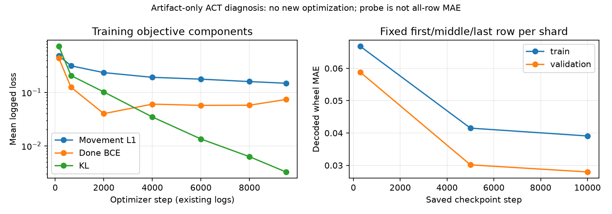

# actdiag — 기존 산출물만으로 본 ACT 진단

진단 완료, 학생 **NOT_READY 유지**. 새 학습/optimizer 0 step, 새 물리·시뮬레이터 렌더 0회, 제어기·모델 변경 0이다. GCP2 CPU/L4만 사용했고 warp3·reloc20은 정지하지 않았다.

핵심은 **명령을 유지해야 할 때 생기는 예측 잡음**이다. 빔 검증의 90.0%는 직전과 같은 휠 명령인데, 이 구간이 ACT 전체 휠 오차의 76.3%를 만든다. 반대로 명령 전환 구간에서는 ACT가 persistence보다 44.0% 낫다. 따라서 “전혀 학습하지 못했다” 또는 “영상에 정보가 없다”로 결론 내릴 수 없다.

## 1. 버그·학습 적합도

wheel MAE는 통계 정규화를 되돌린 발행 명령[-1,1] 단위다. pulse는 ms, PWM은 servo 단위다. 모두 배포와 같은 z=0·실제 명령 투영 후 h0이며, 원본 TRAIN/검증 행을 전부 사용했다.

|자료|N|ACT wheel MAE|persistence|배율|
|---|---:|---:|---:|---:|
|TRAIN 전체|60,023|0.046130|0.022883|2.02×|
|TRAIN 재추론 격자|7,952|0.043932|0.025583|1.72×|
|검증 전체|6,908|0.054589|0.023129|2.36×|
|검증 재추론 격자|913|0.053548|0.022809|2.35×|

TRAIN pulse MAE는 5.826 대 2.872ms, PWM은 22.331 대 7.970이다. 검증은 7.318 대 2.961ms, PWM 23.131 대 8.302다. **학습 자료에서도 기준선보다 나쁘므로 폐루프 분포 이동만의 문제가 아니다.** 재추론 격자는 저장된 교사 경로의 고정8틱 격자이며 새 폐루프 실험이 아니다.

|검사|확인한 수치·범위|
|---|---|
|행동 정규화/역정규화|TRAIN 고유 행에서 action mean/std 재계산 오차0; state std 최대5.55e-17; 왕복 오차1.11e-16|
|시간 정렬|66,931행 관측·라벨·context 불일치0; 유효 미래 표적512,349개가 모두 t+k에 일치|
|발행 명령 시각|66,931행 모두 직전 발행이 t−0.1초; 기록·제어10Hz 일치|
|이력 마스킹|16개 명령×wheel/pulse8 =128 scalar를 정규화 TRAIN 평균0으로 가림; 학습/배포 동일 함수, whole-history dropout0|
|청크/앙상블|chunk8, n_action_steps8, ensemble off; 0.8초 실행. 길이·주기 불일치 없음|
|로봇 분리|자기 RGB 참조267,724개 교차 로봇/미래 영상0; 소스는 로봇별 OwnHistory·ChunkExecutor를 따로 보유|
|이미지 변환|640×480→320×240 RGB bilinear, 4장 2×2 몽타주·ImageNet mean/std; 1,110개 온라인/학습 텐서가 바이트 일치|
|원 결과 재현|검증 wheel MAE 차이6.7e-11; float32 중간 저장 이후에도 보고 숫자 동일|
|패딩 손실|실제 pinned LeRobot이 유효 horizon×14로 나눔; 프로젝트 done L1 제거와 분모 일치|
|CVAE 잠재 변수|7단계×8행 고정56개에서 prior0.070320 / target-conditioned posterior0.070310; 파라미터·버퍼 변화0|

이 검사 범위에서는 정규화·시간 오프셋·마스크·이미지의 학습/추론 불일치를 발견하지 못했다. 설치 라이브러리 코드 해시와 범위는 `runtime-audit.json`에 있다. 과거 설치 파일 전체가 따로 봉인된 것은 아니므로 과거 환경 전체의 완전한 바이트 감사를 주장하지 않는다.

학습 로그의 movement L1 구간 평균은 301–1000 step 0.3142 → 3001–5000 0.1913 → 9001–10000 0.1482다. 당시 연속 검증 손실은 기록하지 않았다. 대신 저장 체크포인트를 같은 first/middle/last 표본(TRAIN996·검증114)에 재추론했다.

|step|TRAIN wheel MAE|검증 wheel MAE|
|---:|---:|---:|
|300|0.066770|0.058773|
|5,000|0.041506|0.030157|
|10,000|0.039089|0.027957|

이 표본은 마지막 행/완료를 많이 포함하므로 전체 MAE와 섞지 않는다. 두 곡선이 함께 낮아지고 전체 TRAIN도 높아, 전반적으로 과적합보다는 **아직 충분히 맞추지 못한 상태**다. 검색은 TRAIN0.05841 / 검증0.15204로 일반화 문제도 남는다.

10k×batch8은 입력 행1.33회분이다. 고정 sampler seed와 smoke→main 복원 순서를 재구성하면 직접 관측 입력으로 뽑힌 행44,072개, 미표집15,951개(26.6%)다. 이는 미래 청크의 표적으로 쓰인 횟수와 구분한다. 최종 optimizer RNG 파일을 새로 열어 확인한 수치는 아니다.

## 2. 행동 표현과 안정 구간

TRAIN wheel 값은 **−0.35 / 0 / +0.35의 3개**뿐이다. scalar의0 비율40.08%, 모든 휠0인 행39.71%다. 같은 부호 비제로 구간의 중앙은5틱(0.5초), 25.8%는1틱(0.1초)이다. 틱 내부의 실제 펄스폭은 별개로 중앙44.28ms, p10 17.88ms, p90 100ms다. μs 반올림에서도57,156종이므로 펄스폭 전체를 몇 개의 단순 on/off 토큰으로 볼 수는 없다.

|검증 층화|N|ACT|persistence|
|---|---:|---:|---:|
|휠 명령 전환|688|0.130139|0.232231|
|휠 명령 유지|6,220|0.046232|0|

연속 L1의 통계적 최적값은 조건부 **중앙값**이며, 무조건 산술평균으로 뭉개진다고 설명하면 부정확하다. 다만 여기서는 3값 wheel에 연속 회귀 출력·명령 투영을 붙여 안정 구간에서도 크기/부호 오차가 남는다. 같은 체크포인트 출력만 실제3값의 최근접 값으로 투영하면 **0.054589→0.042952(21.3% 개선)**다. pulse MAE는7.318→7.364ms로 약간 나빠져 전체 명령 개선이나 물리 성공을 뜻하지 않는다. 그 상태도 persistence보다1.86배 나쁘다.

done 정지를 무시한 검증 wheel MAE는0.054589로 동일했다. 연속 duty 대리값 wheel×pulse/0.1의 MAE도 ACT0.03411 대 persistence0.01450이라, 단순 단위 재표현만으로 기준선을 넘는다는 근거는 없다. 이는 발행 명령의 시간 평균 대리값이며 실제 속도/변위가 아니다.

## 3. 단순 기준선·관측 정보

모든 빔 참조는 TRAIN166시드, 질의는 검증19시드이며 시드 중복0이다. NN은 기존 ACT 영상 백본의 몽타주 오른쪽 아래 특징을 풀링한 RGB 특징만 사용하고 숫자 상태는 받지 않는다. 백본 수용 영역 때문에 과거 몽타주 영향도 포함될 수 있다. 역할은 허용된 고정 지시이며, 교사 단계는 명시한 oracle 진단에서만 썼다.

|빔 기준선|전체 wheel MAE|재추론 격자|
|---|---:|---:|
|persistence|0.023129|0.022809|
|단계별 TRAIN 평균, oracle·투영 전|0.136940|0.132090|
|단계별 TRAIN 중앙값, oracle|0.105626|0.101492|
|RGB 1-NN + 역할, 단계 입력 없음|0.050033|0.048877|
|RGB 1-NN + 역할 + oracle 단계|0.047157|0.045811|

평균을 실제 명령으로 투영해도0.120743이다. 전체에서는 어느 단순 기준선도 persistence를 이기지 못했다. 그러나 **정렬 구간의 단계 입력 없는 RGB NN은0.040762 대 persistence0.045359로10.1% 낫다**(ACT는0.074942). 따라서 관측에 행동 정보가 없다는 결론은 성립하지 않는다. 음성 결과는 표현·검색 방식·부분 관측·숨은 교사 상태도 설명 후보로 남긴다.

단독 과제는 ACT15/act16a의 기존 학생 방문자료를 따로 분석했다. 같은20회790개 재추론 라벨을 참조하고 새20회783개를 질의했다. 새20회에서 ACT0.180707 / persistence0.185564, 단계 평균0.232875 / 중앙값0.218247 / 같은 단계 RGB NN0.214336이다. 이 NN은16×12 RGB 대리 특징이므로 빔 백본 NN과 동일 모델 비교가 아니다. 새20회555/783행은 대상 비가시이며 ACT0.203072(가시228행0.126268)이다. 전체 유효 라벨12,776개 중 비가시8,853개다.

원래 단독 TRAIN 텐서는 금지된 gcp1 디스크에만 있어 **단독 train MAE는 계산 불가**다. 새 학습 금지에 따라 작은 MLP도 새로 맞추지 않았다. 동일 과제/입력용 기존 MLP 체크포인트는 확인되지 않았다. 두 과제의 수치는 서로 다른 상태 분포라 합산하지 않는다.

## 4. 공개 ACT와 실행 설정

[공식 설정·출처 대조표](sources.md)에 chunk100, KL10, temporal ensembling, 50시연 사례, 정규화와 우리의 차이를 정리했다. 100은 보편적인 권장 물리 시간이 아니다. ALOHA50Hz에서100은2초, 우리10Hz에서100은10초다. 현재 코드는 ImageNet 백본을 수동 초기화하므로 config의 pretrained=None만 보고 무작위 백본으로 판단하지 않았다.

같은 저장 교사 경로에서 배포 방식만 모사하면 chunk8 MAE0.053152, 매틱 h0 재추론0.054589, temporal ensemble0.01은0.051480이다. 앙상블은chunk8보다3.15% 나으나 persistence0.023129를 넘지 못한다. ±8틱 lag sweep의 최저는+1틱0.052203이며, t0 원본 정렬 감사는 모두 통과했다. 표본 N도 달라 이를 한 틱 버그의 증거로 삼지 않는다. 앙상블/lag 결과는 폐루프 성능이 아니다.

## 5. 가장 유력한 원인과 권고

1. **안정 명령 재현의 잡음과 이산 wheel 표현.** 전환을 어느 정도 예측하지만 유지 구간을 훼손한다. 빔은 wheel/pulse 이력을128개 모두 가리므로, 강한 persistence가 쓰는 허용 정보를 직접 잃는다. 마스크가 인과 원인이라는 재학습 A/B는 아직 없다. ACT는 유지하고 wheel3분류 + 조건부 연속 펄스폭/PWM, 또는 작은 자기 명령 요약을 쓰는 hold/change·잔차 표현을 같은 데이터로 비교할 가치가 가장 크다. 단순 출력3값 투영의 관측된 효과는21.3%이며, 새 head의 개선율이나 폐루프 성공률을 보장하지 않는다.
2. **학습량과 조건 사용·범위의 한계.** 입력1.33회분·26.6% 미표집, TRAIN 자체2.02× 열세와 감소 중인 곡선이 근거다. 역할 교환 시 접근493행 wheel 변화0.000613, 정렬161행0.001549로 작지만, RGB 교환은 각각0.292425/0.182932다. 기존 실패8329010은 반대 끝으로 접근했다. 또 TRAIN local≤0.8m와 평가 cold start0.5–2m가 다르다. 역할/거리 범위를 유지한 충분한 fit 비교가 필요하며, 역할 교환은 사후 OOD 민감도여서 인과 확정은 아니다.

소요 시간은 기존 같은 공유 L4 main9,700step/7,109.814초를 선형 환산하면 **20k step/조건 약4.07시간**, 두 조건 약8.14시간이다. 각 조건은8시간 VM 상한 안의 별도 유한 실행으로 해야 하며 크레딧 정지는 유지한다. 문서의100k를 그대로 쓰면 같은 부하 약20.36시간/조건으로 커진다. 모두 추정이며 이번에는 실행하지 않았다. 어떤 수정이 우세할지와 새 성공률은 미측정이다. 강화학습은 사용자 방향대로 후속 대상으로 남기며, 현재 자료만으로 RL 개선율·GPU 시간을 만들어 내지 않는다.

## 실패·증거·보존 경계

기존 빔 퍼널 접근8→명목 정렬1→READY1→집기0→들기0, 첫 미통과 접근12·정렬7·집기1, cap_end16·학생 실패4·HOST_ERROR0을 유지한다. 단독40회의 첫 미통과는 정렬22·접근15·집기1·들기 확인2다. [원래 거부 표·물체명·최소 틈·재현 근거](rejection_table.json.zst)는 별도 코호트로 보존했다. 새 퍼널 실행은0이다.

실패8329001/8329010과 교사 성공8328003의 전체2Hz·마지막10초10Hz 띠를 모두 파일로 직접 검토했다. 8329001은 파트너를 계속 바라보며 접근을 못 끝냈고, 8329010은 처음부터 반대 끝을 택했다. 성공 교사도 집기 때 색 띠가 아래로 사라져 화면 이탈만으로 실패를 설명하지 못한다. 기존 GCP2 ffmpeg 파생 영상을 재사용하고 ffprobe·SHA를 다시 확인했다. Mac GUI는 열지 않았다. 자세한 타임라인은 `actdiag-evidence/playback-review.json`이다.

원본·추론 NPZ는 GCP2 `/home/ugrp/ugrp-sim/ops-reviews/actdiag/`, Mac에는 이 요약·가벼운 원장·곡선만 회수했다. 기존 영상은 `outputs/e2e18-admin/playback/beamact2-*`에 있다. 자체 CPU/L4 분석 프로세스·임대0을 확인했고, reloc20/warp3 임대·실행 때문에 VM을 정지하지 않았다. 전체 파일 SHA와 회수 확인은 `actdiag.json`의 evidence 및 `actdiag-evidence/artifacts.json`에 있다. 원래 데이터·체크포인트·모델 등록·PR#540 상태를 바꾸지 않았다.

보존 PR: [#544 DRAFT](https://github.com/cmkang131/UGRP-Multi-Robot-Collaboration-Project/pull/544). 이 Git 기록의 요약 JSON은 `summary.json`이며, 기본 checkout 요청 경로의 `actdiag.json`과 같은 내용을 담는다. 분석 코드·기록 보존용이고 병합·학생 채택은 하지 않았다.
