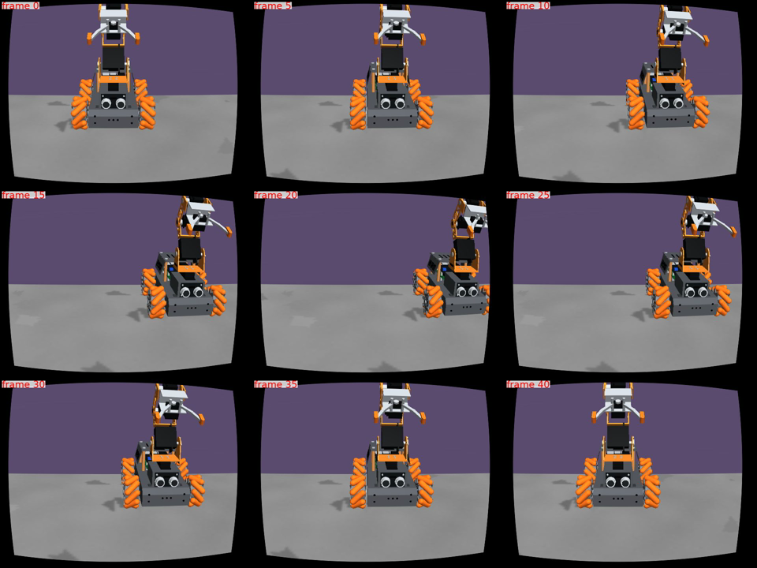

# mapbuild1 — 조사 완료, MJWarp RGB 가능성 일부 개선, NOT_READY

[Draft PR #556](https://github.com/cmkang131/UGRP-Multi-Robot-Collaboration-Project/pull/556), [#366 시작 코멘트](https://github.com/cmkang131/UGRP-Multi-Robot-Collaboration-Project/issues/366#issuecomment-6208792447).
2026-10-16 사용자 "지도 그리는 것도 같이 진행 ㄱ"를 AGENTS와 자연 바닥 SLAM 안내에 기록했다. #366의 첫 E2E 이후 시점을 대체하며 기존 지도 있음(warp7)은 유지한다.

**자기 RGB의 동료 로봇 열을 제외한 LK는 FOLDED 120/120쌍을 추적했다.** 그러나 이는 **한 지도·한 시작점에서 통제된 카메라 변위를 렌더한 자료**다. 실제 바퀴 주행·탐색 지도·운반은0회이며 전체 관문은 NOT_READY다. 독립 holdout도 아니다.

## 변경·조사

- [조사 원문·제약·선택](references.md): ORB-SLAM3, OpenCV VO/PnP, GMapping/Cartographer, DROID-SLAM, MASt3R-SLAM. 최종 계열 OpenCV, 학습형 L4 비교 전용. 외부 시스템 설치·실행 비교0.
- [사전 기록](plan.md): 기본 off `mapbuild1_v1`, 독립 실행 번들, 입력·척도·단계 관문·자원 예산. 코드 탐색 경로와 과업 단계 LLM 판단의 역할을 명시했다. 실제 LLM0.
- `scripts/mapbuild1_capture.py`: pinned warp5 MJWarp 렌더에서6조건246장을10Hz로 기록. 자기 RGB/fixture PWM manifest와 평가 정답 파일을 분리한다. 모든4 SIM초를 기록하므로 마지막10 SIM초 보존 범위를 포함한다. 원래 카메라/FOV·장면·물리를 바꾸지 않는다.
- `scripts/mapbuild1_replay.py`: 기존 ORB 희소 지도, LK와 기본 off FAST7/RGB 열 제외 후보. unknown은 추적 성공으로 세지 않는다. 정답 파일은 추정 궤적을 저장한 뒤 평가기가 연다. frame hash와 허용 필드·인과 순서를 검사한다. 실행 중 world/pose/contact 객체를 전달하지 않는다. 실시간 제어기 입력 감사 실행은0회다.
- `scripts/score_mapbuild1.py`: 평가 전용, 클래스별 벽/문/장애물/목적지 대칭 거리와 격자 커버리지·오검출·누락(unknown 포함) 채점. 수치 오차 문턱을 임의로 만들지 않았다. 점 표본을 물체 인스턴스 개수로 간주하지 않는다. 실제 지도 생성 및 정적 지도→채점용 raster/의미 자료 어댑터는 미완료다.
- 기본 제어기·warp7·공유 MJWarp 설치·모델 공급자 변경0. 공통 runnable 번호는 추가하지 않았다. 새 검사만 CI 목록에 추가했다.

## 측정 결과

장면 `walls_floor_contrast_v5_indigo110_s80` + v1 바닥 + `no_mip_v1`, `warp5_native_visual_v2`의 pinned source `3c598b816b823ef93d064b2f30ffd07cf5493816`. gcp2 L4에서 렌더26.34 wall초(물리0), gcp2 n4-64에서 분석했다. 공유 부하이며 처리량/비용 우월성 측정이 아니다.

`zone_hardmaps1_h1_final_v3` 한 시작점, FOLDED/HIGH × 전진/횡이동/회전, 각0–4 SIM초41장. 0–2초에0.2m 또는15° 변위,2–4초에 원점 복귀. 이것은 시험 범위이며 수용 오차가 아니다. wheel prior는0, 실제 발행 바퀴 명령으로 주행했다고 보고하지 않는다. 척도는 고정 카메라 보정·지면 가정에서 나온다. 평가 시 첫 원점만 맞추고 척도 최적화는 하지 않는다.

|FOLDED LK|기존 추적|RGB 열 제외 추적|xy p95 기존→후보|yaw p95 기존→후보|후보 이동 척도 중앙|
|---|---:|---:|---:|---:|---:|
|전진|21/40|40/40|6.09→1.33cm|4.64→1.42°|1.0086|
|횡이동|40/40|40/40|11.31→0.68cm|12.46→0.65°|1.0032|
|회전|39/40|40/40|2.15→0.60cm|2.30→1.16°|이동 척도 해당 없음|

HIGH는 기존 `servo_fk_v1`의 closed 명령/하중 미자격으로 **120/120쌍 unknown**이다. 실제 하중 유무를 안다는 뜻이 아니며, 측정 관절/정답으로 이 경계를 풀지 않았다. 조건 커버리지는6/6 기록,3/6 카메라 기하 자격이다. 초음파 OFF, 명령 기반 실제 거리 척도·하중 처짐·장시간 drift는 미측정이다.

|ORB 후보|전체 쌍|특징 수 관문 통과|기하 추적 통과|거부 사유|
|---|---:|---:|---:|---|
|기존 FAST20|240|120|3|카메라 미자격120, 대응 부족117|
|FAST7|240|120|23|미자격120, 대응 부족95, rigid consensus2|
|FAST7 + RGB 열 제외|240|120|3|미자격120, 대응 부족117|

FAST7은 ORB를 충분히 회복하지 못했다. RGB 열 제외는 LK에 도움이 됐지만 희소 ORB 지도에는 같은 효과가 없다. 같은 영상의 탐색용 비교라 기본 채택하지 않는다. 기존 수용 상수는 바꾸지 않았고 새 FAST7/마스크 근거와 직접 본 시간순 기록은 [첫 진단](diagnosis-r1.md)에 있다. 원인을 주장하기 전 전진·횡이동 실패 진단2개, 회전 추적 유지1개의 전체2Hz·전체10Hz 띠를 직접 확인했다. 물리 성공 예제는 없다.

## 관문·무결성·모든 시도

[summary.json](summary.json), [기록 프레임246→246 funnel](capture-rejection-table.json), [추적 funnel·거부 분포·재현 인자](rejection-table.json), [모든8개 호출](attempts.json), [원본 영수증](artifact-receipts.json). 두 알고리즘 라운드(기존, 후보2개 비교)이며 같은 결함을 무제한 재조정하지 않았다. 단계3·4 대기열은 [WITHHELD](next-queue.json)이며 실제 `rejection_table` 절대경로를 연결했다.

- 원격 원본270파일 전체 SHA-256 불일치0. Mac 회수 요약14파일·몽타주6장 해시 불일치0([회수 검사](retrieval-verification.json)). 로컬 회수 약6.2MB이며 원본246 JPEG·큰 궤적·영상은 gcp2에 보존했다. 완전 외부 백업을 의미하지 않는다.
- 초기 HOST_ERROR1: sparse 기록기 cwd에서 상대 texture asset을 못 찾음 → pinned renderer cwd로 해결. 실패 원본과 로그 보존.
- 첫 분석 ERROR1: 기존 HIGH 카메라 자격 거부가 예외로 종료 → unknown으로 기록하도록 수정. 보정 자격은 유지.
- 별도 배포 HOST_ERROR1: source checkout 완료 전에 분석을 시작함 → 완료·SHA 확인 후 재실행. 결과 분모에 넣지 않는다.
- 정상 영상 기록 종료는 `cap_end`, 분석/재생 COMPLETE와 구분한다. 영상3개는 원격 ffmpeg `setpts=PTS/3`로 만들었고 각44–57KB·ffprobe duration1.6초다. Mac에는 몽타주만 가져왔으며 GUI/브라우저/재생 앱0이다. 이 자료는 r1만 기록했고 개요/r2 영상이 없어 임의로 대체하지 않았다.
- 관련 비물리 **25 passed**, CI8 shard 목록에 새 검사1회 포함, diff whitespace 통과. 전체 CI·승인·병합 통과가 아니다. 마스크 검사에서 잘못된 시험 PWM을 실제 FOLDED로 고친 뒤 통과했으며 제어 소스 보정은 하지 않았다.

실행 소스: capture `24c515f43d1aa919caa06387e4fdfec0fa3dce28`, baseline replay `01c46bf2ab9d570ef478093bc36f1bcb23be85a1`, 후보 `fe77e1a791eda8fb3209a58aa9643a7ed71819fa`. 자세한 원본 경로·명령·환경은 각 JSON에 있다.

## 남은 관문과 운영

1. 실제 MJWarp 명령 주행 영상에서 LK 후보·명령 척도·초음파 ON/OFF를 검증한다. 이번 renderer source의 전체 색 관문은 warp5에서 미통과였으며 이 렌더 가능성 결과를 제어 자격으로 확대하지 않는다. 후속 warp7 결과를 소급 합산하지 않는다.
2. HIGH/운반 카메라 보정 자격과 ORB 희소 대응 손실을 해결한다. 물리 측정 없이 closed 명령을 unloaded로 위장하지 않는다.
3. 실제 탐색 pose→벽/문/장애물/목적지 점유 지도 생성과 채점 어댑터, 전 지도·관측 영역 커버리지를 잰다.
4. 같은 시드의 지도 있음(warp7)과 위치 추정·경로·통과/도착·운반/place를 각각 비교한다. 현재 지도/운반 실행0이다.

CPU/L4 각각 자기 lease를 사용하고 제거했다. 최종 확인에서 CPU는 warp7, L4는 warp3/warp7 임대를 유지해 **VM 정지 시도0**, 자기 실행 PID0이다. 기존8h/24h 상한·idle20·budget-stop 변경0, 다른 프로세스/공용 git-shared 객체 삭제·gc0, gcp1/gcp3 접근0이다. 원격 소스는 공용 bare 저장소를 참조한 clone이며 L4 기록기는 sparse로 중복 assets를 회수했다. 첫 clone 뒤 디스크15GiB 바닥 아래가 되어 실행 전 sparse로 줄였고 약16.37GB 여유를 확인했다. 실제 비용 청구액은 측정하지 않았다.

Mac 정리로 종전 `gcp2` SSH ProxyCommand가 참조하던 worktree가 없어졌다. gcloud의 현재 gcp2 주소와 기존 `HostKeyAlias=gcp2`를 사용해 키 검증을 유지했고 SSH 설정은 수정하지 않았다. UGRP Drive 제외를 지켰다.
