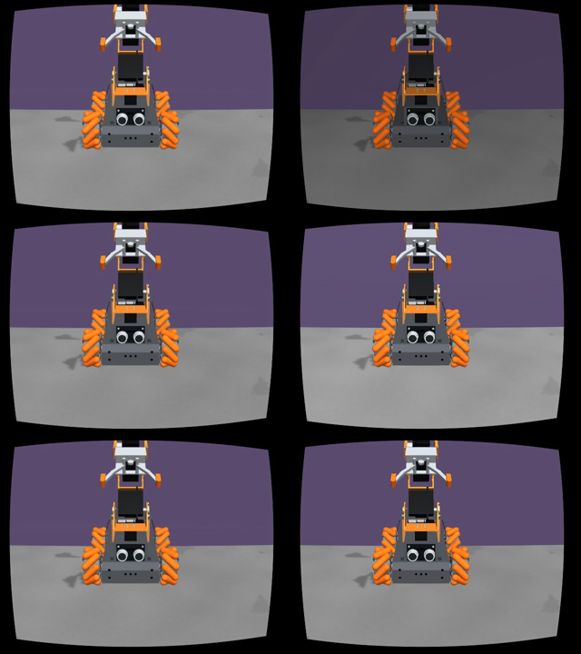
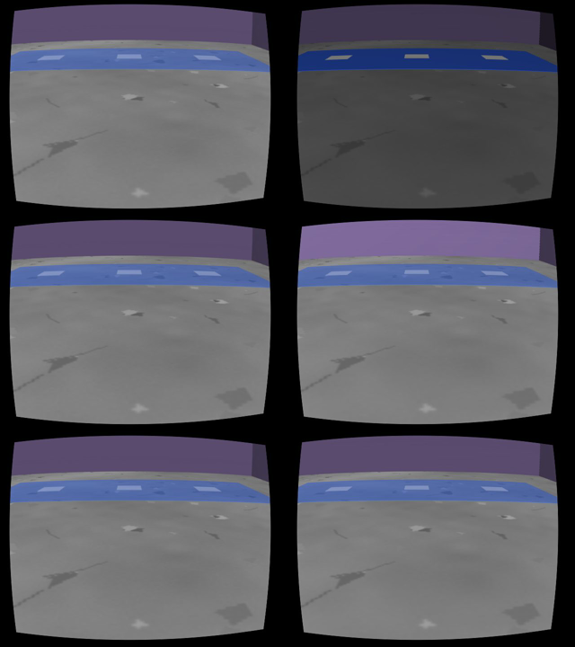
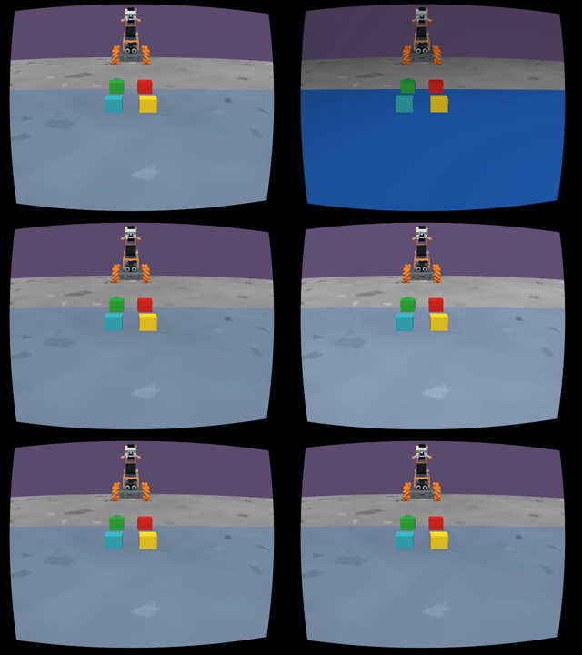

# warp5 — NOT_READY

[Draft PR #550](https://github.com/cmkang131/UGRP-Multi-Robot-Collaboration-Project/pull/550). `claude/warp5`는 reloc20 `2f4f469e` 위 공통 warp-act `e97464a3`를 병합했다. 공통 `warp_act_backend.py/core.py`는 수정하지 않았다. **렌더 기초 지표는 회복했지만 색 검출 관문이 실패했고, N16 운반·place·E2E 물리 이식은 미완료**다.

## 검증 결과

고정 장면 `walls_floor_contrast_v5_indigo110_s80` + v1 바닥 + no_mip_v1의 같은 자세88개, 자기 RGB640×480/PIL82다. CPU/MJWarp는 나란히 비교할 뿐 합산하지 않는다. 호스트는 gcp2 `ugrp-act-l4-gcp2`/L4, MuJoCo/MJWarp3.16·Warp1.15다. 모든 라운드는 warp3·warp4·beamact3와 shared-load이며 처리량/비용 우월성 측정이 아니다.

|지표|CPU 기준|MJWarp R1 기본|R2 alpha·spot180|R3 texture modulation 추가|
|---|---:|---:|---:|---:|
|정적 이미지|88|88|88|88|
|RGB MAE 중앙 /255|해당 없음|38.4708|9.1803|0.80435|
|바닥 ORB FAST7 중앙|107.5|53|135.5|126.5|
|벽 ORB FAST7 중앙|2|1|4|2|
|경계 검출 열|4087|2364|239|4104|
|거짓 경계 열|0|0|0|0|
|경계 잔차 p95 px|0.5|1.5|0.5|0.5|
|색 검출 결과 동일 장면|기준|26/88|68/88|59/88|

CPU 반복 RGB는 R2/R3 각각88/88 바이트 동일했다. R3는 ORB p10/중앙·경계 열·거짓 경계 관문을 통과했으나 **색 결과29/88 차이로 전체 관문은 FAIL**이다. 이 정적 결과를 위치 추정 오차·주행·파지·배치 성공으로 해석하지 않는다.

R3 저장 영상의 원본 백분위로 기존 scene-tex5 추정식을 재사용한 색 보정표를 만들었다(기본 off, 독립 holdout 아님). 벽 클래스 제외는 색 일치59/88로 개선이 없었다. 직접 accepted-mask overlay에서 보이는 로봇의 초음파 구멍이 B 바닥으로 들어가는140/138px 반례를 확인했다. 기존 orange_columns_v1을 그대로 재사용한 별도 후보는54/88로 악화돼 **미채택**이다. 실패를 성공 기준 완화로 해결하지 않았다.

[요약·원본/해시·모든 후보](summary.json), [회수 영수증](artifact-receipts.json). 원본 manifest 등록1,868파일 SHA 불일치0, Mac 회수4파일 SHA 불일치0(679,421bytes). raw는 `/home/ugrp/ugrp-sim/runs/warp5/`에 보존한다. 전체 raw 외부 백업은 아니다.

## 변경과 범위

- 기본 off `warp5_native_visual_v1`: native의 authored-alpha 두 순서 혼합과 cutoff180 조명의 점광원 해석. `warp5_native_visual_v2`: GL_MODULATE와 같은 조명 clamp 뒤 texture 곱. 설치된 공유 MJWarp 파일은 수정하지 않고 SHA를 기록한 별도 생성 kernel을 쓴다. GPU 모델의 시각 배열은 렌더 뒤 복원하며 카메라/FOV·장면 물리·접촉·마찰·weld를 바꾸지 않는다. [근거](references.md).
- 자기 지도·운반 실행기의 물리 진행만 generator 장벽으로 바꾸는 AST 어댑터, 다중 카메라·로봇 명령 포트, GPU 평가 상태 export, 종료 세계 integration 보존 후보를 구현했다. native setup과 MJWarp rollout은 구분한다. 실제 GPU 명령/종료세계 격리 관문은 아직 미측정이다.
- [reloc21 원인표](reloc21-handoff.md)를 읽고 반복 제거 수정 `c13328cdf`의 모듈·호출을 가져왔다. 시작 enclosure 거부1765/hold29.7%·목적지 색0을 후속 우선순위로 유지한다. 오차가 악화된 progress/complete는 기본 off이며 채택하지 않는다. 수정 후 MJWarp 물리0이다.
- E2E0.05 SIM초 장벽 변환, 세계/로봇 비동기 응답 경계와 기존 강한 규칙 client 원형을 구현했다. **현재 E2E 실행기 연결·고정 v5 장면·ACT/교사 근거리 연결·대체 규칙 물리 실행은 미완료**다. 실제 Mac 중계/LLM 검증도 없다. [구현·미완료 인수 항목](e2e-design.md).
- 표준 workflow catalog에 `warp5-batch`를 등록했고 CLI 목록에서 확인했다. 실제 관리 실행·완주 검증은 아니다.

## 실행·운영 한계

새 운반 제어 **0회**, place/완주·xy/yaw p95·입력 감사는 **미측정**이다. `invisible_measurements=0`/`held_world_reads=0`을 실행 증거처럼 보고하지 않는다. 실제 실패/성공 실행이 없어 요구된 전체2Hz·종료10Hz 재생과 실패6프레임 관문도 미충족이다. 실행기에는 기존 기록 전용10Hz failure buffer를 유지한다. 정적 몽타주를 물리 실패 프레임으로 세지 않는다.

환경/초기화 HOST_ERROR3은 EGL 라이브러리 부재, fixture ncon80보다 작은 할당, GPU 환경의 scipy 누락이다. 로그·SHA를 보존했고 OSMesa 비교 렌더·실제 크기 기반 할당·분리된 Python target으로 해소했다. 타 작업 Python 환경은 바꾸지 않았다. 이후 정적88×3은 모두 완료됐다.

Mac 여유 약16GiB로 AGENTS의20GiB 제출 바닥 아래이므로 새 N16 운반/E2E 배치를 제출하지 않았다. 요약·몽타주만 회수했고 다른 자료를 삭제하지 않았다. Gemma 가격+50% 경보로 실제 LLM 호출·배치0을 유지했다. Mac 물리·렌더·GUI0, Drive 조회/업로드0이다.

관련 비물리 **30 passed**. 더 넓게 선택한 `test_active_wall_mapping`의 frozen-source 해시1건은 reloc20의 동일 파일 SHA에서도 존재하는 baseline 실패다(해당 선택검사13 passed/1 failed). frozen `floor_goal.py` 원문은 reloc20과 동일하게 보존했다. 전체 CI/병합 통과를 주장하지 않는다.

[호스트 종료 기록](host-lifecycle.json): 자기 프로세스0·lease 제거, warp3/warp4/beamact3 보존, VM 정지 시도0. GPU VM RUNNING·8h STOP 상한(28800초)을 직접 확인했고 idle20/budget-stop 설정은 변경하지 않았다.

## 정적 영상 직접 검토

행은 R1/R2/R3, 왼쪽 CPU·오른쪽 MJWarp다. gcp2 ffmpeg으로 만들고 파일로 직접 보았다. drive/B/상자 팔레트의 alpha·밝기·바닥 질감 회복과 로봇 구멍 오검출을 확인했다. 영상 앱은 열지 않았다.

