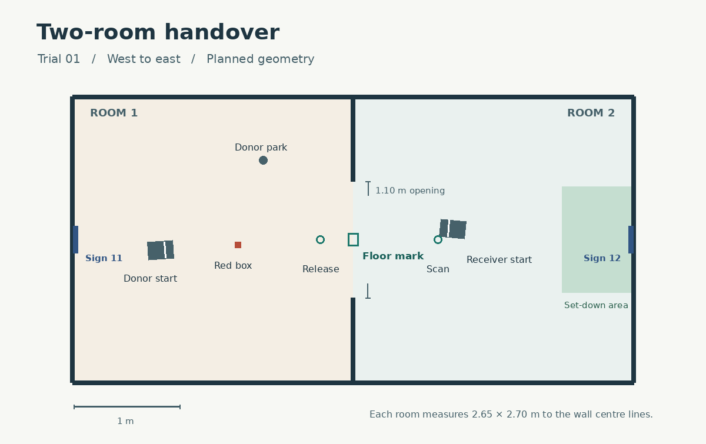

# Two-robot handover gate

**Gate pending. No physical trial was evaluated.** The local trial-01 smoke stopped at setup with exit 2, zero physics steps and 0.000 simulated seconds. The server's Python lacks MuJoCo, OpenCV and the ACT runtime. The workspace also lacks the native scene XML, wheel assets and trained grasp checkpoint. The driver, two-room scene builder, fixed script, scorer and twelve-row table are in place. The main session owns the cohort. [Smoke record](handover/verification/smoke-final-01/run.json) · [Scorer output](handover/verification/smoke-score.txt)

## Floor layout



The drawing is a plan view of trial 01. Each room measures 2.65 m deep by 2.70 m wide between wall centre lines. Walls are 0.05 m thick and 0.40 m high. I chose a **1.10 m clear opening** to leave room on either side of the receiver for the existing camera alignment and wheel corrections. A narrower opening has not been tested. Rotating the same plan by 90° gives the horizontal partition. Reversing a transfer exchanges donor and receiver roles.

The floor frame has its origin at the centre of the opening. Axis *u* points from donor to receiver. Axis *v* points to the donor's left when facing the receiver. All positions below are in metres.

| Feature | Floor specification |
|---|---|
| Transfer mark | Flush, noncolliding matte tape centred at (0, 0). The box's 34 mm edge runs along *u* and its 40 mm edge along *v*. Box height is 32 mm and mass is 30 g. |
| Donor release | Start the 87-row placement replay at (−0.31, 0), facing the receiver. This is the chassis station **before** the replay's forward wheel pulses. The record captures the box pose when the fingers let go. |
| Donor clearance | Back to (−0.85, 0), then park at (−0.85, +0.75). Accept clearance within 0.20 m of that point, at least 0.65 m behind the door and at least 0.50 m to the side of its centre line. |
| Receiver pickup | Wait at the listed start until clearance. Scan from (+0.80, 0) toward the mark. The existing visual approach has a nominal stop range of 0.20 m. |
| Room signs | Existing 0.25 m square ArUco 4×4 cards, marker side 0.1875 m, centre height 0.130 m. Sign 11 belongs to r1 and sign 12 to r2. Each stands at the middle of its far wall, 2.623 m from the partition. |
| Destination | The acceptance area extends 0.65 m into the room and 0.50 m to each side of the card. The receiver aims 0.28 m in front of its own observed sign and adds the 0.31 m chassis stand-off for placement. |

The capture and scoring geometry comes from the R17 dimensions reproduced in the task. The sibling design and review directories were outside this session's workspace. [Geometry](handover/layout.py) · [Scene builder](exec/sim/handover_scene.py)

## Motion and evidence

The compiled scene is required to contain two robot trees, one free task box and zero equality constraints. Both robots share a single MuJoCo model, data object and clock. The stock builder first supplies the three-robot template used by its contact-profile code. The handover scene retains r1, r2 and their original finger-to-box contact pairs before compilation. Blue uses the executor's cyan paint and perception class.

1. The donor surveys with its wrist camera. The existing `SurveyApproach` selects an observed box of the requested colour inside the donor room, approaches it and aligns to a face. The existing CPU `GraspActor` and `ChunkExecutor` run the trained manipulation policy from a local checkpoint. Both robots use the checkpoint's required `west` token for a small box. The floor heading comes from the trial.
2. The donor drives to the marked station using ceiling-camera chassis observations. It runs `ReleaseCodeV1`, backs away and parks off the sightline. The script verifies that the box is detached and resting before handing control to the receiver.
3. The receiver starts its own wrist-camera survey after the donor clears. The first accepted target-colour floor projection within 0.22 m of the mark gets a timestamp and a wrist image. The handover selector admits an observed entry in this small region on either side of the partition. This addresses the legacy 0.25 m door exclusion. There is no generic door-pass or planner `PUT_DOWN` action in the script.
4. Following the receiver's lift, the script raises the held arm for a look, reads its room's card with the executor's `TagReader` and localizes it with `sign_on_floor`. It drives to the observed stand-off, restores the hold posture and uses the same placement replay. Each robot can retry one failed ACT grasp after opening, backing away and resurveying. A survey that cannot supply a target ends at the perception or pickup stage. Attempt starts and outcomes are separate events, so an interrupted second attempt still counts as a retry.

The navigator uses optical chassis poses, fixed floor stations and the receiver's own sign observation. The referee reads native box pose, clearance and finger forces for lift confirmation, retry, drop detection and stage acceptance. Those measurements do not enter the trained actor's input. [Policy and stage sequence](exec/harness/handover_policy.py) · [World and camera interface](exec/scripts/handover_world.py)

**Room enforcement.** Both home rectangles end at the shared wall centre line and at the interior faces of the outer walls. The navigator accepts driving targets at least 0.10 m inside the acting robot's rectangle. An outward command in the 0.08 m guard band ends the trial with `room_guard`. After *every* native integration step, the recorder reads both chassis centres directly from the free joints. Touching or crossing any home boundary stops the episode and records `room_violation` with step, time, robot and coordinates. A guard stop and an actual crossing are distinguishable. No position is clamped. [Recorder](handover/records.py)

| Output of one invocation | What it contains |
|---|---|
| `trial.json`, `map.json` | Seed, direction, starting poses, box identity, mark, wall orientation, sign IDs and areas. |
| `scene.xml`, `cards/` | Assembled native scene and marker textures on a runtime with the assets installed. The world-ready event records the XML digest, solver timestep, MuJoCo version and compiled body ID. The checkpoint event identifies the verified model. |
| `events.jsonl` | Ordered simulated timestamps for approach, first usable receiver sighting, each grasp attempt, release start and first detached sample, donor clear, sign read, and set-down. World box observations include x, y, z, yaw in radians, tilt in degrees, floor clearance, speed, and both robots' finger forces. Final placement also records coordinates and yaw relative to the sign. |
| `chassis.csv` | Initial positions and positions at 10 Hz, with native step number and both axes' minima and maxima over **all** native steps in each interval. A guard or crossing flushes the last interval. |
| `*.jpg` | Initial overhead view, first receiver sighting, sign recognition, and overhead and wrist frames of grasp and physical release, plus settled overhead views. Each frame belongs to its event. The local setup smoke produced no camera images. |
| `run.json` | Status, failing stage and reason, wall time, simulated time, last native step and wall budget. Infrastructure exceptions also leave a traceback in `error.txt`. Output creation is exclusive. |

**Success rule.** The scorer checks evidence in event order, with the chassis trace checked independently. Each lift requires the same compiled body ID, both fingers exerting at least 0.5 N each, bottom clearance at least 12 mm and tilt at most 10° for three continuous seconds at 10 Hz. Donor separation and the subsequent resting box must lie within 0.10 m of the mark and within 25° of its nominal orientation, allowing a half turn for the rectangular box. Each completed placement includes ten settled samples with absolute bottom clearance at most 4 mm, speed at most 0.035 m/s, tilt at most 10° and all finger forces below 0.05 N. The box must remain on the mark at donor clear and end inside the receiver's sign area. The receiver's chassis may settle by up to 0.035 m at the start while waiting. The scorer verifies the entire room trace and decodes the referenced JPEGs. It reports the earliest failure and counts retries by role. The cohort gate requires at least ten successes across twelve distinct evaluated rows. An incomplete cohort prints `PENDING`. [Scorer](handover/score.py) · [Thresholds](handover/criteria.py)

## Preselected trials

The table uses the donor-relative floor frame above. Each pose gives *u*, *v* and heading in degrees from the donor-to-receiver axis. Signs and robot homes remain geographically fixed. r1 occupies west on a north–south partition and south on an east–west partition. The file contains six red and six blue rows, three transfers per compass direction, and distinct seeds. Each robot donates three boxes of each colour. [Machine-readable table](handover/scenes/trials.csv)

| Trial | Seed | Transfer | Box colour | Donor start | Box start | Receiver start | Receiver sign |
|---:|---:|---|---|---|---|---|---:|
| 1 | 251101 | W → E | Red | −1.82, −0.10, 4 | −1.09, −0.05, 0 | 0.94, 0.10, 174 | 12 |
| 2 | 251102 | E → W | Blue | −2.00, 0.15, −6 | −1.19, 0.07, −4 | 0.91, −0.14, 188 | 11 |
| 3 | 251103 | S → N | Blue | −1.89, −0.22, 9 | −1.13, −0.09, 5 | 0.96, 0.18, 170 | 12 |
| 4 | 251104 | N → S | Red | −1.78, 0.23, −8 | −1.07, 0.12, −3 | 0.89, −0.13, 185 | 11 |
| 5 | 251105 | W → E | Blue | −2.01, −0.19, 7 | −1.22, −0.11, 3 | 0.93, −0.18, 189 | 12 |
| 6 | 251106 | E → W | Red | −1.85, 0.12, −3 | −1.14, 0.09, 0 | 1.01, 0.15, 173 | 11 |
| 7 | 251107 | S → N | Red | −2.05, 0.20, −9 | −1.23, 0.06, −5 | 0.90, −0.12, 187 | 12 |
| 8 | 251108 | N → S | Blue | −1.93, −0.16, 5 | −1.15, −0.07, 4 | 0.97, 0.19, 172 | 11 |
| 9 | 251109 | W → E | Red | −1.98, 0.18, −5 | −1.16, 0.10, −2 | 0.88, 0.13, 175 | 12 |
| 10 | 251110 | E → W | Blue | −1.80, −0.20, 8 | −1.08, −0.08, 5 | 0.99, −0.16, 186 | 11 |
| 11 | 251111 | S → N | Blue | −1.86, 0.08, −4 | −1.10, 0.02, −3 | 0.92, 0.16, 171 | 12 |
| 12 | 251112 | N → S | Red | −2.03, −0.12, 6 | −1.20, 0.00, 2 | 0.95, −0.19, 188 | 11 |

## Executor changes and checks

| New executor file | Entry points | Activation |
|---|---|---|
| `exec/sim/handover_scene.py` | `stock_xml`, `arena` | Selected by the handover driver and its `handover.trial.v1` scene. Builds the wall, mark, two cards and one stock cargo body. |
| `exec/scripts/handover_world.py` | `World.control`, `positions`, `witness` | The new driver constructs this world to issue the real wheel and servo commands, serve cameras, and collect step-level evidence. |
| `exec/harness/handover_policy.py` | `Policy.run`, `approach`, `grasp`, `release`, `find_sign` | `handover/run_trial.py --trial K` selects the fixed two-role sequence. |

All **2,215 pre-existing executor files** matched the pre-edit tree digest, including the existing entry points, option defaults, tests and records. The digest is `424ec5b84ce24a853cea8a02ea0c07966aa416d0f7b0f5226eb9afc9e96fbd79`, computed over sorted SHA-256/file-path lines. All eight golden JSONs passed a separate byte check. [Golden checksums](handover/verification/golden.sha256)

| Local verification | Result |
|---|---|
| Direct run of trial 01 with a 60 s limit | Two setup checks reached the same dependency stop. The final invocation recorded about 0.004 s wall time, 0 simulated seconds and last step −1. No robot moved, and no grasp or release was observed. [Final smoke](handover/verification/smoke-final-01/run.json) |
| Handover tests | 24 passed. Coverage includes the full balanced table, rotated XML and sign placement, a constructed substep boundary excursion, camera selection at the mark, retry limits, the real command decoder and placement table with constructed observations, same-body identity, order, settled pose, missing images, incomplete traces and duplicate rows. [Test log](handover/verification/gate-final.log) |
| Existing executor suite | 690 discovered, 641 passed and 49 skipped. All 690 case outcomes matched the pre-change run. The skips comprised 35 OpenCV cases, two MuJoCo cases, six historical Git comparisons, and six cases needing fixtures outside the executor copy. Coverage included approach, door traffic, carry, reveal, retries, placement and option-off goldens. [Before](handover/verification/executor-tests.log) · [After](handover/verification/executor-final.log) |
| Cloud row dry-run | Printed twelve fixed local argv, two robots per row and zero planner processes. The manifest test stages twelve definitions and checks their SHA-256 values. [Dry-run output](handover/verification/dispatch-dry-run.txt) |

The executor regression helper copies `exec/` into a fresh directory beneath `handover/verification/scratch/` and runs its own unittest discovery there. This keeps historical sibling projects outside the tests' fixture search. Reproduce the checks from the phase-3 root.

```bash
mkdir -p handover/verification/scratch
TMPDIR="$PWD/handover/verification/scratch" OPENBLAS_NUM_THREADS=1 \
  python3 -B -m unittest discover -s handover/tests -v
python3 -B handover/tests/legacy_checks.py
sha256sum -c handover/verification/golden.sha256
```

## Main-session commands

### Local, one trial at a time

Use the executor's offline CPU environment with MuJoCo, headless EGL or OSMesa, OpenCV with ArUco, NumPy, Pillow and the original PyTorch/LeRobot ACT dependencies. `GraspActor.load` verifies the checkpoint inventory, adapter contract and pinned LeRobot revision. The default checkpoint directory is `handover/runtime/act/` containing `model.safetensors`, `adapter.json`, `config.json` and `SHA256.json`. The optional `HANDOVER_ACT_MODEL` names an already staged checkpoint directory.

The full matching scene source tree and its assets can be staged at `handover/runtime/scene/sim/`. Alternatively, `HANDOVER_SCENE_ROOT` names its parent, or the driver can use a full `exec/sim/`. The test-only executor export here lacks `masterpi_scene.xml` and the Fuji mesh and source receipt. The same Python interpreter must be able to import the simulator and the CPU actor. The driver performs no download.

```bash
python3 -B handover/run_trial.py --trial 1 --out handover/runs/check-01
python3 -B handover/score.py handover/runs/check-01
```

For all twelve, use a fresh cohort directory. Exit 1 from the driver records a bounded trial failure. Exit 2 identifies a setup or runtime error.

```bash
(
  set -eu
  mkdir -p handover/runs
  cohort=$(mktemp -d "$PWD/handover/runs/gate-XXXXXXXX")
  for k in $(seq 1 12); do
    run_dir=$(printf '%s/trial-%02d' "$cohort" "$k")
    rc=0
    timeout -k 5s 1140s python3 -B handover/run_trial.py \
      --trial "$k" --out "$run_dir" || rc=$?
    case "$rc" in 0|1) ;; *) exit "$rc" ;; esac
  done
  python3 -B handover/score.py "$cohort"/trial-*
)
```

**Wall time on the two-core server.** Reserve 18 minutes per row, or 3 h 36 min for twelve sequential driver budgets, plus process startup and teardown. The driver defaults to 1,080 s. A throughput example for planning is 150 simulated seconds at 0.25 simulated seconds per wall second, which would take 10 minutes. Neither input was measured here. A successful first row's `wall_s` and `sim_s` give the first server-specific speed estimate.

### Cloud Run preparation and dispatch

This dry-run works now. It reads the local table and prints the exact proposed worker argv.

```bash
python3 -B handover/cloud_plan.py --dry-run
```

The following integration work belongs to the existing build and dispatcher owners. Command names and their existing options are taken from the in-workspace build notes. The handover build option and two-robot job mapping below are proposed additions. [Existing build and dispatch commands](REPORT-V8-TOOLS.md) · [Existing image update sequence](REPORT-V11.md)

1. Add an opt-in `--handover-dir` build mode to `../20261118-cloudrun-p2/scripts/build_p2.sh`. Package the driver and table under `/opt/ugrp/handover`, the matching executor and three hook files under `/opt/ugrp/exec`, the staged trial JSONs under `/opt/ugrp/handover/trials`, and the local checkpoint, full sim assets and CPU runtime. This build mode can omit the planner package. Freeze the actual executor revision in the build and manifest.
2. Register `handover_gate` in the phase-3 wrapper and allow an exact `r1,r2` row with `--size 2`. Map it to a dedicated two-robot job, proposed name `ugrp-run2`, using 2 vCPU, 6 GiB, one task per row and one slot. Extend size validation, quota accounting and the update-script job allow-list where needed. Recognize this specific entry point as fixed-script work under the dispatcher's existing fixed-run check.
3. Route that group **before planner startup** in the image's `cr_task_p2.py`. Verify the scene-file hash and the row's trial/seed against the packaged table. Execute the generated Python argv directly with a fresh output directory. `T1` and the donor's leader field fill the legacy manifest columns. The worker uses `model=fixed-handover` and empty server args. Upload the complete row directory on success, trial failure or infrastructure error. Preserve the experiment's exit status in the evidence, and treat a recorded grasp miss as a completed row. Set task dispatch retries to zero. The one physical regrasp is internal to the trial.

After integrating those additions, the main session can use the following templates. Set `EXEC_SHA` to the actual integrated 40-hex revision, `EXEC_WORKTREE` to its full checkout and `IMAGE_TAG` to the new immutable image tag. The local staging command requires a fresh directory.

```bash
phase3=$PWD
p2_scripts="$phase3/../20261118-cloudrun-p2/scripts"
stage="$phase3/handover/dispatch-$IMAGE_TAG"
python3 -B handover/cloud_plan.py --stage "$stage" --exec-sha "$EXEC_SHA"

bash "$p2_scripts/build_p2.sh" "$EXEC_SHA" "$IMAGE_TAG" --strict \
  --worktree "$EXEC_WORKTREE" --handover-dir "$phase3/handover" \
  --scenes-dir "$stage/trials" --manifest "$stage/manifest.csv"
bash "$p2_scripts/update_jobs_p2.sh" --apply --out-dir "$stage/jobs" \
  ugrp-run2 "$IMAGE_TAG" us-central1

batch="$phase3/cloudrun/runs/$IMAGE_TAG"
opts=(--manifest "$stage/manifest.csv" --size 2 --regions us-central1=1 \
      --image-tag "$IMAGE_TAG" --max-retries 0)
python3 -B cloudrun/cr_dispatch_p3.py plan "${opts[@]}" --batch "$IMAGE_TAG"
python3 -B cloudrun/cr_dispatch_p3.py run "${opts[@]}" --dir "$batch" --go
python3 -B cloudrun/cr_dispatch_p3.py fetch --dir "$batch"
# With the worker publishing /work/out/<run_id> under the fetched outroot
python3 -B handover/score.py "$batch"/outroot/HANDOVER-HG*
```

**Illustrative compute cost in USD.** Using planning inputs of $0.000018 per vCPU-second and $0.000002 per GiB-second, the proposed job costs $0.000048 per active second. Twelve 10-minute tasks would cost **$0.35**. Twelve tasks at the 18-minute driver cap would cost **$0.62**. An extra billed minute per task adds about $0.035. Build, registry, storage and egress are additional. These are scenario estimates. Prices, discounts, runtime, quota and billed usage were not queried.

## Real-floor transfer

| Simulation assumption | Physical counterpart and main uncertainty |
|---|---|
| Exact shared line and mark | Measure the jamb-to-jamb opening, tape the centre line, the oriented footprint and the two stand-offs. Check chassis-centre and extended-arm clearance separately. |
| Ceiling pose available on demand | Calibrate ceiling camera intrinsics and floor coordinates, measure top-card height and verify timestamp latency and occlusion. Independent overhead video is needed to audit real boundary crossings. |
| Stable wrist optics and readable card | Print the same 4×4 ArUco card and white border at the specified size. Verify exposure, mounting height, orientation and decoded ID from both approaches under the room lighting. |
| Repeatable wheel pulses and set-down offset | Measure loaded braking distance and the actual forward offset during the placement replay on the chosen floor. Tape edges, floor joints and wheel slip can move the box relative to the 0.10 m mark tolerance. |
| Exact body ID, finger forces, yaw and tilt | Use a single identified box and continuous side/overhead video across release, clearance and pickup. A scale reference gives floor clearance. Reproducing the numerical force threshold requires instrumented fingers or calibrated load sensing. |
| Published donor-clear event | Make the clear acknowledgement depend on the donor's measured parked position and settled box. The receiver must respond to that acknowledgement and independently reacquire the box. |

## 확인 안 됨

- Native scene compilation, optical tag reads in either orientation, ACT inference and physical contact on this checkout.
- A real donor release, receiver grasp, delivery to either sign, room-limit trace under load, or event camera frame.
- The twelve physical outcomes, retry rates, native wall time and the 10/12 gate verdict.
- Cloud image integration, two-robot dispatch, artifact retrieval, current rates and billing.
- Real-floor feasibility, sensor calibration and error margins for either robot.

## FIX2

**Trial 1 reached the mark and failed at donor clearance.** r1 lifted the box on its second attempt. At 126.6 simulated seconds, the settled box centre was at (0.00219, −0.00710) m, with yaw −0.01171 rad. At 132.6 s, r1 was at (−0.82363, 0.00629) m, 0.0271 m from the first clearance waypoint. The lateral parking leg had made no appreciable progress. The original run took 377.85 wall seconds. Rescoring its records gives one evaluated failure at `donor_clear`, one donor retry and gate `PENDING`. [Events](cloudrun/runs/handover-20261125a/trials/trial-01/events.jsonl) · [Chassis trace](cloudrun/runs/handover-20261125a/trials/trial-01/chassis.csv) · [Run record](cloudrun/runs/handover-20261125a/trials/trial-01/run.json)

### Why localization stopped

The exact policy in the trial's image made eight unsuccessful reads of r1. Each miss issued a stationary 0.1 s control row with the current arm command. The final sequence therefore sampled at approximately 131.8 through 132.5 s. The last hold ended at 132.6 s and the policy raised the failure before taking another image. Release replay row 64 (zero-based) through row 86 already commanded the open travel posture, with PWM values 2000, 740, 2320, 1320 and 1500 for servos 1, 3, 4, 5 and 6. The subsequent settle and reverse kept that command. [Deployed policy](cloudrun/runs/handover-20261125a/build/context/exec/harness/handover_policy.py) · [Replay table](exec/harness/release_table_v1.json) · [Settled overview at 126.6 s](cloudrun/runs/handover-20261125a/trials/trial-01/0011-release-settled.jpg)

The saved XML rules out the edge of the camera frame. The navigation camera `top` was at (0, 0, 2.5) m, with a 95.453° vertical field of view and a 1280 × 960 image. At the nominal card height of 0.3325 m, its focal length of 436.36 px gives 201.3 px/m. Projecting r1’s final chassis x and y at that height gives pixel (474, 479), with up to 8.3 px of additional offset from the rear-mounted card. The whole 85 mm card fits there at any yaw. Its **printed code spans only 12.8 px**, about 2.1 px per module. At this scale, rotation and pixel alignment can interfere with ArUco detection. The reader applies OpenCV's default detector. Side length ranks duplicate reads. The archived JPEGs came from the wrist or the separate `handover_overview` camera. The failed `top` images, chassis yaw and detector candidates were never saved, so the records cannot distinguish a sampling or decoding failure from partial arm occlusion, or identify the precise turn at which it began. [Scene XML](cloudrun/runs/handover-20261125a/trials/trial-01/scene.xml) · [Printed card](cloudrun/runs/handover-20261125a/trials/trial-01/cards/tag_40_n.png) · [Original camera inputs](cloudrun/runs/handover-20261125a/build/context/exec/scripts/handover_world.py) · [Calibrated reader](exec/harness/overhead_v1.py)

### Recovery and evidence

- A successful native read takes the original path. On a miss, the policy commands zero wheels and takes up to 12 fresh observations. For each retry it checks the requested ID in the native image, then with the same ArUco decoder on overlapping 2× crops. It maps decoded corners back to native pixels before applying the existing camera calibration. Every configured ceiling view participates, including both tiles on the rotated wall. [Policy](exec/harness/handover_policy.py) · [Camera inputs](exec/scripts/handover_world.py)
- On recheck eight, an arm already commanded to the raised travel posture swivels from centre to PWM 1850, or back to centre from a panned position, and settles for six stationary ticks. The gripper keeps its command throughout recovery. A lower arm holds its full grasp posture. Total wait is bounded at 1.2 simulated seconds with a fixed arm and 1.7 s with a pan. A thirteenth consecutive missing observation ends the trial at the active stage. [Recovery and motor commands](exec/harness/handover_policy.py)
- The donor and receiver share this code in all four directions. It covers the receiver's scan and approach origin, its retreat after lifting, sign localization and the drive to set-down. If recovery advances the clock while locating the sign, the receiver reads its wrist camera again before computing the destination. The grasp, lift-witness window and 87-row placement replay retain their timing. The room guard and native-step trace remain active during every stationary control row. [Policy](exec/harness/handover_policy.py) · [Room and carry checks](exec/scripts/handover_world.py) · [Referee thresholds](handover/criteria.py)
- Each interval starts with `overhead_lost` and closes with `overhead_recovered` or `overhead_timeout` when recovery returns or exhausts its budget. The pair records the robot, stage, simulated start and end, miss count and any recovery pan. A recovery identifies the decoding method and fresh chassis pose. Both endpoints save lossless PNGs of the exact ceiling inputs. The scorer checks the pairing, keeps the current milestone pending and scores a timeout as a failure at that stage. [Scorer](handover/score.py) · [Constructed observations and scoring tests](handover/tests/test_overhead_recovery.py)

### Offline verification

All **62 requested tests passed** (31 hand-over, 14 cloud-wrapper and 17 dispatcher). The seven new tests exercise short and repeated losses, recovery on the last permitted read, persistent loss, pixel-coordinate mapping, sign re-observation and scoring. The separate executor suite ran 690 tests with 49 skips. All eight golden hashes matched. The four pre-existing bytecode deletions in `exec-repo/` remain outside the commit. [Verification log](cloudrun/handover/verification/fix2-tests.log)

Local commit `2891894258b177ac4850a4992329b7795da056ae` on `phase3/handover-cloud` changes the hand-over policy and its camera interface. A fresh context and the build entry point with simulated cloud replies both staged the pinned executor and scorer. The independent file walk verified all 15 files (76,196 bytes), with inventory SHA-256 `774c224e2484f0c4c833a8dd06145f0067b4f2c04e2a023e3f6fdd7a0d14dba4`. The image build now includes a 12 px marker fixture for the installed OpenCV decoder. [Commit provenance](cloudrun/handover/verification/provenance.txt) · [File hashes](cloudrun/handover/verification/staged.sha256) · [Context verification](cloudrun/handover/verification/context-check.txt) · [Image check](cloudrun/handover/check_image.py)

### Main-session commands

Run these blocks in the same Bash shell. Keep the new cohort path printed below for any resume. The original `handover-20261125a` contains a build receipt that selects the earlier image. [Operator](cloudrun/handover/ops.py)

```bash
cd <work>/20261123-phase3
export PATH="$HOME/bin:$PATH"
work=$(mktemp -d "$PWD/cloudrun/runs/handover-fix2-XXXXXXXX")
printf 'FIX2 cohort %s\n' "$work"
hg() {
  local operation="$1"
  shift
  python3 -B cloudrun/handover/ops.py "$operation" "$work" "$@"
}
hg build && hg deploy
```

Run trial 1, fetch its evidence and check the scorer's stage and any recorded ceiling intervals. A completed Cloud Run task can contain an evaluated trial failure. [Worker exit handling](cloudrun/handover/worker.py)

```bash
hg run smoke && hg watch smoke
hg fetch smoke && python3 -B handover/score.py "$work/trials/trial-01"
```

For trials 2–12, use the same cohort and image. The final command scores all twelve trials, including the smoke. [Offline command preview](cloudrun/handover/verification/commands.txt)

```bash
hg run remaining && hg watch remaining
hg fetch remaining && python3 -B handover/score.py "$work"/trials/trial-{01..12}
```

### 확인 안 됨

The FIX2 image build and its OpenCV check, native recovery at the original loss, receiver pickup and delivery, and the twelve-trial gate await execution by the main session. Local recovery tests used constructed observations. Real-floor visibility and hardware transfer also remain unverified.

## FIX3

Build `<record-id>` stopped at the centre-card assertion. FIX2 already added the 0.041 m rear offset to its expected x. The reported x and y missed the old expectation by 0.001898 m and 0.000156 m, both inside the 0.02 m limit. The failing component was yaw. The same scalar limit of 0.02 rad allowed only `11 × tan(0.02) = 0.22 px` of top-edge rise. The reported yaw of −0.041643 rad corresponds to a rise of 0.5 px over a 12 px run. [Recorded failure](TASK-HANDOVER-FIX3.md) · [Archived FIX2 assertion](cloudrun/runs/handover-fix2-20261125b/build/context/check_image.py)

### Expected chassis pose and tolerance

- Trial 1 has one camera centred at arena `(0, 0)`. At the card height, depth is `2.5 − 0.0325 − 0.30 = 2.1675 m` and focal length is `480 / (2.75 / 2.5) = 436.3636 px`. Dividing depth by focal length gives `s = 0.0049671875 m/px`. The rear offset spans `0.041 / s = 8.254 px`. [Camera calibration](exec/harness/overhead_v1.py) · [Trial map](handover/layout.py)
- The 12 × 12 print covers columns 634–645 and rows 474–485. Its pixel centre `(639.5, 479.5)` lies half a pixel above and left of the reader's principal point `(640, 480)`. Image y increases downward. At zero yaw the expected chassis pose is **`(0.041 − s/2, s/2, 0) = (0.03851640625 m, 0.00248359375 m, 0 rad)`**. [Fixture calculation](exec/scripts/handover_card_check.py)
- Both crop axes invert the 2× resize about pixel centres using `native = origin + (zoom + 0.5)/2 − 0.5`. Undoing the rotated rear offset on the reported chassis pose puts the detected card centre at `(639.625, 479.625)`, only 0.125 px from the printed centre on either axis. That agrees with the crop mapping. The correction is confined to build verification. [Crop mapping](exec/harness/handover_policy.py) · [Numeric replay](cloudrun/handover/verification/fix3-tests.log)
- The nominal top edge spans 11 pixel-centre intervals. Half a pixel per endpoint allows one pixel of rise and a horizontal span as short as 10 px. The yaw limit is `atan2(1, 10) = 0.099668652 rad`. One native pixel per centroid axis gives `√2 × s` of translation. Rotation of the rear mount adds a chord of `2 × 0.041 × sin(yaw_limit/2)`. Together these give **0.011109387 m** of chassis-position tolerance. The image applies both limits to each pose against the expected pose and directly to the native–magnified pair. [Pose checks](exec/scripts/handover_card_check.py)

### Build and offline verification

The gate runs the calibrated native reader and the magnifier independently on the same ID 40 image. It prints both poses, their reference and both tolerances before asserting. It also records the decoded top-edge lengths before remapping. At 2×, 24 samples span 23 zoom pixels. The accepted range is 21–25 zoom pixels, allowing one native pixel of edge-length error. A missing ID, a displaced chassis, excessive yaw or a native-only passthrough fails the build. [Image entry point](cloudrun/handover/check_image.py) · [Regression tests](handover/tests/test_centre_card.py)

**67 tests passed and one was skipped** across the three requested suites. Hand-over had 36 passes and one skip, the cloud wrapper had 14 passes, and the dispatcher had 17 passes. The local raster test used the full fixture checked against the archived printed card, measured its corners on both paths, and ran the calibrated reader. It recovered the expected chassis pose on both paths. A separate test accepted the pose quoted from the failed build. Other cases rejected a stale camera origin, a missing detection, an omitted mount offset, path disagreement and a magnifier bypass. The skipped test requires OpenCV. [Test log and diagnostic output](cloudrun/handover/verification/fix3-tests.log) · [Trial 1 printed card](cloudrun/runs/handover-20261125a/trials/trial-01/cards/tag_40_n.png)

Local commit `7ab759bb7d7c29a1c5eb2612c4c690f513612e0c` on `phase3/handover-cloud` adds the build-time verifier. An independent walk verified all **16 staged files** (79,748 bytes), inventory SHA-256 `e359304916a0d89fdb21973c64d58790a8d0e60a777311a356c96589159095d6`. The new context adds the verifier and updates the image check and layer manifest. The other 13 inputs match the archived FIX2 build byte for byte, including the trial policy, camera interface and scorer. [Staged hashes](cloudrun/handover/verification/staged.sha256) · [Context comparison](cloudrun/handover/verification/context-check.txt) · [Commit provenance](cloudrun/handover/verification/provenance.txt)

### Main-session commands

Run these blocks in one Bash shell. The fresh cohort keeps this build separate from the failed FIX2 receipt. Save the printed path for resuming. [Operator](cloudrun/handover/ops.py)

```bash
cd <work>/20261123-phase3
export PATH="$HOME/bin:$PATH"
work=$(mktemp -d "$PWD/cloudrun/runs/handover-fix3-XXXXXXXX")
printf 'FIX3 cohort %s\n' "$work"
hg() {
  local operation="$1"
  shift
  python3 -B cloudrun/handover/ops.py "$operation" "$work" "$@"
}
hg build && hg deploy
```

Run trial 1 first and inspect its scored result and any overhead recovery events.

```bash
hg run smoke && hg watch smoke
hg fetch smoke && python3 -B handover/score.py "$work/trials/trial-01"
```

Use the same cohort for trials 2–12, then score all twelve together. [Offline command preview](cloudrun/handover/verification/commands.txt)

```bash
hg run remaining && hg watch remaining
hg fetch remaining && python3 -B handover/score.py "$work"/trials/trial-{01..12}
```

### 확인 안 됨

Local Python lacks OpenCV. The FIX3 image build, its installed ArUco decoder's two poses, and deployment await the main session. Trial 1 recovery at `donor_clear`, receiver delivery and the twelve-trial gate also await execution.

## FIX4

**The fetched FIX3 cohort scored 3/12.** Trials 1, 7 and 12 delivered. All six blue donors stopped before their first ACT call. Three red trials stopped later, one each at donor release, destination recognition and receiver grasp. Re-scoring all twelve folders reproduced the original result and the four retries. FIX4 corrects the blue paint and restores a sign-reading path used by the archived executor. The available stage rates project **6–8 deliveries per 12** under the assumptions below. [Original smoke, line 120](cloudrun/runs/handover-fix3-20261125c/chain.log#L120) · [Cohort scores, lines 379–391](cloudrun/runs/handover-fix3-20261125c/chain-remaining.log#L379) · [Offline re-score](cloudrun/handover/verification/fix4-tests.log)

### F1. The six blue donors

**(a) Scene paint.** Trial 2's XML contains one free body `dispatch_box`, joint `dispatch_box_free` and plain box geom `dispatch_box_geom`. Its half-sizes are 17 × 20 × 16 mm, mass 30 g, with no material override. FIX3 line 95 painted that geom with `zone_arena.COLORS["cyan"]`, RGBA `.20 .65 .70 1`. The archived solo appearance profile instead paints the same `cyan` class with `.10 .25 .85 1`. The nominal OpenCV-scale hues are **93 and 114**, respectively. Red uses `.80 .12 .10 1` in both profiles. [Trial 2 compiled input, line 174](cloudrun/runs/handover-fix3-20261125c/trials/trial-02/scene.xml#L174) · [Exact FIX3 paint assignment, line 95](cloudrun/runs/handover-fix3-20261125c/build/context/exec/sim/handover_scene.py#L95) · [Stock palette, line 44](exec/sim/zone_arena.py#L44) · [Solo paint constants and mapping, lines 37–49 and 98–107](exec/scripts/solo_appearance_v1.py#L37)

The frozen own-camera survey labels a component `cyan` at **110 ≤ H ≤ 124, S > 170, V > 70**. Red requires H ≤ 8 or H ≥ 172, S > 150 and V > 90. It needs a whole component of at least 100 pixels, a valid floor projection in the 0.10–4.0 m range, and two observations of the same track. The handover asks for `cyan` on blue trials, takes the first qualifying entry in observed-list order, and checks its measured arena position. A donor needs longitudinal coordinate u < −0.25 m. A receiver needs a point within 0.22 m of the mark. MuJoCo names and trial order play no part in choosing between detections. [Frozen masks and component size, lines 95 and 134–138](exec/harness/approach_survey_v1_parts/approach_core.py#L95) · [Survey projection, lines 97–130](exec/harness/approach_survey_v1_parts/survey_observe.py#L97) · [Track publication, lines 167–185](exec/harness/approach_survey_v1_parts/survey_observe.py#L167) · [FIX3 selector, lines 153–166](cloudrun/runs/handover-fix3-20261125c/build/context/exec/harness/handover_policy.py#L153)

**Archived positive control.** In MuJoCo run `P3V8CHK-S10-LL-r3`, r1 selected `cyan` at index 0 with 12 observations at 0.721 m. Its first approach acquisition contained 1,862 pixels. The run identifies `cargo_cyan_2`, records a successful lift and release with welds off, and scores that blue box at sign 12, (3.620, −3.262) m. The archived builder copies the same unmarked 34 × 40 × 32 mm, 30 g prototype and renames its geom `cargo_cyan_2_geom`. The paint values above come from the profile source. The run summary independently supplies the observed selection and carry. [Prototype, lines 134–138](exec/sim/research_dispatch_arena.py#L134) · [Replica construction, lines 418–429](exec/sim/zone_arena.py#L418) · [Plain-geom paint application, lines 143–150](exec/scripts/solo_appearance_v1.py#L143) · [Run identification, line 1390](video/runs/P3V8CHK-S10-LL-r3/out-r1/summary.json#L1390) · [RGB acquisition, line 1669](video/runs/P3V8CHK-S10-LL-r3/out-r1/summary.json#L1669) · [Survey, lines 1760–1781](video/runs/P3V8CHK-S10-LL-r3/out-r1/summary.json#L1760) · [Lift and release, lines 3557–3580](video/runs/P3V8CHK-S10-LL-r3/out-r1/summary.json#L3557) · [Final body score, lines 3084–3092](video/runs/P3V8CHK-S10-LL-r3/team.json#L3084)

Trial 2 began 0.814 m from the box, only 0.36° from the donor's forward axis, at u = −1.19 m. Projecting its eight corners with the commanded far posture and calibrated fisheye gives an estimated 35 × 35 px footprint in the first wrist view. Trial 1's estimate is 41 × 41 px. The recorded trial 2 **overhead** JPEG supplies an independent paint check. The projected top-face centre at (823, 490) is RGB (131, 255, 255), H = 90 and S = 124. Across all six blue overview centres H ranged from 88.3 to 90.0. FIX3 saved only the overview on those trials. The wrist-pixel areas are therefore estimates. The survey has no confidence score, and its recorded result in each case was `not_found`, selected null at 9.90 s. [Trial 2 layout](handover/scenes/trials.csv#L3) · [Wrist projection](exec/harness/approach_survey_v1_parts/ground_projection.py#L12) · [Original overview](cloudrun/runs/handover-fix3-20261125c/trials/trial-02/initial-overview.jpg) · [Trial 2 events, lines 4–5](cloudrun/runs/handover-fix3-20261125c/trials/trial-02/events.jsonl#L4) · [Per-trial pixel and event measurements](cloudrun/handover/verification/fix4-records.txt#L21)

FIX4 paints the handover geom from the frozen solo palette. The image build now runs trial 2 and trial 1 in fresh processes so each reader loads the correct map. Each check renders the donor's first fisheye JPEG, requires a survey projection of the expected colour near the physical start, then runs the regular stationary pan on new frames and requires the real selector to choose that box. The position comparison uses the frozen 0.25 m identity radius after selection. The build logs components, projected positions, entries and selected index. The trial layout and evaluator are byte-identical to FIX3. [Scene fix, line 48](exec/sim/handover_scene.py#L48) · [Rendered regression](handover/check_donor_view.py#L37) · [Required build invocation](cloudrun/handover/check_image.py#L40)

### F2. The red failures

**Trial 4 · donor release · (c) physical cause unknown.** At 34.7 s r2 was at (0.1221, 1.2835) m. The box was at (0.1257, 1.0722, 0.0923) m, clearance 73.9 mm, tilt 8.64°, fingers 3.637/3.637 N. It had satisfied the hold test for 77 consecutive samples spanning 27.1–34.7 s, including the final 3.1 s settle. The successful donors in trials 1, 7 and 12 ended their lifts with 5.203/5.203, 4.578/4.582 and 5.137/5.138 N, and tilts of 5.76°, 6.57° and 6.61°. Trial 4 had the smallest force margin and the largest tilt. Its departure grasp met the same bilateral, clearance, tilt and duration criteria. [Trial 4 lift and failure, lines 6–7](cloudrun/runs/handover-fix3-20261125c/trials/trial-04/events.jsonl#L6) · [Hold thresholds](handover/layout.py#L13) · [Successful donor comparisons](cloudrun/handover/verification/fix4-records.txt)

At 43.3 s the station check failed before the release motion started. The chassis had travelled 0.982 m along its sampled path to (0.0022, 0.3216) m. FIX3 wrote neither the failed hold witness nor intermediate carry forces. Its in-transit watchdog required clearance below 6 mm **and** both fingers below 0.05 N for three ticks. The station test required clearance ≥12 mm, tilt ≤10° and both fingers ≥0.5 N. A tilt excursion, a slipping grip and a late drop could all produce this record. The first observed invalid hold is at the station. The hold predicate changed within (34.7, 43.3] s. A continuously floor-level, contact-free box over all of the final three ticks would already have tripped the watchdog. The departure check was present. These data do not establish a better threshold. FIX4 records every 10 Hz change of the hold predicate and the rejected station witness, including box pose, chassis heading, forces and issued PWM, in `observations.jsonl`. This stage failed in 1/6 donor carries. [Chassis lines 349–435](cloudrun/runs/handover-fix3-20261125c/trials/trial-04/chassis.csv#L349) · [FIX3 carry watchdog](cloudrun/runs/handover-fix3-20261125c/build/context/exec/scripts/handover_world.py#L129) · [FIX3 station check](cloudrun/runs/handover-fix3-20261125c/build/context/exec/harness/handover_policy.py#L252) · [New carry witness](exec/scripts/handover_world.py#L131) · [New station witness](exec/harness/handover_policy.py#L266)

**Trial 6 · destination sign · (a) reader integration, (c) cause of this individual miss.** r1 lifted at 105.7 s with 68.3 mm clearance and 4.580/4.580 N. Sign 11 stood at (−2.623, 0, 0.130) m, facing +x. The seven 0.6 s pans place the images at 114.0–117.6 s. At the first and last samples r1 was at (−0.4635, −0.0073) and (−0.4667, −0.0053) m. Chassis-to-sign range across the seven was 2.156–2.160 m. The map bearing was about +179.8°, within 0.20° of the commanded west heading. The CSV records x/y. Its last separately recorded overhead yaw at 108.7 s precedes the turn's completion. [Lift and scan failure, lines 21–24](cloudrun/runs/handover-fix3-20261125c/trials/trial-06/events.jsonl#L21) · [Sign placement, lines 22–27](cloudrun/runs/handover-fix3-20261125c/trials/trial-06/map.json#L22) · [All seven chassis samples](cloudrun/handover/verification/fix4-records.txt#L52)

With the commanded heading, level chassis and settled far-arm geometry, the 187.5 mm inner marker projects to rectified x = 260–320, y = 18–80 at centre pan. At PWM 1350 and 1650 it also fits, at x = 96–163 and 417–485. The wider four pans put it outside the horizontal rectified view. Successful trials 1, 7 and 12 decoded at 2.159, 2.153 and 2.142 m. Their recorded marker edges averaged 59.8, 62.1 and 63.1 px, with top rows 16, 15 and 14. In their raw wrist JPEGs, the frozen red-dominance test found pixels only at rows 400–463, none, and 413–463, respectively. Trial 6's negative scan frames and tag candidates were discarded. Its clearance and final cargo occlusion at scan time, actual image clipping and possible projection rejection cannot be recovered from its earlier grasp photo. [Camera geometry](exec/harness/approach_survey_v1_parts/ground_projection.py#L20) · [Sign dimensions](exec/harness/robot_tags_v1.py#L102) · [Trial 1 wrist](cloudrun/runs/handover-fix3-20261125c/trials/trial-01/0033-receiver-sign.jpg) · [Trial 7 wrist](cloudrun/runs/handover-fix3-20261125c/trials/trial-07/0019-receiver-sign.jpg) · [Trial 12 wrist](cloudrun/runs/handover-fix3-20261125c/trials/trial-12/0018-receiver-sign.jpg)

FIX3 used only the rectified tag reader. The archived executor enabled `sign_raw_read` and supplied raw-image detections with corners mapped back into the same calibrated coordinates. Its documented 900-frame comparison found the sign in 380 raw frames and 240 rectified frames, including all 240 on the raw path. Those are frame counts from another run. FIX4 invokes that existing raw reader on the **same JPEG** when the target ID is missing, and requires the same valid floor projection. A miss saves the JPEG, each decoder's readings, PWM, chassis pose and box witness. A successful sighting records which path localized the sign. The FIX3 scan failed in 1/4 receiver carries that reached it. [FIX3 sighting, lines 300–315](cloudrun/runs/handover-fix3-20261125c/build/context/exec/harness/handover_policy.py#L300) · [Archived run option, line 49](video/runs/P3V8CHK-S10-LL-r3/out-r1/summary.json#L49) · [Archived merge](exec/harness/place_memory_v1.py#L599) · [Raw reader and documented measurements](exec/harness/robot_tags_v1.py#L174) · [FIX4 sighting](exec/harness/handover_policy.py#L311)

**Trial 9 · receiver pickup · (b) frozen grasp failures.** At 56.4 s the donor left the resting box at (+14.14, −5.61) mm, 15.21 mm from the mark, yaw +0.430°, tilt under 0.001°. The successful transfers in trials 1, 7 and 12 had radial errors of 7.43, 10.05 and 11.49 mm and absolute yaw errors of 0.671°, 1.234° and 1.170°. The gate allows 100 mm and 25°. Trial 9's receiver started its survey 0.787 m from the released box. [Trial 9 release and receiver scan, lines 9 and 19](cloudrun/runs/handover-fix3-20261125c/trials/trial-09/events.jsonl#L9) · [Comparison measurements](cloudrun/handover/verification/fix4-records.txt) · [Mark criteria](handover/criteria.py#L21)

| Trial 9 receiver | Approach handoff | Last measured box to handoff chassis | Grasp endpoint |
|---|---|---:|---|
| First attempt | 95.6 s, selected 0, `aligned_wide_face` | 0.2111 m | At 132.0 s the box was at (+46.25, −15.81) mm, yaw 3.32°, 0/0 N, on the floor. It had moved 33.7 mm. |
| Retry | 157.2 s, selected 0, `aligned_unverified_face` | 0.2126 m | At 196.0 s the box was at (+115.49, −24.22) mm, yaw 5.24°, 0/0 N, on the floor. It had moved a further 69.7 mm. |

Both attempts ended with zero consecutive held samples. The handoff distances use the last available box pose and contemporaneous chassis x/y. FIX3 retained the alignment labels. They imply final accepted yaw error ≤4°, centroid error ≤30 px and estimated contact x in 0.196–0.210 m. A wide face requires at least three edge observations with median ≥39 mm. The retry lacked enough observations to verify the face. The teacher grasped across the 40 mm face, and development grasps held at true ranges of 0.206–0.220 m. The first entry resembles that operating region. The logs do not establish the exact final yaw estimate, individual contact history, or the checkpoint's joint training distribution over pose and wrist image. FIX4 records the final numeric alignment batch and face check. R16 reports **19/82 failed grasp attempts (23.2%)**. Here 5/15 attempts failed (33.3%), including 4/8 receiver attempts. One of five reached receiver pickups exhausted both attempts. [Attempt and force records, lines 21–29](cloudrun/runs/handover-fix3-20261125c/trials/trial-09/events.jsonl#L21) · [Chassis lines 958 and 1574](cloudrun/runs/handover-fix3-20261125c/trials/trial-09/chassis.csv#L958) · [Teacher and face measurements](exec/harness/approach_survey_v1_parts/face_align.py#L108) · [Handoff rules, lines 213–256](exec/harness/approach_survey_v1_parts/face_align.py#L213) · [R16 count as supplied](TASK-HANDOVER-FIX4.md#L42) · [FIX4 alignment record](exec/harness/handover_policy.py#L192)

### F3. What 10/12 would require

| Stage | FIX3 successes / trials reaching it | What happened on retries |
|---|---:|---|
| Donor selected the box | Red 6/6, blue 0/6 | Blue contributed zero ACT attempts |
| Donor grasped within two attempts | 6/6 selected | 5/6 first attempts and 1/1 retry succeeded |
| Donor carried, released at the mark and cleared | 5/6 lifted | Trial 4 stopped before opening |
| Receiver saw the box and grasped within two attempts | Seen 5/5, lifted 4/5 | 2/5 first attempts and 2/3 retries succeeded |
| Receiver localized the sign | 3/4 lifted | Seven existing pan positions available |
| Receiver carried to the sign and completed set-down | 3/3 localized | All three satisfied the original scorer |

Assume the paint fix makes all donors selectable and that the six untested blue trajectories then have the red conditional stage rates. Let q be the fraction of formerly missed scans rescued by raw recognition. The projected end-to-end rate is **(6/6) × (5/6) × (4/5) × (3/4 + q/4) × (3/3) = 0.50 + q/6**. Giving the sign change zero credit yields 6/12. Full rescue yields 8/12. This is a sensitivity range, with only six red starts and four reached scans. As a separate check, using R16's 19/82 miss rate and assuming independent retries gives 94.6% per two-attempt grasp. Applying that twice with the observed carry and scan rates gives 56.0% end-to-end. The second trial 9 miss followed a displaced box, so independence is uncertain. [Stage evidence and retries](cloudrun/handover/verification/fix4-records.txt) · [Archived attempt denominator](TASK-HANDOVER-FIX4.md#L44)

**Keep 10/12 as the promotion gate.** The frozen skills can reach it in a particular cohort, but the observed rates do not support 10/12 as a repeatable expectation. For scale only, 12 independent equal-probability trials give a 1.93% chance of ≥10 at p = 0.50 and 18.11% at p = 2/3. The actual cohort uses fixed, varied layouts. [Trial table](handover/scenes/trials.csv) · [Promotion criterion](handover/score.py#L270)

| Candidate for a later experiment | Conditional effect | Cost and real-robot feasibility |
|---|---|---|
| One more receiver grasp after two misses | If it recovers 2/3 of exhausted pickups, as the current second attempts did, receiver lift rises from 80% to 93.3%. End-to-end gain is 8.3 percentage points at the observed scan rate. | One rescan, realignment and grasp on affected rows. The observed retry cycles took 45.3, 45.9 and 64.0 sim s. Feasible on hardware with the same camera and arm. |
| One new viewpoint after both readers exhaust the existing pan sweep | If it recovers half the residual sign misses, it adds 8.3 points at the original scan rate. This scales by (1 − q) after the raw-reader fix. | A measured move inside the receiver's room plus up to 4.2 sim s of pan dwell. Feasible on hardware. Its recovery probability needs measurement. |
| Test gentler donor travel if new witnesses show loss during acceleration or turning | Recovering half the donor carry failures would move that stage from 83.3% to 91.7%, adding 5 points at the original downstream rates. Even perfect receiver grasp and scan only reach 83.3% with the observed donor carry rate. | A lower wheel-command ramp lengthens the affected transfer. The original donor trips to the release station took 8.6–9.1 sim s after lift. Feasible on hardware, where a wrist view or instrumented grip would supply the hold evidence. |

FIX4 keeps the original two-attempt limit, navigation motions, seven-pan sweep and thresholds. The candidate effects describe separate hypothetical interventions. [Trial policy](exec/harness/handover_policy.py#L245) · [Frozen trial and scorer hashes](cloudrun/handover/verification/staged.sha256)

### F4. Verification and main-session commands

Local commit `d013eeabeeff4f228d9afb9ac107c4b0d1f7448a` on `phase3/handover-cloud` changes the three handover hooks. The staged context contains **17 files, 86,350 bytes**. Its inventory SHA-256 is `6db742f8b6438ba0ddef09dc53292d89c9cf6b3e6ca9863b42309e5c98133c2b`. An independent file walk and hash check matched the context, layer manifest, executor worktrees and commit. Nine inputs match FIX3 byte for byte, including the scorer, criteria and trial table. [Staged context](cloudrun/handover/verification/fix4-context/layer.json) · [File comparison](cloudrun/handover/verification/context-check.txt) · [Commit provenance](cloudrun/handover/verification/provenance.txt)

**72 tests passed, 2 skipped.** Hand-over had 39 passes and two local native-vision skips. The cloud wrapper passed all 16, including a blue-first archive/fetch round trip with all twelve trial identities and overlap rejection. The dispatcher passed all 17 and emitted its two existing lock-file resource warnings. All eight stored executor golden hashes matched. The operator preview used a disabled cloud entry point. [Suite log](cloudrun/handover/verification/fix4-tests.log) · [Offline command preview](cloudrun/handover/verification/commands.txt)

The main session can run the following in one Bash shell. Save the printed directory to resume the same cohort. The operator builds and pins one image, then deploys it. The smoke group submits **only blue trial 2**. [Build and image receipt](cloudrun/handover/ops.py#L68) · [Trial groups](cloudrun/handover/worker.py#L17)

```bash
cd <work>/20261123-phase3
export PATH="$HOME/bin:$PATH"
work=$(mktemp -d "$PWD/cloudrun/runs/handover-fix4-XXXXXXXX")
printf 'FIX4 cohort %s\n' "$work"
hg() {
  local operation="$1"
  shift
  python3 -B cloudrun/handover/ops.py "$operation" "$work" "$@"
}
hg build && hg deploy && hg run blue-smoke && hg watch blue-smoke
```

Fetch and score the smoke, including a later-stage failure if one occurred. The selector record and ACT handoff below test F1 directly. A single scored row gives `gate PENDING`. [Fetch identity checks](cloudrun/handover/fetch.py#L43)

```bash
hg fetch blue-smoke && python3 -B handover/score.py "$work/trials/trial-02"
```

Use the following block for the remaining eleven. It checks the fetched blue donor's selected entry and first grasp start before submitting trials **1 and 3–12**. The final score includes the original blue smoke exactly once. [Worker mapping](cloudrun/handover/worker.py#L31) · [Reservation check](cloudrun/handover/ops.py#L199)

```bash
if python3 -B - "$work/trials/trial-02" <<'PY'
import json
import sys
from pathlib import Path
folder = Path(sys.argv[1])
trial = json.loads((folder / "trial.json").read_text())
events = [json.loads(line) for line in (folder / "events.jsonl").read_text().splitlines()]
donor = [e for e in events if e.get("robot") == trial["donor"] and e.get("attempt") == 1]
selected = next((e for e in donor if e["event"] == "approach_end"), {})
i = selected.get("selected")
ready = (trial["trial"] == 2 and trial["colour"] == "blue" and type(i) is int
         and 0 <= i < len(selected["entries"]) and selected["entries"][i]["kind"] == "cyan"
         and any(e["event"] == "attempt_start" and e["seq"] > selected["seq"] for e in donor))
print("Trial 2 blue selection and ACT handoff", ready)
sys.exit(0 if ready else 1)
PY
then
  hg run after-blue && hg watch after-blue
  hg fetch after-blue && python3 -B handover/score.py "$work"/trials/trial-{01..12}
fi
```

### 확인 안 됨

Local Python lacks MuJoCo and OpenCV. The native donor renders, installed ArUco checks, FIX4 image build, blue smoke and twelve-trial FIX4 score await the main session. The exact trial 4 hold transition, trial 6 wrist view and raw-reader rescue, trial 9 training-set coverage, and performance on physical robots remain unverified.


## FIX5

**Blue completed 6/6 handovers and red 3/6.** All 27 approaches found the intended box and handed it to ACT. Five red grasps finished with the box on the floor and zero force on both fingers. Retries recovered trials 1 and 12. Trial 9 exhausted both receiver attempts. In the other two failed trials, 4 and 6, both fingers still pressed on an elevated box at the station. Its tilt exceeded the 10° placement limit. The record establishes these failure modes. Each layout had only one paint colour, so the cause of the colour difference is still open. [FIX4 re-score](cloudrun/handover/verification/fix5-original-score.txt) · [27 grasp measurements](handover/verification/fix5-grasps.csv)

### A1. Three-robot archive, release evaluation and training

**R16's 19/82 is reproducible from the top-level `decisions` array in the twelve S10 `team.json` files.** The denominator is every `point == "pick"` with an issued `option` matching `box:<integer>`. The numerator is every `point == "report"` with `milestone == "grasp_failed"`. Eight runs have at least one such report. Each row below gives selections / reports. The old executor uses the same report for a failed approach, an unsuccessful grasp and an empty gripper during a carry. [R16](../20261123-plan3/debate/R16-ASTRA-extracted.md#L7) · [Pick logger](exec/scripts/run_team_carry.py#L1070) · [Failure logger](exec/scripts/run_team_carry.py#L1654) · [82-row ledger with run, robot, time and evaluator line](handover/verification/fix5-archive.csv)

| Archive under `cloudrun/runs` | Run suffixes and selections / reports |
|---|---|
| `p3v8-check-a/outroot/P3V8CHK-S10-*` | LL-r1 6/1, LP-r1 9/2, PL-r1 5/0, PP-r1 6/0 |
| `p3v8-check-b/outroot/P3V8CHK-S10-*` | LL-r2 5/1, LL-r3 4/0, LP-r2 8/4, PL-r2 8/1, PL-r3 8/2, PP-r2 5/0, PP-r3 7/2 |
| `p3v8-fixcheck/outroot/P3V8FIX-S10-*` | PL-r1 11/6 |

| S10 measure | Red | Blue | Total |
|---|---:|---:|---:|
| Box selections | 50 | 32 | 82 |
| `grasp_failed` reports | 14 | 5 | 19 |
| Approach ended before ACT | 5 | 0 | 5 |
| Grasp attempts reaching ACT | 45 | 32 | 77 |
| Stable lifts of the selected evaluator target | 38 | 24 | 62 |
| ACT attempts without a stable lift | 7 | 8 | 15 |
| Lifted, then physically lost before intentional release | 2 | 0 | 2 |
| Stable lifts retained to the planned release | 36 | 24 | 60 |

For each selection, the chosen option text in `brain.decisions[robot]` gives its colour. The join matches robot, decision time to 0.1 s and option index. This matters on two red pre-ACT failures where the evaluator still pointed at a cyan body. The archive names blue bodies `cyan_*` and draws `green_1` red. For each robot and selection interval, the audit checks the selected colour, evaluator target identity, forces from that robot's own fingers, clearance ≥12 mm, tilt ≤10°, no weld and ≥3 s of consecutive valid grasp samples. Missing ticks break a hold. The endpoint is the last grasp row before the first release-skill row or the failed-grasp witness. The release skill includes travel. The separate replay-start time bounds checks for an unintended loss. [Selection and evaluator matching](exec/scripts/run_grasp_act_student.py#L1920) · [Paint naming](exec/scripts/run_team_carry.py#L61) · [Lift criterion](exec/harness/grasp_act_rollout.py#L69) · [Reproducible audit](handover/verification/fix5_archive.py)

The 19 reports comprise **5 pre-ACT failures, 12 ACT misses and 2 carry drops**. Of the 12 reported ACT misses, red had five learned-done timeouts, one floor-box check and one blind-grasp check. Blue had four floor-box checks and one blind-grasp check. Three further blue selections advanced without a failure report but had no stable physical lift of the scored target. These were LP-r1/r3 at 14.1 s, PL-r1/r1 at 12.0 s, and PP-r1/r3 at 466.0 s. All 15 physical misses ended at 0/0 N on the target. All 60 retained lifts still had ≥0.5 N on each finger at replay entry. Both carry drops were red r2 attempts. Their pre-replay traces show three consecutive low-clearance, unloaded readings on the same body, beginning at world times 457.0 s and 366.9 s. [Per-pick witnesses](handover/verification/fix5-archive.csv) · [LP-r1, first unloaded row](cloudrun/runs/p3v8-check-a/outroot/P3V8CHK-S10-LP-r1/out-r2/eval-only.jsonl#L4548) · [LP-r2, first unloaded row](cloudrun/runs/p3v8-check-b/outroot/P3V8CHK-S10-LP-r2/out-r2/eval-only.jsonl#L3647)

| Retained S10 alignment label | Red selections | Blue selections |
|---|---:|---:|
| `aligned_wide_face` | 35, all lifted | 22, 21 lifted |
| `aligned_unverified_face` | 1, lifted | 0 |
| `alignment_budget` | 0 | 3, all lifted |
| `quality_exhausted` | 1, missed | 3, all missed |
| Approach missed before alignment | 5 | 0 |
| Label unavailable after re-selection | 8, including both later drops | 4 |

End-of-grasp left/right force medians across confirmed lifts were **5.203/5.203 N red** and **5.248/5.248 N blue**. Red left/right ranges were 4.981–5.385 / 4.979–5.381 N. Blue ranges were 5.201–5.371 / 5.203–5.337 N. The ledger preserves each pair, its evaluator line, and a blank alignment when the previous approach was overwritten. **S10 shows a red disadvantage in planner failure reports** (14/50 versus 5/32), **and a higher physical lift rate for red once ACT started** (38/45 or 84.4% versus 24/32 or 75.0%). Both colours missed. The FIX4 pattern of five red misses and zero blue misses did not recur across these three-robot selections. [Endpoint forces and classifications](handover/verification/fix5-archive.csv)

**Solo policy evaluation.** The release records 19/20 development deliveries and 12/12 held-out deliveries under its pickup, three-second hold and same-spot set-down criterion. The architecture report identifies the one development failure as a drop after lifting. Neither release source identifies the colour of that box or the per-colour denominators. The local per-seed `devfull*` and `expD-new*` records with colour use the earlier `approach_code_v1` controller and reproduce 13/20 development (red 6/10, blue 7/10) and 6/12 evaluation (red 3/6, blue 3/6). Their colours cannot identify the failed seed or supply per-colour attempts, forces or losses for the published evaluation. No held-out delivery failed in the published twelve. [Release results](../20261114-release/RELEASE-NOTES.md#L35) · [Description of the single drop](../20261116-arch-docs/repo/docs/solo_architecture.md#L93) · [Earlier development record](../20261113-solo-hybrid/run-e-hyb-devfull1/src/solo-drive/collected/run-out/run-out/seed-90800/summary.json) · [Earlier evaluation record](../20261113-solo-hybrid/run-e-hyb-expD-new1/src/solo-drive/collected/run-out/run-out/seed-90720/summary.json)

**Training comprised 69 red and 71 blue demonstrations.** Joining the 140 distinct seeds in the training manifest to the admitted teacher records gives 23 red / 24 blue clean demonstrations and 46 red / 47 blue perturbed demonstrations. The final training manifest contains 26,905 red and 26,775 blue selected rows, summing to the trainer's 53,680. Its byte hash matches the training receipt (`95c9dc4c…553289`). The step-4000 weights digest matches all 36 S10 robot summaries and all 12 FIX4 checkpoint events. The counts provide no evidence of a large training shortage for red. [Training manifest](../20261112-solo-green-train/kaggle/upload-green2/manifest.json) · [Admitted seeds and colours](../20261112-solo-green-train/vm-summaries/dataset-green-report.json) · [Clean and perturbed counts](../20261112-solo-green-train/vm-summaries/dataset-green-check.json) · [Trainer receipt](../20261112-solo-green-train/output-g-seg/train/summary.json)

### A2. Where the FIX4 trajectories diverged

All 15 red and 12 blue attempts ended their approach with `arrived`, selected entry 0 of the intended kind, and an accepted alignment label. D and R below mean donor and receiver. W means `aligned_wide_face` and U means `aligned_unverified_face`. The range pairs distinguish the distance from the latest recorded box centre to the chassis at ACT handoff from the face detector's last forward contact estimate. The former uses the layout on a donor's first attempt, the most recent body witness thereafter, and contemporaneous chassis x/y. The face yaw and centroid error come from the final wrist-camera alignment measurement. Positive centroid error is right of the calibrated 286.9 px reference. [Alignment estimates](exec/harness/approach_survey_v1_parts/face_align.py#L190) · [Handoff logger](exec/harness/handover_policy.py#L190) · [Per-attempt source times and event lines](handover/verification/fix5-grasps.csv)

**The archive has no synchronized measurement at finger closure.** It saves the wrist photograph and box pose at the grasp endpoint, after the 3.1 s settle, and retains the final consecutive held samples. It omits the finger-close command trace, jaw-centre pose and box pose at that tick. The table therefore gives the observed planar box shift since its last witness and final box yaw relative to the floor mark. Wrist paint is the percentage of the 640 × 480 endpoint JPEG passing the frozen face estimator's red or blue channel test. The final column measures ACT plus settle. [Grasp sampling loop](exec/harness/handover_policy.py#L206) · [Photographs of all 27 endpoints](handover/verification/fix5-grasp-wrists.jpg) · [Image and pose measurement code](handover/verification/fix5_grasps.py)

| Trial, role, robot/try | Paint | Grasp | Entry/face | Range / contact mm | Centroid px / face yaw ° | Box shift mm / end yaw ° | Wrist paint % | End L/R N | End clearance mm / tilt ° | Held samples / s | ACT + settle s |
|---|---|---|---|---:|---:|---:|---:|---:|---:|---:|---:|
| 1 D r1/1 | red | miss | 0/W | 213.4 / 208.3 | -15.7 / 2.63 | 41.8 / 2.96 | 0.0 | 0.000 / 0.000 | -0.1 / 0.0 | 0 / 0.0 | 41.2 |
| 1 D r1/2 | red | lift | 0/W | 209.2 / 204.9 | -1.9 / 2.54 | 9.5 / 4.89 | 10.8 | 5.203 / 5.203 | 66.7 / 5.8 | 77 / 7.6 | 12.0 |
| 1 R r2/1 | red | miss | 0/W | 212.4 / 207.7 | -14.1 / 1.68 | 26.4 / 3.00 | 8.7 | 0.000 / 0.000 | -0.1 / 0.0 | 0 / 0.0 | 54.9 |
| 1 R r2/2 | red | lift | 0/W | 206.1 / 200.7 | 1.4 / 1.59 | 9.2 / 4.09 | 7.1 | 5.203 / 5.203 | 65.6 / 6.2 | 76 / 7.5 | 11.9 |
| 2 D r2/1 | blue | lift | 0/W | 207.1 / 200.9 | -24.1 / 2.60 | 3.0 / -1.31 | 45.7 | 3.404 / 3.408 | 72.7 / 5.5 | 77 / 7.6 | 11.9 |
| 2 R r1/1 | blue | lift | 0/W | 204.2 / 198.6 | -1.0 / -2.07 | 7.2 / 4.49 | 0.0 | 5.205 / 5.205 | 66.0 / 6.9 | 77 / 7.6 | 11.9 |
| 3 D r1/1 | blue | lift | 0/W | 211.4 / 207.2 | -5.2 / -2.70 | 9.2 / 8.05 | 37.5 | 5.268 / 5.261 | 67.6 / 8.1 | 77 / 7.6 | 12.4 |
| 3 R r2/1 | blue | lift | 0/U | 207.6 / 201.9 | -12.3 / -1.94 | 10.4 / 2.50 | 15.6 | 5.203 / 5.203 | 64.6 / 8.0 | 77 / 7.6 | 12.0 |
| 4 D r2/1 | red | lift → tilt | 0/W | 212.1 / 206.5 | -23.9 / 0.50 | 6.1 / 0.71 | 50.5 | 3.637 / 3.637 | 74.0 / 8.6 | 77 / 7.6 | 12.0 |
| 5 D r1/1 | blue | lift | 0/W | 204.2 / 198.6 | -26.3 / 1.13 | 7.0 / 4.40 | 0.9 | 5.335 / 5.334 | 64.3 / 8.0 | 76 / 7.5 | 11.9 |
| 5 R r2/1 | blue | lift | 0/U | 208.4 / 203.2 | -0.1 / -1.97 | 12.2 / -1.85 | 0.0 | 5.336 / 5.337 | 61.7 / 9.0 | 76 / 7.5 | 11.9 |
| 6 D r2/1 | red | lift | 0/U | 208.8 / 204.2 | 5.7 / 2.20 | 9.9 / 1.79 | 10.3 | 5.203 / 5.204 | 65.4 / 7.3 | 77 / 7.6 | 12.3 |
| 6 R r1/1 | red | lift → tilt | 0/W | 212.5 / 207.5 | -18.2 / 0.91 | 1.0 / 5.11 | 46.7 | 4.580 / 4.580 | 68.3 / 5.2 | 76 / 7.5 | 11.9 |
| 7 D r1/1 | red | lift | 0/W | 211.1 / 206.6 | 4.9 / -3.57 | 4.2 / -2.35 | 46.6 | 4.578 / 4.582 | 70.0 / 6.6 | 77 / 7.6 | 12.2 |
| 7 R r2/1 | red | lift | 0/W | 209.7 / 204.2 | 18.8 / -0.76 | 8.8 / -0.29 | 0.0 | 5.209 / 5.209 | 65.3 / 6.2 | 76 / 7.5 | 11.9 |
| 8 D r2/1 | blue | lift | 0/W | 208.8 / 203.1 | 27.4 / -2.74 | 8.7 / 5.58 | 22.5 | 5.202 / 5.203 | 65.8 / 4.5 | 76 / 7.5 | 11.9 |
| 8 R r1/1 | blue | lift | 0/U | 205.9 / 200.0 | 8.0 / 1.72 | 6.8 / 0.07 | 0.0 | 5.334 / 5.333 | 63.8 / 8.9 | 76 / 7.5 | 12.0 |
| 9 D r1/1 | red | lift | 0/W | 212.2 / 207.6 | 28.3 / -0.79 | 12.1 / -0.12 | 12.9 | 5.205 / 5.204 | 65.7 / 6.3 | 76 / 7.5 | 12.2 |
| 9 R r2/1 | red | miss | 0/W | 211.1 / 205.2 | 16.7 / -0.58 | 33.7 / 3.32 | 0.0 | 0.000 / 0.000 | -0.1 / 0.0 | 0 / 0.0 | 36.4 |
| 9 R r2/2 | red | miss | 0/U | 212.6 / 209.0 | 2.3 / 3.31 | 69.7 / 5.24 | 0.0 | 0.000 / 0.000 | -0.1 / 0.0 | 0 / 0.0 | 38.8 |
| 10 D r2/1 | blue | lift | 0/W | 207.8 / 202.0 | 29.8 / -3.20 | 13.3 / 6.12 | 12.1 | 5.203 / 5.203 | 64.9 / 6.4 | 77 / 7.6 | 11.9 |
| 10 R r1/1 | blue | lift | 0/U | 212.4 / 207.9 | 3.2 / -0.90 | 13.2 / 0.30 | 11.8 | 5.333 / 5.333 | 62.3 / 8.0 | 76 / 7.5 | 12.5 |
| 11 D r1/1 | blue | lift | 0/W | 203.1 / 197.1 | -15.6 / 0.27 | 6.8 / -1.72 | 0.0 | 5.346 / 5.346 | 63.6 / 7.8 | 77 / 7.6 | 11.9 |
| 11 R r2/1 | blue | lift | 0/U | 207.8 / 202.3 | 8.5 / -0.70 | 12.3 / 2.93 | 11.0 | 5.205 / 5.205 | 65.9 / 6.8 | 77 / 7.6 | 12.1 |
| 12 D r2/1 | red | lift | 0/W | 208.8 / 203.3 | 2.6 / -2.75 | 11.3 / 4.48 | 15.2 | 5.137 / 5.138 | 65.8 / 6.6 | 77 / 7.6 | 12.0 |
| 12 R r1/1 | red | miss | 0/W | 207.7 / 202.1 | 23.1 / -0.39 | 27.7 / 3.32 | 0.0 | 0.000 / 0.000 | -0.1 / 0.0 | 0 / 0.0 | 52.4 |
| 12 R r1/2 | red | lift | 0/W | 209.1 / 203.0 | -22.8 / 0.21 | 11.7 / 5.28 | 4.1 | 5.210 / 5.209 | 65.4 / 7.7 | 77 / 7.6 | 12.0 |

**Red stopped a few millimetres farther away on these layouts.** Median handoff range was 211.13 mm red and 207.70 mm blue. For donors the medians were 211.13 and 207.47 mm, and for receivers 210.40 and 207.70 mm. Median vision contact estimates were 205.25 and 201.95 mm overall. The medians of the paired range-minus-contact differences were 5.04 and 5.63 mm. Both methods see the small range difference. The red misses spanned 207.71–213.36 mm, and blue lifts spanned 203.08–212.45 mm. Trial 12's receiver missed at 207.71 mm and lifted on retry at 209.12 mm. Four misses had W and one had U. Five of six blue receivers lifted with U. [Range, face observations and retry comparisons](handover/verification/fix5-grasps.csv)

The five misses had signed centroid errors of −15.71, −14.09, +16.74, +2.27 and +23.10 px. Blue lifts covered −26.27 to +29.80 px. The final accepted yaw errors also overlap. The evidence supports a small difference in stopping range in this cohort, with no consistent left/right sign for misses. **The clearest separation is after handoff.** All 22 lifts took 11.9–12.5 s and ended with 76–77 consecutive held samples. The five misses took 36.4–54.9 s, displaced the box 26.4–69.7 mm since its last witness, and ended on the floor at 0/0 N with empty final hold windows. On lifts the corresponding displacement was 1.0–13.3 mm. Four miss photos contain zero target-coloured pixels. Trial 1's receiver still saw the red box to the right, with 26,816 target pixels and zero force. Five confirmed lifts also have zero endpoint paint pixels. The image alone cannot classify the grip. [All endpoint JPEGs](handover/verification/fix5-grasp-wrists.jpg) · [Trial 1 receiver miss](cloudrun/runs/handover-fix4-Zc6HAKV9/trials/trial-01/0025-receiver-grasp-wrist.jpg) · [Window lengths, forces and displacement](handover/verification/fix5-grasps.csv)

**Trial 4, donor.** At 34.7 s r2 finished a 7.6 s hold at 73.95 mm clearance and 8.64° tilt. The first invalid carry witness at 36.4 s had 10.06° tilt, 73.20 mm clearance and 3.642/3.629 N. At the release station at 43.3 s the tilt had risen to **16.12°**, with 69.92 mm clearance and **3.606/3.665 N**. **Trial 6, receiver.** At 105.7 s r1 finished a 7.5 s hold at 68.26 mm and 5.22°. It exceeded the tilt limit at 112.1 s (11.18°), recovered at 130.0 s (9.52°), and crossed it again at 130.8 s (10.71°). At set-down at 131.3 s the box still had **65.29 mm clearance, 4.580/4.580 N and 10.81° tilt**. The common hold predicate stopped each replay before opening. Neither trace recorded a floor drop. [Trial 4 station observations](cloudrun/runs/handover-fix4-Zc6HAKV9/trials/trial-04/observations.jsonl) · [Trial 6 station observations](cloudrun/runs/handover-fix4-Zc6HAKV9/trials/trial-06/observations.jsonl) · [Hold criterion](handover/criteria.py#L7) · [Replay entry check](exec/harness/handover_policy.py#L265)

All twelve scene XMLs give the box the same 34 × 40 × 32 mm dimensions, 30 g mass and friction (`1.2 .20 .010`). The hooks choose red or cyan for the selected entry and ACT input. Both colours use the same role-specific spatial filter, camera alignment, grasp-end rule and hold thresholds. The frozen approach and ACT frontend accept red at hue ≤8 or ≥172, saturation >150 and value >90. Blue uses hue 110–124, saturation >170 and value >70 on the OpenCV scale. The frozen face estimator instead requires the selected red or blue channel to exceed 90 and dominate the other two by more than 60, then applies common centring, yaw and distance limits. ACT maps the selected paint to the same target display colour but also receives the target kind in its state. Perception and the learned response therefore remain possible contributors. The logs do not isolate a colour-dependent hook error, a centroid bias at a matched pose, or a particular learned finger motion. No executor change was warranted. [Scene paint and mechanics](exec/sim/handover_scene.py#L45) · [Selector and ACT input](exec/harness/handover_policy.py#L153) · [Approach HSV bands](exec/harness/approach_survey_v1_parts/approach_core.py#L134) · [Face estimator](exec/harness/approach_survey_v1_parts/face_align.py#L28) · [ACT segmentation](exec/harness/seg_frontend_v1.py#L30) · [ACT state](exec/harness/grasp_act_contract.py#L105)

### A3. Paired colour swap

`trials-swapped.csv` flips every paint cell across the same 12 IDs, seeds, directions, poses and wall orientations. The exhaustive byte test also covers the header and line endings. Default CSV SHA-256 is `be332ba20e280d42c0bee819f149f7f6596a52bce694d9dbd9f6dfff7a7b9471`, matching the archived FIX4 build. Swapped CSV SHA-256 is `a83c503c4b2e56fe5f25e42966e7e782ed7e9e9d2e10ccd07c9770a78e8a0cd4`. The local driver accepts `--trial-table trials-swapped.csv`. The wrapper accepts the same option on the cohort's first `run`, records it in `trial-table.txt` under the submission lock, and reuses it for subsequent groups. The worker records the selected table hash and driver arguments. Each swapped trial identifies its table in `trial.json`. Fetch checks the receipt, table digest and archived definition. The scorer reads old default trials as `trials.csv`, prints the table name and rejects mixed-table gate totals. [Paired table](handover/scenes/trials-swapped.csv) · [Driver](handover/run_trial.py#L23) · [Cohort selection](cloudrun/handover/ops.py#L161) · [Worker](cloudrun/handover/worker.py#L87) · [Fetch](cloudrun/handover/fetch.py#L43) · [Scorer](handover/score.py#L238)

**The existing FIX4 image requires a new build for this interface.** Its worker always invokes the driver without a table argument and always identifies `handover/scenes/trials.csv` in its receipt. Its driver only reads that baked file. The FIX5 context contains both tables so future selections use a runtime option on one image. The staged context has 18 files, 88,956 bytes, inventory SHA-256 `d9d99e69f6e2d9e79797ecf53b1d64847c7f6d0c53bf9a1e78e989d18400f29e`. An independent walk matched the inventory and every hashed input in the layer. Compared with the actual FIX4 build, it adds the swapped CSV and changes the table reader, driver, worker, scorer and layer manifest. Twelve inputs are byte-identical, including all four executor files, the physical criteria, original table, Dockerfile and image checks. The executor remains at local `phase3/handover-cloud` commit `d013eeabeeff4f228d9afb9ac107c4b0d1f7448a`. [FIX4 worker](cloudrun/runs/handover-fix4-Zc6HAKV9/build/context/worker.py#L80) · [FIX4 driver](cloudrun/runs/handover-fix4-Zc6HAKV9/build/context/handover/run_trial.py#L132) · [FIX5 staged context](cloudrun/handover/verification/fix5-context/layer.json) · [FIX5 inventory](cloudrun/handover/verification/fix5-staged.sha256)

**Main-session commands.** Run these blocks in the same Bash shell. Save the printed directory for a resume. The smoke is trial 1, blue in the swapped table and red in FIX4.

```bash
cd <work>/20261123-phase3
export PATH="$HOME/bin:$PATH"
work=$(mktemp -d "$PWD/cloudrun/runs/handover-fix5-swap-XXXXXXXX")
printf 'Swapped cohort %s\n' "$work"
hg() {
  local operation="$1"
  shift
  python3 -B cloudrun/handover/ops.py "$operation" "$work" "$@"
}
hg build && hg deploy && hg run smoke --trial-table trials-swapped.csv &&
  hg watch smoke && hg fetch smoke
```

The second block prints the smoke result and checks that the fetched trial was evaluated on the intended table. A measured physics failure qualifies for the comparison. A setup or evidence error leaves the remaining eleven unsubmitted.

```bash
if python3 -B - "$work" <<'PY'
import json
from pathlib import Path
import sys
from handover import layout, score

work = Path(sys.argv[1])
folder = work / "trials/trial-01"
name = "trials-swapped.csv"
trial = json.loads((folder / "trial.json").read_bytes())
marker = json.loads((folder / "cloud-meta.json").read_bytes())
result = score.score_dir(folder)
print(name, "smoke", result["status"], result["stage"], result["reason"])
ready = ((work / "trial-table.txt").read_text().strip() == name
         and trial == layout.trials(name)[1] and trial["colour"] == "blue"
         and marker["trial_table"] == name and result["evaluated"])
sys.exit(0 if ready else 1)
PY
then
  hg run remaining && hg watch remaining && hg fetch remaining &&
    python3 -B handover/score.py "$work"/trials/trial-{01..12}
fi
```

Compare the two rows for each layout by donor/receiver, first attempt, retry and station tilt, as well as by final delivery. Trial 4 never reached receiver pickup in FIX4. Its missing opportunity belongs outside that stage's denominator. [Original per-attempt ledger](handover/verification/fix5-grasps.csv) · [Preselected pairs](handover/scenes/trials-swapped.csv)

- **Failures follow red.** Previously failing red layouts improve when blue and newly red layouts acquire misses or station rejections. This supports a paint-dependent effect in the camera-to-grasp pipeline for these paired layouts. The stage measurements help distinguish a shift already visible at approach handoff from one first observed during grasp or carry.
- **Failures stay with layouts.** Trials 4, 6 and 9 continue to fail at similar stages after becoming blue, or the same layouts still need retries. This supports geometry, approach posture or release placement as the larger contributor on these seeds.
- **Neither pattern holds.** If stages or affected layouts change without a consistent colour direction, the pairwise outcomes support no single colour or layout explanation. An interaction and execution variability remain compatible with one pair per layout.

### A4. Offline verification

**78 passed, 2 skipped.** Hand-over ran 45 (43 passed and 2 native-vision skips), the cloud wrapper passed all 18 and the dispatcher passed all 17. A setup-only run of the actual driver wrote the swapped definition for trial 1 with the scene and checkpoint deliberately absent. The wrapper test submitted a fixture smoke, inherited the swapped table for 11 fixture tasks, fetched all 12 archives and re-scored them through the normal scorer. Tests also reject a table change after reservation, an incompatible old image, a mixed-table gate and a conflicting fetch receipt. All eight executor golden files matched their stored hashes. The dispatcher emitted its existing two lock-file resource warnings. A separate read-only re-score of the real FIX4 files returned 9/12, with one donor retry, three receiver retries and gate FAIL. [Three-suite log](cloudrun/handover/verification/fix5-tests.log) · [Round-trip test](cloudrun/handover/test_handover_cloud.py#L207) · [Original cohort re-score](cloudrun/handover/verification/fix5-original-score.txt)

### 확인 안 됨

The finger-close instant, gripper-centre offset and box yaw at closure remain unmeasured in FIX4. The release's per-colour development and held-out results could not be verified from the release records. The FIX5 image build, installed native-camera checks, swapped-cohort physics outcomes and real-robot behaviour remain unverified. FIX5 staged files and replayed existing measurements offline. It made no network, cloud or model calls.

## FIX6

With `--station-tilt ignore`, the donor and receiver start the normal placement replay when **each finger measures at least 0.5 N and the box has at least 12 mm of bottom clearance**. If tilt exceeds 10°, `observations.jsonl` records `held_tilted` with the measured `pose.tilt_deg`, both finger loads, clearance, robot, stage, chassis pose and PWM at the replay start. A weak finger or insufficient clearance still produces `station_hold_failed`. The driver writes the mode to `run.json`. The default and older records without the field use `strict`. [Station decision](exec/harness/handover_policy.py#L262) · [Driver and run record](handover/run_trial.py#L122) · [Offline scorer](handover/score.py#L74)

**The 10° value comes from the frozen executor's evaluation rules.** Its lift record specifies 10°, and its set-down evaluator describes an upright, stationary, grounded box with unloaded fingers and gives upright the same 10° tolerance. The handover gate adopted this numerical convention. At rest it distinguishes a box lying flat from one propped on an edge. The grasp still requires a three-second flat lift. The carry watchdog and two attempts per role keep their existing rules. [Lift criterion](exec/harness/grasp_act_rollout.py#L67) · [Upright set-down criterion](exec/harness/grasp_act_rollout.py#L241) · [Handover tolerances](handover/layout.py#L14) · [Carry watchdog](exec/scripts/handover_world.py#L138)

For a donor admitted with a tilted grip, the first detached sample must still be within 0.10 m and 25° yaw of the mark. It can finish leveling after the fingers open. At either station, **all ten settled samples** must have tilt ≤10°, absolute bottom clearance ≤4 mm, speed ≤0.035 m/s and every finger below 0.05 N. All ten donor samples must be at the mark, and the free box must still be there when the donor clears. All ten receiver samples and the final box must be within the sign area, 0–0.65 m inward and at most 0.50 m to either side. [Separation and resting samples](handover/score.py#L157) · [Placement geometry](handover/criteria.py#L16)

### Four rows to rerun

These are the final station witnesses before the archived runs stopped. All four boxes were red. [Archived measurements](cloudrun/handover/verification/fix6-archive-checks.txt)

| Table and trial | Station | Sim time (s) | Tilt (°) | Clearance (mm) | Finger loads (N) |
|---|---|---:|---:|---:|---:|
| Original 4 | Donor release, r2 | 43.3 | 16.12 | 69.92 | 3.606 / 3.665 |
| Original 6 | Receiver set-down, r1 | 131.3 | 10.81 | 65.29 | 4.580 / 4.580 |
| Swapped 2 | Receiver set-down, r1 | 132.2 | 10.84 | 65.06 | 4.919 / 4.918 |
| Swapped 5 | Receiver set-down, r2 | 130.1 | 10.71 | 68.02 | 4.037 / 4.036 |

The other 20 rows contain 36 placement starts. The maximum recorded station tilt was 9.52° across 19 original starts and 9.79° across 17 swapped starts. Those rows contribute **9/10 original and 8/10 swapped successes**. The three failures exhausted their grasp attempts. To reach 10/12, the original table needs at least one of its two reruns to succeed and the swapped table needs both. [Retained rows, thresholds and failures](cloudrun/handover/verification/fix6-archive-checks.txt)

**Repeatability on the recorded seeds.** All six original red trials had identical grasp-attempt outcomes and simulated attempt times in FIX3 and FIX4. On the unchanged control paths, trials 1, 4 and 9 reproduced the entire chassis CSV byte for byte and ended at the same stage and simulated time, respectively complete at 306.6 s, release at 43.3 s and receiver pickup at 196.0 s. Trial 1 also reproduced its final box pose, with up to 1.39 × 10⁻¹⁷ m difference in intermediate lift clearance. On trials 6, 7 and 12 the chassis traces matched through 114.0, 115.7 and 212.0 s, respectively, when FIX4's raw sign reader changed the control path. This supports reusing the 20 outcomes whose station decision stays the same. Their provenance remains FIX4 or FIX5. [Per-trial trace hashes, matching prefixes and attempt times](cloudrun/handover/verification/fix6-archive-checks.txt)

### Offline verification

**84 tests passed and 2 native-vision tests skipped.** Hand-over passed 47 of 49, the cloud wrapper passed 20 of 20 and the dispatcher passed 17 of 17. The policy tests ran the 87-row placement replay on constructed witnesses at both stations. The scorer tests covered a tilted arrival and flat landing, a tilted landing, misplaced landings, a weak grip, low clearance and the strict default. The wrapper fixture exercised the two pairs through submission, recorded driver arguments, fetch and composite scoring. All eight executor golden hashes matched. The dispatcher emitted its two existing lock-file resource warnings. [Three-suite log](cloudrun/handover/verification/fix6-tests.log) · [Policy cases](handover/tests/test_policy.py#L118) · [Scoring cases](handover/tests/test_gate.py#L155) · [Paired wrapper test](cloudrun/handover/test_handover_cloud.py#L278)

The FIX6 and archived FIX5 scorer CLIs produced identical stdout, stderr and exit codes on **all 37 available archived trial folders**, with identical arguments per cohort. The original smoke is still pending at one evaluated row. FIX3 scores 3/12, FIX4 scores 9/12 and FIX5 swapped scores 8/12. FIX2 has a staged build and no fetched trials. [Byte comparison test](handover/tests/test_trial_tables.py#L47) · [Output sizes, hashes and gate totals](cloudrun/handover/verification/fix6-archive-checks.txt)

One image context is staged from local executor commit `ba0eb353ef00e376bfa64b3b17d7b26d77425973` on `phase3/handover-cloud`. Its 18 files total 90,720 bytes. Inventory SHA-256 is `f63c8dea9ee4f5635469068783d74cdfe4d15ccd3a69c12c33a9133b9b73fda3`. An independent read verified every staged file and all 14 input hashes in the layer manifest. The new worker maps each two-task execution to its exact trial IDs and carries the recorded tilt mode into the driver. [Staged layer](cloudrun/handover/verification/fix6-context/layer.json) · [Full inventory](cloudrun/handover/verification/fix6-staged.sha256) · [Worker trial groups](cloudrun/handover/worker.py#L22)

### Main-session commands

The kit pins one trial table per cohort. Use two cohort directories, one build and one deployment. Run the blocks in the same Bash shell and keep the two printed paths for resuming. Each execution has exactly two tasks. [Cohort options and reservations](cloudrun/handover/ops.py#L160)

```bash
cd <work>/20261123-phase3
export PATH="$HOME/bin:$PATH"
hg() {
  python3 -B cloudrun/handover/ops.py "$@"
}
original=$(mktemp -d "$PWD/cloudrun/runs/handover-fix6-original-XXXXXXXX") &&
swapped=$(mktemp -d "$PWD/cloudrun/runs/handover-fix6-swapped-XXXXXXXX") &&
ln -s -- "$original/build" "$swapped/build" &&
printf 'original=%s\nswapped=%s\n' "$original" "$swapped" &&
hg build "$original" &&
hg deploy "$original" &&
hg run "$original" trials-4-6 --trial-table trials.csv --station-tilt ignore &&
hg watch "$original" trials-4-6 &&
hg fetch "$original" trials-4-6 &&
hg run "$swapped" trials-2-5 --trial-table trials-swapped.csv --station-tilt ignore &&
hg watch "$swapped" trials-2-5 &&
hg fetch "$swapped" trials-2-5
```

After both fetches, score all 24 table/trial pairs. The command takes original 4 and 6 and swapped 2 and 5 from the FIX6 directories. It takes the other ten rows of each table from their named archives. It checks each row's table, ID, recorded mode and evaluation status, prints its source directory, and reports both 10/12 gates plus a descriptive total out of 24. [Composite scoring command](handover/verification/score_fix6.py)

```bash
python3 -B handover/verification/score_fix6.py "$original" "$swapped"
```

### 확인 안 됨

FIX6 이미지 빌드와 이미지 안의 카메라 검사, 네 번의 실제 시뮬레이션에서 상자가 내려앉은 자세, 두 표의 갱신된 게이트 결과, 실물 로봇에서의 성능은 확인 안 됨
